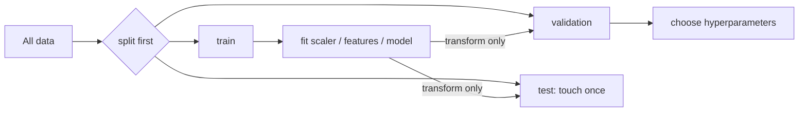

# 03 · Machine Learning Fundamentals
> **Goal:** the concepts every DL model inherits: loss, generalization, evaluation. · **Time:** 20–30 h · **Needs:** 01, 02

> [!GOAL]
> By the end of this chapter you can:
>
> - state the supervised-learning setup (data, model, loss, risk) and why we split data three ways;
> - fit **linear** and **logistic** regression, derive their gradients, and see that a neural net is stacked logistic regressions;
> - diagnose **underfitting vs overfitting** and fix each one, using the bias–variance decomposition and regularization;
> - evaluate honestly: cross-validation, **data leakage**, and the right metric (precision, recall, F1, ROC-AUC, PR curves).

## Skip test
- [ ] Explain train / validation / test splits and why tuning on the test set is cheating.
- [ ] Derive the logistic regression gradient. Explain why its loss is cross-entropy.
- [ ] Explain the bias–variance trade-off, and how L2 regularization changes it.
- [ ] For an imbalanced dataset (1% positive), explain why accuracy is misleading, and define precision, recall, F1, and ROC-AUC.
- [ ] Explain k-fold cross-validation and data leakage, with an example.
- [ ] Say what ROC-AUC measures as a probability, and why it doesn't change when the class balance changes but precision does.

🎯 Not sure? Take the auto-graded [Foundations Quiz](interactive/foundations-quiz.html) (filter by module) before deciding.

## 1 · What "learning" means

A machine-learning model is a function with adjustable knobs (**parameters**). Learning means turning the knobs so the function does well on examples, and, more importantly, on **examples it has never seen**.

> [!DEF] Supervised learning
> You are given $N$ labelled examples $(\mathbf x_i, y_i)$: inputs $\mathbf x_i$ (features) and the correct outputs $y_i$ (labels). You choose
>
> - a **model** $f_\theta$ with parameters $\theta$, which maps an input to a prediction $\hat y = f_\theta(\mathbf x)$;
> - a **loss** $\ell(\hat y, y)\ge0$ that measures how wrong one prediction is.
>
> **Regression** predicts a number ($y\in\mathbb R$); **classification** predicts a class ($y\in\{1,\dots,C\}$).

> [!FORMULA] Empirical risk minimization
> $$\hat\theta = \arg\min_\theta\; \underbrace{\frac1N\sum_{i=1}^N \ell\big(f_\theta(\mathbf x_i), y_i\big)}_{\text{training loss (empirical risk)}}$$
> What we actually care about is the **expected risk** $\mathbb E_{(\mathbf x,y)\sim\text{data}}\,\ell(f_\theta(\mathbf x),y)$ on new data from the same source. The gap between the two is the **generalization gap**.

> [!KEY] Learning = optimization + generalization
> Driving training loss down is optimization (module 01, section 6). Making sure that also lowers the loss on new data is generalization, and it is the hard part.

> [!DEF] Train / validation / test split
> - **Training set:** used to fit the parameters.
> - **Validation set:** used to make decisions (model size, learning rate, regularization strength, when to stop).
> - **Test set:** used **once**, at the very end, to report performance.
>
> Every time you look at a score and change something, that data stops being "unseen". Tuning on the test set makes the test score optimistic, which is why it is cheating.

## 2 · Linear regression

The simplest model: a weighted sum of the features plus a constant.

> [!DEF] Linear regression
> $$\hat y = \mathbf w^\top\mathbf x + b$$
> trained with the **mean squared error** $\frac1N\sum_i(\hat y_i-y_i)^2$. Adding a constant-1 feature to every $\mathbf x$ lets you fold $b$ into $\mathbf w$.

> [!FORMULA] Closed form (normal equations)
> With all inputs stacked as rows of $X$ ($N\times d$):
> $$\mathbf w^* = (X^\top X)^{-1}X^\top\mathbf y$$
> derived in module 01, section 5 by setting $\nabla_{\mathbf w}\|X\mathbf w-\mathbf y\|^2 = 2X^\top(X\mathbf w-\mathbf y)=0$. In practice use `np.linalg.lstsq`, or gradient descent when $d$ is huge.

> [!KEY] Why MSE?
> MSE is the negative log-likelihood under Gaussian noise (module 01, section 7). If your errors have heavy outliers, the **mean absolute error** (Laplace noise) or the Huber loss is more robust.

> [!DEF] Feature scaling (standardization)
> Replace each feature by $(x-\mu)/\sigma$, using the mean and standard deviation **of the training set**. Features on wildly different scales make the loss surface a long thin valley (high condition number, module 01), so gradient descent crawls. Scaling makes it rounder.

## 3 · Logistic and softmax regression

For classification we want a **probability**, not an unbounded number. Logistic regression squashes the linear score through the sigmoid.

> [!DEF] Sigmoid and logistic regression
> $$\sigma(z) = \frac{1}{1+e^{-z}} \in (0,1) \qquad p(y{=}1\mid\mathbf x) = \sigma(\mathbf w^\top\mathbf x)$$
> The **decision boundary** $\mathbf w^\top\mathbf x = 0$ (where $p=0.5$) is a straight line (hyperplane), so logistic regression is a *linear classifier*. Useful identity: $\sigma'(z) = \sigma(z)\,(1-\sigma(z))$.

> [!FORMULA] Binary cross-entropy (log loss)
> $$\ell = -\big[y\log p + (1-y)\log(1-p)\big], \qquad p = \sigma(\mathbf w^\top\mathbf x)$$
> It is the negative log-likelihood of a Bernoulli model (module 01, section 8). The total loss is convex in $\mathbf w$, so gradient descent finds the global optimum. (If the classes are perfectly separable, $\|\mathbf w\|\to\infty$ without regularization.)

> [!EXAMPLE] The logistic-regression gradient in three lines
> One example, $z=\mathbf w^\top\mathbf x$, $p=\sigma(z)$. Using $\sigma'(z)=p(1-p)$:
> $\frac{\partial\ell}{\partial p}=-\frac yp+\frac{1-y}{1-p}$, so $\frac{\partial\ell}{\partial z}=\frac{\partial\ell}{\partial p}\,p(1-p)=p-y$, and $\nabla_{\mathbf w}\ell=(p-y)\mathbf x$.
>
> Stack the rows: $\nabla = X^\top(\hat{\mathbf y}-\mathbf y)$ for the summed loss (divide by $N$ for the mean). Same "prediction minus target" form as linear regression. That isn't luck: both are generalized linear models with their canonical link.
>
> *Numbers:* $\mathbf x=(1,2)$, $\mathbf w=\mathbf 0$, $y=1$ → $p=0.5$, gradient $=(0.5-1)(1,2)=(-0.5,-1)$. A GD step increases both weights, pushing $p$ toward 1 ✓.

> [!DEF] Softmax regression (multinomial logistic regression)
> For $C$ classes, keep one weight vector per class, compute scores $z_k = \mathbf w_k^\top\mathbf x$, and turn them into probabilities with softmax: $p_k = e^{z_k}/\sum_j e^{z_j}$. The loss is categorical cross-entropy $-\log p_y$, and the gradient with respect to the scores is again $\mathbf p - \mathbf y_{\text{one-hot}}$.

> [!KEY] A neural network is stacked logistic regressions
> A hidden unit computes $\sigma(\mathbf w^\top\mathbf x+b)$, exactly a logistic regression. A network feeds the outputs of many such units into the next layer, and the last layer is a softmax regression on top of features the network learned itself (module 04).

> [!VIDEO] yIYKR4sgzI8 | Logistic Regression | StatQuest · 9 min

## 4 · Generalization: underfitting and overfitting

> [!DEF] Underfitting and overfitting
> - **Underfitting (high bias):** the model is too simple to capture the pattern. *Training* error is high. → Bigger model, better features, train longer, less regularization.
> - **Overfitting (high variance):** the model memorizes noise in the training set. Training error is low but validation error is much higher. → More data, data augmentation, regularization, early stopping, smaller model.

> [!FORMULA] Bias–variance decomposition (squared loss)
> Imagine retraining the model on many different training sets drawn from the same source. At a point $\mathbf x$ with true function $f$ and noise variance $\sigma^2$:
> $$\mathbb E\big[(y-\hat f(\mathbf x))^2\big] = \underbrace{\big(\mathbb E\hat f(\mathbf x)-f(\mathbf x)\big)^2}_{\text{bias}^2} + \underbrace{\mathrm{Var}\big(\hat f(\mathbf x)\big)}_{\text{variance}} + \underbrace{\sigma^2}_{\text{noise}}$$
> **Bias:** how far the *average* fit is from the truth. **Variance:** how much the fit wobbles from one training set to another. **Noise:** irreducible; no model beats it.

> [!EXAMPLE] Polynomial degree
> Fit polynomials to 20 noisy points from a sine curve. Degree 1: a line, can't bend → high bias, train and validation error both high. Degree 3: follows the curve → both low. Degree 15: wiggles through every point → train error ≈ 0, validation error huge (high variance). Plot validation error against degree and you get the classic **U-curve**.

> [!NOTE] Deep nets and double descent
> Very large neural networks can fit their training data perfectly *and* generalize well, and test error can drop again past the point of perfect fit (**double descent**, module 12). The diagnosis above (compare train and validation error) still guides day-to-day practice.

> [!TRY] [Generalization Lab](interactive/generalization-lab.html)
> Slide the polynomial degree and the number of training points. Watch the train and validation curves split apart as the model overfits, and close up again with more data or regularization.

> [!VIDEO] EuBBz3bI-aA | Machine Learning Fundamentals: Bias and Variance | StatQuest · 6 min

## 5 · Regularization

Regularization means anything that discourages the model from fitting noise, usually by preferring "simpler" parameters.

> [!FORMULA] L2 (ridge) and L1 (lasso)
> $$\text{L2: } \min_{\mathbf w}\;\text{loss} + \lambda\|\mathbf w\|_2^2 \qquad\qquad \text{L1: } \min_{\mathbf w}\;\text{loss} + \lambda\|\mathbf w\|_1$$
> - **L2** shrinks all weights smoothly toward zero. It equals a Gaussian prior on the weights (MAP, module 01). In neural nets it is called **weight decay**.
> - **L1** drives many weights to exactly zero, which selects features (a Laplace prior).
> - $\lambda$ trades fit for simplicity: larger $\lambda$ → more bias, less variance. Choose it on the validation set.

> [!DEF] Early stopping
> Watch the validation loss during training and keep the parameters from the epoch where it was lowest. For gradient descent from small weights this acts much like L2 regularization: training longer lets the weights grow.

> [!WARN] Don't regularize the bias term
> Penalizing $b$ just drags predictions toward 0 for no reason. Libraries exclude it by default; if you write your own, exclude it too.

> [!VIDEO] Q81RR3yKn30 | Regularization Part 1: Ridge (L2) Regression | StatQuest · 20 min

## 6 · Honest evaluation: cross-validation and leakage

> [!DEF] k-fold cross-validation
> Split the (non-test) data into $k$ equal folds. Train on $k-1$ folds, validate on the remaining one, and rotate so each fold is the validation set once. Average the $k$ scores. It gives a more reliable estimate than one split when data is small, at $k$ times the cost. $k=5$ or $10$ is typical.

> [!DEF] Data leakage
> **Leakage** is any way information about the validation/test data (or the future) gets into training. It produces scores that look great and collapse in the real world. It is the #1 source of fake results.
>
> Common causes: fitting the scaler or feature selection on all the data before splitting; the same patient/user in train and test; random splits of time-ordered data; duplicated examples across splits.

> [!EXAMPLE] Leakage you won't notice
> You standardize features with the mean/std of the *whole* dataset, then split. The validation rows influenced the scaling, so the validation score is slightly optimistic. With feature selection on all data ("keep the 20 features most correlated with y") the effect can be huge: on pure noise you can get well-above-chance CV accuracy. **Fix:** put every fitted step inside the CV loop (`sklearn.pipeline.Pipeline`).

> [!KEY] Always beat a baseline
> Before any model, compute a trivial baseline: predict the training mean (regression) or the majority class (classification). A model that can't beat it has learned nothing.

## 7 · Metrics: is the model actually good?

Accuracy (fraction correct) is misleading when classes are imbalanced. For a binary problem, count the four kinds of outcome.

> [!DEF] Confusion matrix
> | | predicted positive | predicted negative |
> |---|---|---|
> | **actually positive** | true positive (TP) | false negative (FN) |
> | **actually negative** | false positive (FP) | true negative (TN) |

> [!FORMULA] Precision, recall, F1
> $$\text{precision} = \frac{TP}{TP+FP}\qquad \text{recall} = \frac{TP}{TP+FN}\qquad F_1 = \frac{2\cdot\text{precision}\cdot\text{recall}}{\text{precision}+\text{recall}}$$
> **Precision:** of the cases you flagged, how many were real? **Recall** (sensitivity, true-positive rate): of the real cases, how many did you catch? F1 is their harmonic mean, which is low if either is low.

> [!EXAMPLE] The accuracy trap, in numbers
> 1000 patients, 10 sick. A model flags 30 people, 8 of them sick: TP = 8, FN = 2, FP = 22, TN = 968.
>
> Accuracy $=976/1000=97.6\%$, which is *worse* than "everyone is healthy" (99%). But recall $=8/10=80\%$, precision $=8/30\approx27\%$, F1 $=2\cdot0.27\cdot0.8/(0.27+0.8)\approx0.40$. For screening, this model is useful and the baseline is useless. Accuracy hides that.

> [!DEF] Thresholds, ROC curve and AUC
> A classifier outputs a score; you choose a **threshold** above which you say "positive". Lowering it catches more positives (recall ↑) but raises false alarms.
>
> - The **ROC curve** plots the true-positive rate against the false-positive rate $\frac{FP}{FP+TN}$ for every threshold.
> - **ROC-AUC** (area under it) = the probability that a random positive gets a higher score than a random negative. 1.0 is perfect, 0.5 is random guessing. It ignores the threshold *and* the class balance.
> - The **precision–recall curve** (and its area, *average precision*) is more informative when positives are rare, because precision reacts to the number of false positives among many negatives.

> [!FORMULA] Regression metrics
> $$\text{MSE} = \frac1N\sum(\hat y_i-y_i)^2\qquad \text{MAE} = \frac1N\sum|\hat y_i-y_i|\qquad R^2 = 1-\frac{\sum(\hat y_i-y_i)^2}{\sum(y_i-\bar y)^2}$$
> $R^2=1$ is a perfect fit; $R^2=0$ means no better than predicting the mean.

> [!TRY] [Generalization Lab · threshold simulator](interactive/generalization-lab.html)
> Move the decision threshold and watch the confusion matrix, the ROC point and the PR point move together. Then make the positive class rare and see AUC stay put while precision drops.

> [!VIDEO] 4jRBRDbJemM | ROC and AUC, Clearly Explained! | StatQuest · 16 min

## 8 · The classical toolbox (know what they are)

You don't need to master these, but you should recognize them and know when they win.

> [!DEF] Classical models at a glance
> | Model | Idea | Good for |
> |---|---|---|
> | k-nearest neighbours | predict from the $k$ closest training points | baselines, small low-dim data |
> | decision tree | a flowchart of feature thresholds | interpretable rules |
> | random forest | average many trees on random subsets | strong default, little tuning |
> | **gradient boosting** (XGBoost, LightGBM) | add small trees that fix the previous ones' errors | **medium-sized tabular data** |
> | SVM | the widest-margin separating boundary, kernels for curves | small, clean datasets |
> | k-means | group points around $k$ centroids | clustering (no labels) |
> | PCA | project onto the top singular vectors (module 01) | compression, visualization |

> [!KEY] Tabular data is different
> Boosted trees are still the default for medium-sized *tabular* data ([Grinsztajn et al., 2022](https://arxiv.org/abs/2207.08815)), although tabular foundation models such as [TabPFN (Nature, 2025)](https://www.nature.com/articles/s41586-024-08328-6) now match or beat them on small datasets. Deep learning dominates images, audio, text and other unstructured data.

## Practice (answers hidden)

1. Train error 2%, validation error 15%. Train error 18%, validation error 19% (human-level ≈ 2%). Diagnose each and give two fixes.

Answer

First: **high variance** (overfitting). More data, augmentation, regularization (weight decay, dropout), early stopping, or a smaller model. Second: **high bias** (underfitting; the gap to human level is 16 points). Bigger model, better features, train longer, less regularization.

2. Prove that ROC-AUC doesn't change if you apply any strictly increasing function to the scores (e.g. sigmoid, or ×10).

Answer

AUC $=P(s(x^+)>s(x^-))$ depends only on the *ranking* of scores, and a strictly increasing $g$ preserves every pairwise comparison. (So AUC also says nothing about calibration.)

3. Why can't you get the logistic-regression weights in closed form like linear regression?

Answer

Setting $X^\top(\sigma(X\mathbf w)-\mathbf y)=0$ gives equations that are nonlinear in $\mathbf w$ (through $\sigma$). You solve them iteratively: gradient descent, or Newton's method (= IRLS), which uses the Hessian $X^\top SX$ with $S=\mathrm{diag}(p_i(1-p_i))$.

4. You have 500 labelled examples. Describe 5-fold CV for choosing the L2 strength $\lambda$, then how you report the final number.

Answer

First set aside a test set (e.g. 100). On the remaining 400: for each $\lambda$ on a log grid, train on 4 folds and validate on the 5th, rotating through all 5, and average the 5 scores. Pick the best $\lambda$, retrain on all 400, and evaluate **once** on the test set. (Or use nested CV if the data are too few for a test set.)

5. A time-series model predicts tomorrow's sales. You shuffle the rows and do 5-fold CV, and it looks great. What's wrong?

Answer

Leakage from the future: training folds contain days after the validation days. Use a forward-chaining split (train on the past, validate on the next block), e.g. `TimeSeriesSplit`.

6. A spam filter has precision 0.95 and recall 0.60. What does each number mean for the user, and which would you raise for an email client?

Answer

Precision 0.95: 5% of emails sent to spam are actually legitimate. Recall 0.60: 40% of spam still reaches the inbox. Losing a real email is worse than seeing some spam, so an email client usually keeps precision high and accepts lower recall.

7. Compute $\sigma(0)$, $\sigma(2)$ and $\sigma'(0)$. What is the largest possible value of $\sigma'$?

Answer

$\sigma(0)=0.5$, $\sigma(2)=1/(1+e^{-2})\approx0.881$, $\sigma'(0)=0.5\cdot0.5=0.25$. Since $p(1-p)\le 1/4$, the maximum is $0.25$, which is one reason deep stacks of sigmoids have vanishing gradients (module 04).

## Build
1. **Logistic regression from scratch in NumPy** (gradient descent, no sklearn) on a binary dataset. Plot the loss curve and the decision boundary.
2. Same dataset with `sklearn`: compare against yours, then run 5-fold cross-validation and a grid search over the regularization strength.
3. A Kaggle "Getting Started" competition (Titanic or House Prices): full pipeline with a gradient-boosting baseline.

## Traps
- Celebrating 99% accuracy on a 99%-majority dataset.
- Fitting the scaler on all the data before splitting (leakage).
- Skipping baselines. **Always** compare against a trivial baseline (predict the mean or the majority class).
- Reporting the validation score you tuned on as your final result. It's optimistically biased. Report the untouched test score.
- Random splits on grouped or time-ordered data (same patient in train and val, future in train). Split by group or by time.

## Go deeper (all optional)
- ⭐ **[Machine Learning Specialization (Andrew Ng, Coursera)](https://www.coursera.org/specializations/machine-learning-introduction)**: courses 1–2. Coursera's free-audit and financial-aid options change over time, so check the course page.
- ⭐ (alt) **[An Introduction to Statistical Learning, with Python (ISLP)](https://www.statlearning.com/)**: free PDF, ch. 2–6, 8, 10, 12.
- **[Stanford CS229 lecture notes](https://cs229.stanford.edu/main_notes.pdf)**: the math-heavy version (GLMs, the exponential family).
- **[scikit-learn user guide](https://scikit-learn.org/stable/user_guide.html)**: the practical API and a great reference.
- **[Google ML Crash Course](https://developers.google.com/machine-learning/crash-course)**: quick, interactive refresher.
- **[StatQuest](https://statquest.org/)**: short, friendly videos on every classical ML idea (several are embedded above).

## Done when
- [ ] Scratch and sklearn logistic regression agree · [ ] you can explain every number on your confusion matrix
