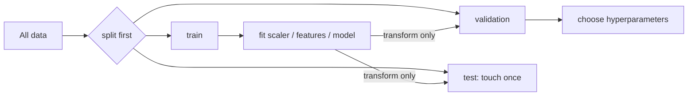

# 03 · Machine Learning Fundamentals
> **Goal:** the concepts every DL model inherits: loss, generalization, evaluation. · **Time:** 20–30 h · **Needs:** 01, 02

## Skip test
- [ ] Explain train / validation / test splits and why tuning on the test set is cheating.
- [ ] Derive the logistic regression gradient. Explain why its loss is cross-entropy.
- [ ] Explain the bias–variance trade-off, and how L2 regularization changes it.
- [ ] For an imbalanced dataset (1% positive), explain why accuracy is misleading, and define precision, recall, F1, and ROC-AUC.
- [ ] Explain k-fold cross-validation and data leakage, with an example.
- [ ] Say what ROC-AUC measures as a probability, and why it doesn't change when the class balance changes but precision does.

🎯 Not sure? Take the auto-graded [Foundations Quiz](interactive/foundations-quiz.html) (filter by module) before deciding.

## Core ideas
- **Learning = optimization + generalization.** Fit training data (minimize empirical risk) and do well on unseen data. The second is the hard part.
- **Supervised setup:** data $(x_i, y_i)$, model $f_\theta$, loss $\ell$, minimize $\frac1N\sum\ell(f_\theta(x_i), y_i)$.
- **Linear regression:** $\hat y = \mathbf w^\top\mathbf x + b$, MSE loss, closed form $\mathbf w = (X^\top X)^{-1}X^\top\mathbf y$.
- **Logistic regression:** $p(y{=}1\mid\mathbf x) = \sigma(\mathbf w^\top\mathbf x)$, binary cross-entropy loss, gradient $X^\top(\hat{\mathbf y}-\mathbf y)$ for the summed loss (divide by $N$ for the mean). The loss is convex in $\mathbf w$, so GD finds the global optimum (if the data are linearly separable, $\|\mathbf w\|\to\infty$ without regularization). **A neural net is stacked logistic regressions.**
- **Softmax regression:** the multi-class version, with categorical cross-entropy.
- **Generalization:**
  - **Underfitting** (high bias): train error high. → Bigger model, more features, train longer.
  - **Overfitting** (high variance): train ≪ val error. → More data, regularization, augmentation, early stopping.
  - **Decomposition (squared loss):** expected test error $=\text{bias}^2+\text{variance}+\sigma^2_{\text{noise}}$. No model beats the noise term.
  - Deep nets break the classic U-curve (**double descent**, see module 12), but the diagnosis above still guides practice.
  - 🎛️ **See it:** [Generalization Lab](interactive/generalization-lab.html): polynomial fits with train/val curves, plus a threshold/ROC/PR simulator.
- **Regularization:** L2/weight decay (Gaussian prior), L1 (sparsity), early stopping, and later dropout.
- **Evaluation:** a held-out **test set touched once**. Use a **validation set** for decisions. Cross-validation for small data.
- **Metrics:** accuracy, precision/recall/F1, ROC-AUC, confusion matrix (classification); MSE/MAE/$R^2$ (regression). **ROC-AUC** = probability a random positive is scored above a random negative; it ignores the threshold *and* the class balance. With rare positives, the **precision–recall curve** (and average precision) is more informative.
- **Data leakage:** information from the test set or the future leaks into training (e.g. normalizing with statistics from all data). It's the #1 source of fake results.
- **Feature scaling:** standardize inputs (mean 0, std 1). This matters for GD convergence (conditioning, from module 01).
- **Other classical models (know what they are, don't master them):** k-NN, decision trees, random forests, **gradient boosting (XGBoost/LightGBM)**, SVM, k-means, PCA. Boosted trees are still the default for medium-sized *tabular* data ([Grinsztajn et al., 2022](https://arxiv.org/abs/2207.08815)), although tabular foundation models such as [TabPFN (Nature, 2025)](https://www.nature.com/articles/s41586-024-08328-6) now match or beat them on small datasets.

## Worked examples

**1 · Logistic-regression gradient in three lines.** One example, $z=\mathbf w^\top\mathbf x$, $p=\sigma(z)$, loss $\ell=-[y\log p+(1-y)\log(1-p)]$.
Using $\sigma'(z)=\sigma(z)(1-\sigma(z))$: $\frac{\partial\ell}{\partial p}=-\frac yp+\frac{1-y}{1-p}$, so $\frac{\partial\ell}{\partial z}=\frac{\partial\ell}{\partial p}\,p(1-p)=p-y$, and $\nabla_{\mathbf w}\ell=(p-y)\mathbf x$. Stack the rows: $\nabla = X^\top(\hat{\mathbf y}-\mathbf y)$. Same "prediction minus target" form as linear regression. That isn't luck: both are GLMs with their canonical link.
*Numbers:* $\mathbf x=(1,2)$, $\mathbf w=\mathbf 0$, $y=1$ → $p=0.5$, gradient $=(0.5-1)(1,2)=(-0.5,-1)$. A GD step increases both weights, pushing $p$ toward 1 ✓.

**2 · The accuracy trap, in numbers.** 1000 patients, 10 sick. A model flags 30 people, 8 of them sick.

| | predicted sick | predicted healthy |
|---|---|---|
| **sick (10)** | TP = 8 | FN = 2 |
| **healthy (990)** | FP = 22 | TN = 968 |

Accuracy $=976/1000=97.6\%$, which is *worse* than "everyone is healthy" (99%). But recall $=8/10=80\%$, precision $=8/30\approx27\%$, F1 $=2\cdot0.27\cdot0.8/(0.27+0.8)\approx0.40$. For screening, this model is useful and the baseline is useless. Accuracy hides that.

**3 · Leakage you won't notice.** You standardize features with the mean/std of the *whole* dataset, then split. The validation rows influenced the scaling, so the validation score is slightly optimistic. With feature selection on all data ("keep the 20 features most correlated with y") the effect can be huge: on pure noise you can get well-above-chance CV accuracy. Fix: put every fitted step inside the CV loop (`sklearn.pipeline.Pipeline`).

## Practice (answers hidden)

1. Train error 2%, validation error 15%. Train error 18%, validation error 19% (human-level ≈ 2%). Diagnose each and give two fixes.

Answer

First: **high variance** (overfitting). More data, augmentation, regularization (weight decay, dropout), early stopping, or a smaller model. Second: **high bias** (underfitting; the gap to human level is 16 points). Bigger model, better features, train longer, less regularization.

2. Prove that ROC-AUC doesn't change if you apply any strictly increasing function to the scores (e.g. sigmoid, or ×10).

Answer

AUC $=P(s(x^+)>s(x^-))$ depends only on the *ranking* of scores, and a strictly increasing $g$ preserves every pairwise comparison. (So AUC also says nothing about calibration.)

3. Why can't you get the logistic-regression weights in closed form like linear regression?

Answer

Setting $X^\top(\sigma(X\mathbf w)-\mathbf y)=0$ gives equations that are nonlinear in $\mathbf w$ (through $\sigma$). You solve them iteratively: gradient descent, or Newton's method (= IRLS), which uses the Hessian $X^\top SX$ with $S=\mathrm{diag}(p_i(1-p_i))$.

4. You have 500 labelled examples. Describe 5-fold CV for choosing the L2 strength $\lambda$, then how you report the final number.

Answer

First set aside a test set (e.g. 100). On the remaining 400: for each $\lambda$ on a log grid, train on 4 folds and validate on the 5th, rotating through all 5, and average the 5 scores. Pick the best $\lambda$, retrain on all 400, and evaluate **once** on the test set. (Or use nested CV if the data are too few for a test set.)

5. A time-series model predicts tomorrow's sales. You shuffle the rows and do 5-fold CV, and it looks great. What's wrong?

Answer

Leakage from the future: training folds contain days after the validation days. Use a forward-chaining split (train on the past, validate on the next block), e.g. `TimeSeriesSplit`.

## Learn from
- ⭐ **[Machine Learning Specialization (Andrew Ng, Coursera)](https://www.coursera.org/specializations/machine-learning-introduction)**: courses 1–2. Coursera's free-audit and financial-aid options change over time, so check the course page. You'll move fast. Or, if you prefer reading:
- ⭐ (alt) **[An Introduction to Statistical Learning, with Python (ISLP)](https://www.statlearning.com/)**: free PDF, ch. 2–6, 8, 10, 12.
- **[Stanford CS229 lecture notes](https://cs229.stanford.edu/main_notes.pdf)**: the math-heavy version, which suits you well (GLMs, the exponential family).
- **[scikit-learn user guide](https://scikit-learn.org/stable/user_guide.html)**: the practical API and a great reference.
- **[Google ML Crash Course](https://developers.google.com/machine-learning/crash-course)**: quick, interactive refresher.

## Build
1. **Logistic regression from scratch in NumPy** (gradient descent, no sklearn) on a binary dataset. Plot the loss curve and the decision boundary.
2. Same dataset with `sklearn`: compare against yours, then run 5-fold cross-validation and a grid search over the regularization strength.
3. A Kaggle "Getting Started" competition (Titanic or House Prices): full pipeline with a gradient-boosting baseline.

## Traps
- Celebrating 99% accuracy on a 99%-majority dataset.
- Fitting the scaler on all the data before splitting (leakage).
- Skipping baselines. **Always** compare against a trivial baseline (predict the mean or the majority class).
- Reporting the validation score you tuned on as your final result. It's optimistically biased. Report the untouched test score.
- Random splits on grouped or time-ordered data (same patient in train and val, future in train). Split by group or by time.

## Done when
- [ ] Scratch and sklearn logistic regression agree · [ ] you can explain every number on your confusion matrix
