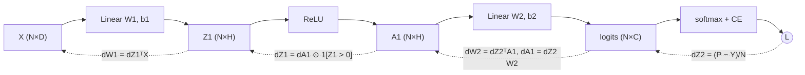

# 04 · Neural Networks from Scratch
> **Goal:** understand backprop so well you could build PyTorch's core yourself. · **Time:** 15–20 h · **Needs:** 01, 03

**The most important module.** Everything after this is architecture choices on top of the same engine.

## Skip test
- [ ] Draw a 2-layer MLP. Write the forward pass in matrix form with shapes.
- [ ] Derive backprop for `Linear → ReLU → Linear → softmax-cross-entropy` by hand.
- [ ] Show that $\partial L/\partial \mathbf z = \hat{\mathbf y} - \mathbf y$ for softmax + cross-entropy.
- [ ] Explain why stacked linear layers without nonlinearities collapse to one linear layer.
- [ ] Explain reverse-mode autodiff and why it suits "many params → one scalar loss".
- [ ] Explain vanishing gradients with sigmoid, and why ReLU helps.
- [ ] Say what the initial loss of a 10-class classifier should be, and derive the 2 in He initialization.

## Core ideas
- **Neuron:** $a = \phi(\mathbf w^\top\mathbf x + b)$. **Layer:** $\mathbf h = \phi(W\mathbf x + \mathbf b)$. **MLP:** a stack of layers.
- **Why nonlinearity:** $W_2(W_1\mathbf x) = (W_2W_1)\mathbf x$ is still linear. $\phi$ (ReLU, GELU, tanh) gives expressive power.
- **Universal approximation:** one wide enough hidden layer with any non-polynomial activation can approximate any continuous function on a compact set (Cybenko 1989; Hornik 1991; Leshno et al. 1993). It says nothing about how *many* units you need or whether training finds them. *Depth* makes it **efficient**: some functions need exponentially many units in a shallow net but few in a deep one (e.g. Telgarsky 2016).
- **Computational graph:** each op is a node. Forward computes values. Backward sends **gradients** from the loss back to every parameter.
- **Backprop = chain rule + caching.** Each node only needs its *local* derivative and the upstream gradient:
  `grad_input = local_jacobianᵀ · grad_output`
- **Key local gradients** (for $\mathbf y = W\mathbf x$ in batch form $Y = XW^\top$):
  - $\partial L/\partial W = (\partial L/\partial Y)^\top X$, $\partial L/\partial X = (\partial L/\partial Y)\, W$
  - ReLU: pass the gradient where input > 0, zero elsewhere.
  - Softmax + CE combined: $\hat{\mathbf y} - \mathbf y$ (clean and stable, which is why frameworks fuse them).
- **Gradients accumulate (+=)** when a value is used in several places. This is the multivariable chain rule.
- 🎛️ **See it:** [Backprop Step-Through](interactive/backprop-stepper.html) runs this node by node (neuron, shared variable, vanishing chain, softmax-CE), with a gradient check.
- **Reverse-mode AD** costs ~2–3× a forward pass, whatever the number of parameters. That's why training billion-parameter nets is possible.
- **Activations:** sigmoid/tanh saturate → **vanishing gradients**. ReLU doesn't saturate for x > 0 (but neurons can "die"). GELU/SiLU are smooth variants used in transformers.
- **Initialization matters:** variance-preserving init keeps signals from exploding or vanishing. For $z=\sum_{i=1}^{n_{in}} w_ix_i$ with independent zero-mean weights, $\text{Var}(z)=n_{in}\text{Var}(w)\,\mathbb E[x^2]$. **LeCun:** $\text{Var}(w)=1/n_{in}$. **Xavier/Glorot** (tanh/sigmoid): $\text{Var}(w)=2/(n_{in}+n_{out})$, a compromise between the forward and backward pass. **He/Kaiming** (ReLU): $2/n_{in}$, because ReLU zeroes half the inputs so $\mathbb E[x^2]$ is half the pre-activation variance.

## The picture

Solid arrows: forward pass (values cached). Dotted arrows: backward pass, right to left. Every arrow only needs the cached values next to it.

## Worked examples

**1 · Softmax + cross-entropy gives $\hat{\mathbf y}-\mathbf y$.** $p_i=e^{z_i}/\sum_k e^{z_k}$, $L=-\sum_i y_i\log p_i$ with one-hot $\mathbf y$. Since $\log p_i = z_i-\log\sum_k e^{z_k}$,
$L = -\sum_i y_i z_i + \log\sum_k e^{z_k}$ (using $\sum_i y_i=1$). So $\frac{\partial L}{\partial z_j} = -y_j + \frac{e^{z_j}}{\sum_k e^{z_k}} = p_j - y_j$.
*Numbers:* $\mathbf z=(2, 0.5)$, true class 1 → $p_1=e^2/(e^2+e^{0.5})\approx0.818$, so $\nabla_{\mathbf z}L\approx(-0.182,\ +0.182)$. (This is the "softmax" graph in the step-through tool.)

**2 · Linear-layer gradients by the shape trick.** Batch form $Y = XW^\top+\mathbf b$ with $X\,(N\times D)$, $W\,(H\times D)$, $Y\,(N\times H)$, upstream $G=\partial L/\partial Y\,(N\times H)$.
$\partial L/\partial W$ must be $H\times D$, and the only product of $G$ and $X$ with that shape is $G^\top X$. $\partial L/\partial X$ must be $N\times D$: $GW$. $\partial L/\partial\mathbf b$ must be $H$: $\sum_n G_{n,:}$ (sum over the batch, because $\mathbf b$ was broadcast). Verified numerically with finite differences ✓.

**3 · Why He init has the 2.** With $\text{Var}(w)=2/n$ and ReLU inputs ($\mathbb E[x^2]=\tfrac12\text{Var}(z_{\text{prev}})$), $\text{Var}(z)=n\cdot\tfrac2n\cdot\tfrac12\text{Var}(z_{\text{prev}})=\text{Var}(z_{\text{prev}})$: the signal keeps its scale through any depth. A quick simulation (n = 512, unit-variance pre-activations) gives $\text{Var}(z)\approx1.02$ ✓. With $1/n$ instead, the variance halves at every layer: after 20 layers it is $2^{-20}\approx10^{-6}$.

## Practice (answers hidden)

1. A freshly initialized 10-class classifier reports an initial loss of 9.7. What should it be, and what's likely wrong?

Answer

About $\ln 10\approx2.30$ (uniform predictions). 9.7 means the logits are far too large at init, so the net is confidently wrong. Typical causes: weights too big (wrong init scale), or unnormalized inputs. Fix: scale the last layer's weights down (e.g. ×0.01) and standardize inputs. (Karpathy's "makemore part 3" covers exactly this.)

2. Derive $\sigma'(z)$ and show that a stack of 10 sigmoid layers multiplies the gradient by at most $0.25^{10}\approx10^{-6}$ (ignoring weights).

Answer

$\sigma'(z)=\sigma(z)(1-\sigma(z))\le\tfrac14$, with the max at $z=0$. Each layer's backward pass multiplies by $\sigma'(z_\ell)$ (times a weight), so 10 layers give at most $4^{-10}\approx9.5\times10^{-7}$ unless the weights are large. ReLU's derivative is exactly 1 on the active side, which is why it trains deep nets better.

3. In micrograd, `c = a + a; c.backward()`. What must `a.grad` be, and which bug gives 1 instead?

Answer

$\partial c/\partial a=2$. Writing `self.grad = out.grad` instead of `self.grad += out.grad` in `__add__`'s backward overwrites the first contribution with the second, giving 1.

4. Your NumPy MLP's gradient check gives relative error $10^{-2}$ for $W_1$ but $10^{-9}$ for $W_2$. Where is the bug, most likely?

Answer

Between $W_2$ and $W_1$ in the backward pass: the ReLU mask (`dZ1 = dA1 * (Z1 > 0)`), a missing transpose in `dA1 = dZ2 @ W2`, or forgetting to divide by $N$ consistently. Also check that the check isn't landing exactly on a ReLU kink (use float64 and a few random points).

5. Why is reverse mode the right choice for training, and when would forward mode win?

Answer

Reverse mode gives the gradient of **one** output w.r.t. **all** $n$ inputs in one backward pass (≈ a small constant × the forward cost). Forward mode gives the derivative of all outputs w.r.t. **one** input direction per pass, so a full gradient would take $n$ passes. Forward mode wins when there are few inputs and many outputs (e.g. a Jacobian-vector product for a handful of directions).

## Learn from
- ⭐ **[Neural Networks: Zero to Hero (Andrej Karpathy)](https://karpathy.ai/zero-to-hero.html)**: videos 1–5 (micrograd → makemore with MLPs, BatchNorm, "Becoming a Backprop Ninja"). **Code along with every line.** This is the best single resource in the whole curriculum.
- **[3Blue1Brown: Neural Networks](https://www.3blue1brown.com/topics/neural-networks)**: the intuition, watched first (~1.5 h).
- **[Neural Networks and Deep Learning (Michael Nielsen)](http://neuralnetworksanddeeplearning.com/)**: free book. Ch. 1–3 for a clear backprop derivation.
- **[CS231n: Backprop notes](https://cs231n.github.io/optimization-2/)** + **[Yes you should understand backprop](https://karpathy.medium.com/yes-you-should-understand-backprop-e2f06eab496b)**.
- Reference code: **[karpathy/micrograd](https://github.com/karpathy/micrograd)** (compare *after* you've written your own).

## Build
1. **micrograd**: a scalar autograd engine (~150 lines) plus a tiny MLP that learns a 2D dataset (moons). Follow Karpathy, then **rewrite it from memory**.
2. **NumPy MLP on MNIST** with hand-derived matrix backprop. Target ≥ 97% test accuracy. Gradient-check every layer.
3. 💡 C++ bonus: port micrograd to C++ (a `Value` class with `shared_ptr` children and a topological sort). It cements the graph idea and uses your STL skills.

## Traps
- "I understand it from the video." You don't until you've written it from a blank file.
- Forgetting to **zero gradients** between steps (they accumulate).
- Using float32 for gradient checks. Use float64.
- Computing `softmax` then `log` separately. Use log-softmax / log-sum-exp, or `exp` overflows and `log(0)` gives `-inf`.
- Forgetting that the bias gradient sums over the batch (`db = dY.sum(axis=0)`).

## Done when
- [ ] micrograd rewritten from memory · [ ] NumPy MLP ≥ 97% on MNIST · [ ] all skip-test derivations done on paper
