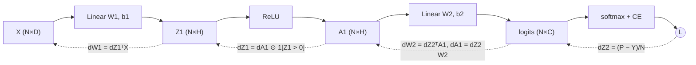

# 04 · Neural Networks from Scratch
> **Goal:** understand backprop so well you could build PyTorch's core yourself. · **Time:** 15–20 h · **Needs:** 01, 03

**The most important module.** Everything after this is architecture choices on top of the same engine.

> [!GOAL]
> By the end of this chapter you can:
>
> - write the forward pass of a multi-layer perceptron (MLP) in matrix form, with every shape;
> - explain what activations do, and why sigmoid stacks stop learning (vanishing gradients);
> - run **backpropagation** by hand on a computational graph and derive the gradients of a whole MLP;
> - explain reverse-mode autodiff, gradient checking, and why initialization scale matters (LeCun, Xavier, He);
> - train a NumPy MLP on MNIST to ≥ 97% accuracy.

## Skip test
- [ ] Draw a 2-layer MLP. Write the forward pass in matrix form with shapes.
- [ ] Derive backprop for `Linear → ReLU → Linear → softmax-cross-entropy` by hand.
- [ ] Show that $\partial L/\partial \mathbf z = \hat{\mathbf y} - \mathbf y$ for softmax + cross-entropy.
- [ ] Explain why stacked linear layers without nonlinearities collapse to one linear layer.
- [ ] Explain reverse-mode autodiff and why it suits "many params → one scalar loss".
- [ ] Explain vanishing gradients with sigmoid, and why ReLU helps.
- [ ] Say what the initial loss of a 10-class classifier should be, and derive the 2 in He initialization.

🎯 Not sure? Take the auto-graded [Foundations Quiz](interactive/foundations-quiz.html) (filter by module) before deciding.

## 1 · Neurons, layers and the forward pass

> [!DEF] Neuron
> A **neuron** (unit) takes inputs $\mathbf x$, computes a weighted sum plus a bias, and passes it through an **activation function** $\phi$:
> $$a = \phi(\mathbf w^\top\mathbf x + b)$$
> $z=\mathbf w^\top\mathbf x+b$ is the **pre-activation**; $a$ is the **activation**. With $\phi=\sigma$ this is exactly logistic regression (module 03).

> [!DEF] Layer and multi-layer perceptron (MLP)
> A **dense (fully connected) layer** is many neurons side by side, all reading the same input:
> $$\mathbf h = \phi(W\mathbf x+\mathbf b), \qquad W\in\mathbb R^{H\times D},\ \mathbf b\in\mathbb R^H$$
> An **MLP** stacks layers: the output of one is the input of the next. The last layer produces **logits** (raw scores), which a softmax turns into class probabilities. The layers in between are **hidden layers**; their size $H$ is the **width**, their count the **depth**.

> [!FORMULA] Forward pass of a 2-layer MLP (batch form)
> For a batch $X$ of $N$ examples with $D$ features, $H$ hidden units and $C$ classes:
> $$Z_1 = XW_1^\top + \mathbf b_1\;(N\times H)\quad A_1 = \mathrm{ReLU}(Z_1)\quad Z_2 = A_1W_2^\top + \mathbf b_2\;(N\times C)\quad P = \mathrm{softmax}(Z_2)$$
> $$L = -\frac1N\sum_{n=1}^N\log P_{n,\,y_n}$$
> Parameter count: $W_1$ has $H\cdot D$, $\mathbf b_1$ has $H$, $W_2$ has $C\cdot H$, $\mathbf b_2$ has $C$.

> [!KEY] Why nonlinearity is essential
> Without $\phi$, two layers give $W_2(W_1\mathbf x) = (W_2W_1)\mathbf x$: still one linear map, no matter how many layers you stack. The nonlinearity lets each layer bend the space, so the network can carve out curved decision boundaries and compose simple features into complex ones.

> [!EXAMPLE] Counting parameters
> MNIST: $D=784$ pixels, $H=128$, $C=10$. $W_1$: $128\cdot784=100\,352$; $\mathbf b_1$: 128; $W_2$: $10\cdot128=1\,280$; $\mathbf b_2$: 10. Total **101 770** parameters.

> [!VIDEO] aircAruvnKk | But what is a neural network? | 3Blue1Brown · 19 min (chapter 1 of the series)

## 2 · Activation functions

> [!FORMULA] Common activations and their derivatives
> | Name | $\phi(z)$ | $\phi'(z)$ | Notes |
> |---|---|---|---|
> | sigmoid | $\frac{1}{1+e^{-z}}$ | $\sigma(z)(1-\sigma(z))\le\frac14$ | saturates at both ends |
> | tanh | $\frac{e^z-e^{-z}}{e^z+e^{-z}}$ | $1-\tanh^2 z\le1$ | zero-centred, still saturates |
> | ReLU | $\max(0,z)$ | $1$ if $z>0$, else $0$ | cheap, doesn't saturate for $z>0$ |
> | Leaky ReLU | $\max(\alpha z, z)$, e.g. $\alpha=0.01$ | $1$ or $\alpha$ | never fully "dies" |
> | GELU | $z\,\Phi(z)$ ($\Phi$ = normal CDF) | smooth | used in transformers (BERT, GPT) |
> | SiLU / Swish | $z\,\sigma(z)$ | smooth | used in many modern nets (e.g. Llama's SwiGLU) |

> [!DEF] Saturation and vanishing gradients
> An activation **saturates** where it is flat (sigmoid for large $|z|$). There its derivative is ≈ 0, so almost no gradient flows back. Backprop multiplies one such factor per layer, so with many layers the gradient reaching the first layers shrinks exponentially: **vanishing gradients**. (If the factors are > 1 it grows exponentially instead: **exploding gradients**.)

> [!WARN] Dead ReLUs
> If a ReLU unit's pre-activation is negative for every input, its gradient is always 0 and it never recovers. A large learning rate or a big negative bias can kill many units. Leaky ReLU, GELU or careful initialization reduce the risk.

## 3 · What a network can represent

> [!DEF] Universal approximation theorem
> One hidden layer that is wide enough, with any non-polynomial activation, can approximate any continuous function on a bounded region as closely as you like (Cybenko 1989; Hornik 1991; Leshno et al. 1993).

> [!KEY] Why depth anyway?
> The theorem says nothing about **how many** units you need or whether gradient descent will **find** the right weights. Depth makes representation **efficient**: some functions need exponentially many units in a shallow net but only a few in a deep one (e.g. Telgarsky 2016). Deep nets also build features in stages: edges → textures → parts → objects.

> [!TRY] [Neural Network Playground](interactive/mlp-playground.html)
> Train a tiny MLP on 2D datasets (moons, spirals, circles). Start with 0 hidden layers (a straight boundary), then add units and layers and watch the boundary bend. Switch activations and compare.

## 4 · Computational graphs and the chain rule

To train, we need $\partial L/\partial\theta$ for every parameter. Doing that by hand for millions of parameters is impossible; **backpropagation** does it automatically by breaking the computation into small steps.

> [!DEF] Computational graph
> Write the computation as a graph: each node is one simple operation (add, multiply, ReLU, matmul…), and edges carry values. The **forward pass** computes every node's value from its inputs and **caches** it. The **backward pass** sends gradients from the loss back through the graph.

> [!FORMULA] The backprop rule at one node
> If a node computes $y = f(x_1,\dots,x_k)$ and you already know the **upstream gradient** $\bar y = \partial L/\partial y$, then for each input
> $$\bar x_i \mathrel{+}= \bar y\cdot\frac{\partial f}{\partial x_i}$$
> (for vectors: $\bar{\mathbf x} \mathrel{+}= J^\top\bar{\mathbf y}$, a vector–Jacobian product). Every node only needs its **local derivative** and the upstream gradient. Process nodes in reverse topological order, starting from $\bar L = 1$.

> [!KEY] Gradients accumulate
> If a value feeds into several places, its gradient is the **sum** of the gradients from each use (the multivariable chain rule). That's why implementations use `+=`, and why you must **zero the gradients** before each training step.

> [!EXAMPLE] Backprop through a single neuron, by hand
> $L = (\sigma(wx+b) - y)^2$ with $w=2$, $x=1$, $b=-1$, $y=1$.
>
> **Forward:** $z = 2\cdot1-1 = 1$; $a=\sigma(1)\approx0.731$; $L=(0.731-1)^2\approx0.072$.
>
> **Backward:** $\bar a = 2(a-y) \approx -0.538$; $\bar z = \bar a\cdot a(1-a)\approx -0.538\cdot0.197\approx-0.106$; $\bar w = \bar z\cdot x \approx -0.106$; $\bar b = \bar z \approx -0.106$; $\bar x = \bar z\cdot w\approx-0.212$.
>
> Both $\bar w$ and $\bar b$ are negative, so a gradient step increases $w$ and $b$, raising $a$ toward the target 1 ✓.

> [!FORMULA] Local gradients you'll use constantly
> | Operation | Backward rule |
> |---|---|
> | $y = a+b$ | $\bar a \mathrel{+}= \bar y$, $\bar b \mathrel{+}= \bar y$ (copies the gradient) |
> | $y = a\cdot b$ | $\bar a \mathrel{+}= b\,\bar y$, $\bar b \mathrel{+}= a\,\bar y$ (swaps the inputs) |
> | $y = \mathrm{ReLU}(z)$ | $\bar z \mathrel{+}= \bar y\cdot\mathbb 1[z>0]$ (a gate) |
> | $y=\sigma(z)$ | $\bar z \mathrel{+}= \bar y\cdot y(1-y)$ |
> | $y = e^z$ | $\bar z \mathrel{+}= \bar y\cdot y$ |
> | $Y = XW^\top + \mathbf b$ | $\bar W = \bar Y^\top X$, $\bar X = \bar YW$, $\bar{\mathbf b} = \sum_n \bar Y_{n,:}$ |
> | softmax + cross-entropy | $\bar{\mathbf z} = \hat{\mathbf y}-\mathbf y$ (per example) |

> [!TRY] [Backprop Step-Through](interactive/backprop-stepper.html)
> Step through the forward and backward pass node by node on four small graphs (a neuron, a shared variable, a vanishing chain, softmax-CE), and run the built-in gradient check.

> [!VIDEO] VMj-3S1tku0 | The spelled-out intro to neural networks and backpropagation: building micrograd | Andrej Karpathy · 2 h 25 min. Code along.

## 5 · Backprop for a whole MLP

Put the local rules together for the 2-layer MLP from section 1.


Solid arrows: forward pass (values cached). Dotted arrows: backward pass, right to left. Every arrow only needs the cached values next to it.

> [!FORMULA] The full backward pass
> With $Y$ the one-hot labels ($N\times C$):
> $$\bar Z_2 = \tfrac1N(P-Y)\quad \bar W_2 = \bar Z_2^\top A_1\quad \bar{\mathbf b}_2=\textstyle\sum_n\bar Z_2\quad \bar A_1 = \bar Z_2W_2$$
> $$\bar Z_1 = \bar A_1\odot\mathbb 1[Z_1>0]\quad \bar W_1 = \bar Z_1^\top X\quad \bar{\mathbf b}_1=\textstyle\sum_n\bar Z_1$$
> ($\odot$ = element-wise product.) Then update every parameter: $W \leftarrow W - \eta\bar W$.

> [!EXAMPLE] Softmax + cross-entropy gives $\hat{\mathbf y}-\mathbf y$
> $p_i=e^{z_i}/\sum_k e^{z_k}$, $L=-\sum_i y_i\log p_i$ with one-hot $\mathbf y$. Since $\log p_i = z_i-\log\sum_k e^{z_k}$,
> $L = -\sum_i y_i z_i + \log\sum_k e^{z_k}$ (using $\sum_i y_i=1$). So $\frac{\partial L}{\partial z_j} = -y_j + \frac{e^{z_j}}{\sum_k e^{z_k}} = p_j - y_j$.
>
> *Numbers:* $\mathbf z=(2, 0.5)$, true class 1 → $p_1=e^2/(e^2+e^{0.5})\approx0.818$, so $\nabla_{\mathbf z}L\approx(-0.182,\ +0.182)$. (This is the "softmax" graph in the step-through tool.)

> [!EXAMPLE] Linear-layer gradients by the shape trick
> Batch form $Y = XW^\top+\mathbf b$ with $X\,(N\times D)$, $W\,(H\times D)$, $Y\,(N\times H)$, upstream $G=\partial L/\partial Y\,(N\times H)$.
> $\partial L/\partial W$ must be $H\times D$, and the only product of $G$ and $X$ with that shape is $G^\top X$. $\partial L/\partial X$ must be $N\times D$: $GW$. $\partial L/\partial\mathbf b$ must be $H$: $\sum_n G_{n,:}$ (sum over the batch, because $\mathbf b$ was broadcast). Verified numerically with finite differences ✓.

> [!CODE] A NumPy training step
> ```python
> # forward
> Z1 = X @ W1.T + b1;  A1 = np.maximum(Z1, 0)
> Z2 = A1 @ W2.T + b2
> Z2 -= Z2.max(1, keepdims=True); P = np.exp(Z2); P /= P.sum(1, keepdims=True)
> loss = -np.log(P[np.arange(N), y]).mean()
> # backward
> dZ2 = P.copy(); dZ2[np.arange(N), y] -= 1; dZ2 /= N
> dW2 = dZ2.T @ A1;  db2 = dZ2.sum(0);  dA1 = dZ2 @ W2
> dZ1 = dA1 * (Z1 > 0)
> dW1 = dZ1.T @ X;   db1 = dZ1.sum(0)
> # update
> for p, g in [(W1, dW1), (b1, db1), (W2, dW2), (b2, db2)]:
>     p -= lr * g
> ```

> [!TRY] [Neural Network Playground](interactive/mlp-playground.html)
> Watch the loss fall and the decision boundary form as this exact loop runs. Raise the learning rate until training becomes unstable.

## 6 · Automatic differentiation

> [!DEF] Reverse-mode and forward-mode autodiff
> **Automatic differentiation (autodiff)** applies the local rules above mechanically to any program.
>
> - **Reverse mode** (backprop): one backward pass gives the gradient of **one** scalar output with respect to **all** inputs, at about 2–3× the cost of the forward pass, whatever the number of parameters. Perfect for "millions of parameters → one loss".
> - **Forward mode:** carries derivatives forward alongside values; one pass gives the derivative of all outputs along **one** input direction. Better when there are few inputs and many outputs.
>
> PyTorch, JAX and TensorFlow build the graph as your code runs and use reverse mode for `.backward()`.

> [!KEY] Why billion-parameter training is possible
> Because reverse mode's cost doesn't grow with the number of parameters, computing the gradient of a 70-billion-parameter model costs only a few forward passes, not 70 billion of them.

> [!DEF] Gradient checking
> Compare each analytic gradient with a numerical estimate $\frac{L(\theta+h)-L(\theta-h)}{2h}$ (central difference, $h\approx10^{-5}$, **float64**). Report the relative error $\frac{|g_a-g_n|}{\max(|g_a|,|g_n|)}$: around $10^{-7}$ or smaller is correct; $10^{-2}$ means a bug. Check a few random entries of every parameter.

## 7 · Initialization

Before training, the weights are random. Their **scale** decides whether signals survive the trip through many layers.

> [!FORMULA] Variance of a pre-activation
> For $z=\sum_{i=1}^{n_{in}} w_ix_i$ with independent zero-mean weights:
> $$\mathrm{Var}(z) = n_{in}\,\mathrm{Var}(w)\,\mathbb E[x^2]$$
> To keep the signal's scale constant from layer to layer, choose $\mathrm{Var}(w)$ to cancel the factor $n_{in}$.

> [!DEF] LeCun, Xavier/Glorot and He/Kaiming initialization
> | Scheme | $\mathrm{Var}(w)$ | Use with |
> |---|---|---|
> | LeCun | $1/n_{in}$ | SELU, or linear/tanh as a simple default |
> | Xavier / Glorot | $2/(n_{in}+n_{out})$ | tanh, sigmoid: a compromise between the forward and backward pass |
> | He / Kaiming | $2/n_{in}$ | ReLU and its variants |
>
> Biases are usually initialized to 0.

> [!EXAMPLE] Why He init has the 2
> With $\text{Var}(w)=2/n$ and ReLU inputs ($\mathbb E[x^2]=\tfrac12\text{Var}(z_{\text{prev}})$, because ReLU zeroes half of a symmetric input), $\text{Var}(z)=n\cdot\tfrac2n\cdot\tfrac12\text{Var}(z_{\text{prev}})=\text{Var}(z_{\text{prev}})$: the signal keeps its scale through any depth. A quick simulation (n = 512, unit-variance pre-activations) gives $\text{Var}(z)\approx1.02$ ✓. With $1/n$ instead, the variance halves at every layer: after 20 layers it is $2^{-20}\approx10^{-6}$.

> [!KEY] Sanity-check the initial loss
> With small random weights the network predicts roughly uniform probabilities, so the initial cross-entropy should be about $\ln C$: **2.30** for 10 classes. A much larger value means the logits are too big at init (weights too large, or unnormalized inputs).

## Practice (answers hidden)

1. A freshly initialized 10-class classifier reports an initial loss of 9.7. What should it be, and what's likely wrong?
<details><summary>Answer</summary>

About $\ln 10\approx2.30$ (uniform predictions). 9.7 means the logits are far too large at init, so the net is confidently wrong. Typical causes: weights too big (wrong init scale), or unnormalized inputs. Fix: scale the last layer's weights down (e.g. ×0.01) and standardize inputs. (Karpathy's "makemore part 3" covers exactly this.)
</details>

2. Derive $\sigma'(z)$ and show that a stack of 10 sigmoid layers multiplies the gradient by at most $0.25^{10}\approx10^{-6}$ (ignoring weights).
<details><summary>Answer</summary>

$\sigma'(z)=\sigma(z)(1-\sigma(z))\le\tfrac14$, with the max at $z=0$. Each layer's backward pass multiplies by $\sigma'(z_\ell)$ (times a weight), so 10 layers give at most $4^{-10}\approx9.5\times10^{-7}$ unless the weights are large. ReLU's derivative is exactly 1 on the active side, which is why it trains deep nets better.
</details>

3. In micrograd, `c = a + a; c.backward()`. What must `a.grad` be, and which bug gives 1 instead?
<details><summary>Answer</summary>

$\partial c/\partial a=2$. Writing `self.grad = out.grad` instead of `self.grad += out.grad` in `__add__`'s backward overwrites the first contribution with the second, giving 1.
</details>

4. Your NumPy MLP's gradient check gives relative error $10^{-2}$ for $W_1$ but $10^{-9}$ for $W_2$. Where is the bug, most likely?
<details><summary>Answer</summary>

Between $W_2$ and $W_1$ in the backward pass: the ReLU mask (`dZ1 = dA1 * (Z1 > 0)`), a missing transpose in `dA1 = dZ2 @ W2`, or forgetting to divide by $N$ consistently. Also check that the check isn't landing exactly on a ReLU kink (use float64 and a few random points).
</details>

5. Why is reverse mode the right choice for training, and when would forward mode win?
<details><summary>Answer</summary>

Reverse mode gives the gradient of **one** output w.r.t. **all** $n$ inputs in one backward pass (≈ a small constant × the forward cost). Forward mode gives the derivative of all outputs w.r.t. **one** input direction per pass, so a full gradient would take $n$ passes. Forward mode wins when there are few inputs and many outputs (e.g. a Jacobian-vector product for a handful of directions).
</details>

6. In the single-neuron example (section 4), change the target to $y=0$. What are the signs of $\bar w$ and $\bar b$ now, and why does that make sense?
<details><summary>Answer</summary>

$\bar a = 2(0.731-0) \approx 1.462 > 0$, so $\bar z = 1.462\cdot0.197\approx0.288$ and $\bar w=\bar b\approx0.288 > 0$. A gradient step now *decreases* $w$ and $b$, lowering $a$ toward the new target 0 ✓.
</details>

7. How many parameters does an MLP $784\to256\to256\to10$ have?
<details><summary>Answer</summary>

$(784\cdot256+256)+(256\cdot256+256)+(256\cdot10+10) = 200\,960+65\,792+2\,570 = 269\,322$.
</details>

## Build
1. **micrograd**: a scalar autograd engine (~150 lines) plus a tiny MLP that learns a 2D dataset (moons). Follow Karpathy, then **rewrite it from memory**.
2. **NumPy MLP on MNIST** with hand-derived matrix backprop. Target ≥ 97% test accuracy. Gradient-check every layer.
3. 💡 C++ bonus: port micrograd to C++ (a `Value` class with `shared_ptr` children and a topological sort). It cements the graph idea and uses your STL skills.

## Traps
- "I understand it from the video." You don't until you've written it from a blank file.
- Forgetting to **zero gradients** between steps (they accumulate).
- Using float32 for gradient checks. Use float64.
- Computing `softmax` then `log` separately. Use log-softmax / log-sum-exp, or `exp` overflows and `log(0)` gives `-inf`.
- Forgetting that the bias gradient sums over the batch (`db = dY.sum(axis=0)`).

## Go deeper (all optional)
- ⭐ **[Neural Networks: Zero to Hero (Andrej Karpathy)](https://karpathy.ai/zero-to-hero.html)**: videos 1–5 (micrograd → makemore with MLPs, BatchNorm, "Becoming a Backprop Ninja"). **Code along with every line.** The best single resource in the whole curriculum.
- **[3Blue1Brown: Neural Networks](https://www.3blue1brown.com/topics/neural-networks)**: the intuition (~1.5 h). The full series:

> [!VIDEO] PLZHQObOWTQDNU6R1_67000Dx_ZCJB-3pi | Neural networks (series) | 3Blue1Brown · gradient descent, backpropagation, backprop calculus

- **[Neural Networks and Deep Learning (Michael Nielsen)](http://neuralnetworksanddeeplearning.com/)**: free book. Ch. 1–3 for a clear backprop derivation.
- **[CS231n: Backprop notes](https://cs231n.github.io/optimization-2/)** + **[Yes you should understand backprop](https://karpathy.medium.com/yes-you-should-understand-backprop-e2f06eab496b)**.
- Reference code: **[karpathy/micrograd](https://github.com/karpathy/micrograd)** (compare *after* you've written your own).

## Done when
- [ ] micrograd rewritten from memory · [ ] NumPy MLP ≥ 97% on MNIST · [ ] all skip-test derivations done on paper
