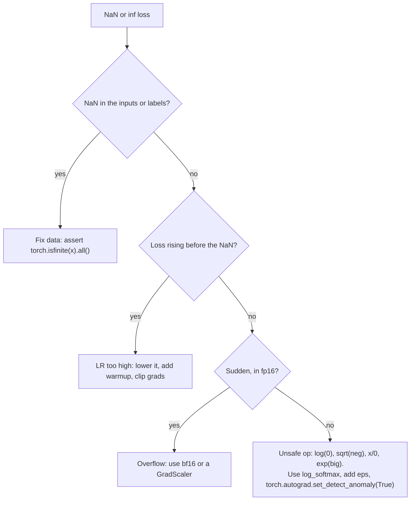

# 05 · PyTorch & the Craft of Training
> **Goal:** train any model reliably, and know what to do when it doesn't train. · **Time:** 20–30 h · **Needs:** 04

## Skip test
- [ ] Write a full training loop from memory: `Dataset`/`DataLoader`, `nn.Module`, loss, optimizer, `zero_grad → backward → step`, eval with `torch.no_grad()` + `model.eval()`.
- [ ] Explain SGD + momentum vs Adam vs **AdamW** (and why decoupled weight decay matters).
- [ ] Explain what BatchNorm and LayerNorm normalize over, and the train/eval difference for BatchNorm.
- [ ] Explain why a LR warmup + cosine decay schedule is standard.
- [ ] Your loss is NaN at step 200. List five things to check.
- [ ] Explain mixed precision (bf16/fp16) and gradient clipping.
- [ ] Write the Adam update from memory, and explain why plain Adam + L2 is not the same as AdamW.

## Core ideas

### PyTorch mechanics
- **Tensor** = a NumPy array + device (CPU/GPU) + autograd. `requires_grad=True` records ops into a graph.
- `loss.backward()` fills `.grad`. The optimizer reads `.grad` to update parameters. `optimizer.zero_grad()` resets them.
- **`nn.Module`**: define layers in `__init__` and compute in `forward`. Parameters register automatically.
- **`Dataset` / `DataLoader`**: batching, shuffling, worker processes.
- **Modes:** `model.train()` / `model.eval()` switch dropout and BatchNorm behavior. `torch.no_grad()` turns off graph building.
- **Devices:** move the model *and* the data `.to(device)`. Most "device mismatch" errors come from this.
- **`torch.compile(model)`** often speeds training up with a one-line change (it fuses ops into optimized kernels). The first steps are slow while it compiles.

### Optimizers
- **SGD + momentum:** $v \leftarrow \beta v + g,\ \theta \leftarrow \theta - \eta v$ (heavy ball 🔭).
- **Adam:** per-parameter adaptive step from running averages of $g$ and $g^2$:
  $m\leftarrow\beta_1m+(1-\beta_1)g$, $v\leftarrow\beta_2v+(1-\beta_2)g^2$, $\hat m=m/(1-\beta_1^t)$, $\hat v=v/(1-\beta_2^t)$, $\theta\leftarrow\theta-\eta\,\hat m/(\sqrt{\hat v}+\epsilon)$. Defaults $\beta_1=0.9,\ \beta_2=0.999,\ \epsilon=10^{-8}$.
- **AdamW** ([Loshchilov & Hutter, 2019](https://arxiv.org/abs/1711.05101)): $\theta\leftarrow\theta-\eta\big(\hat m/(\sqrt{\hat v}+\epsilon)+\lambda\theta\big)$. The decay is applied *directly* to the weights. With plain Adam + L2, the penalty's gradient $\lambda\theta$ gets divided by $\sqrt{\hat v}$, so weights with large gradients are barely regularized. **The default for transformers.** Don't decay biases and norm gains.
- **LR is the #1 hyperparameter.** Use warmup (stability early) + cosine/linear decay. LR range test to find a good value. 🎛️ Shape one in the [LR Schedule Designer](interactive/lr-schedules.html) (it generates PyTorch code).
- **Batch size:** larger means less gradient noise. Rules of thumb: scale the LR linearly with batch size for SGD ([Goyal et al., 2017](https://arxiv.org/abs/1706.02677)) and roughly with √ for Adam. Both stop working past a *critical batch size*, after which bigger batches stop speeding up training.

### Normalization & regularization
- **BatchNorm:** normalize each channel over the *batch* (and spatial positions, for CNNs). It uses running statistics at eval time. Common in CNNs, fragile with tiny batches.
- **LayerNorm / RMSNorm:** normalize over the *features* of each example (token). Independent of batch size. Used in transformers; RMSNorm skips the mean subtraction. 🎛️ Click through them in the [Normalization Explorer](interactive/norm-explorer.html).
- **Residual connections** $\mathbf x + F(\mathbf x)$ give gradients a highway. This is what makes deep nets trainable.
- **Dropout:** randomly zero activations in training, which acts like an ensemble. **Weight decay**, **data augmentation**, **early stopping**, **label smoothing**.

### Debugging recipe (from Karpathy's "Recipe")
1. Get to know the data: look at samples and label distributions.
2. Build a dumb baseline, fix random seeds, check the **initial loss** (≈ $\ln(C)$ for $C$ classes).
3. **Overfit a single batch** to ~0 loss. If you can't, there's a bug.
4. Then add regularization and scale up. Change **one thing at a time**.
5. Track everything: loss curves (train and val), LR, gradient norms. Use **Weights & Biases** or TensorBoard.

🎛️ Practice reading curves in the [Training Doctor](interactive/training-doctor.html): 11 realistic failure modes to diagnose.

### Performance
- **Mixed precision** (`torch.autocast`, prefer **bf16**) often gives up to ~2× speed on GPUs with tensor cores and roughly halves activation memory. bf16 has float32's exponent range, so it needs no loss scaling; fp16 needs `torch.amp.GradScaler` to avoid underflow/overflow.
- **Gradient clipping** (clip by norm, e.g. 1.0) prevents explosions.
- **Gradient accumulation** simulates a large batch on a small GPU.
- **Checkpointing:** save model + optimizer + step so you can resume.

## Worked examples

**1 · Adam's first step has size ≈ η, whatever the gradient's scale.** Take one parameter, $g_1=0.01$. Then $m=0.1\cdot0.01=0.001$, $v=0.001\cdot10^{-4}=10^{-7}$, $\hat m=0.001/0.1=0.01$, $\hat v=10^{-7}/0.001=10^{-4}$, step $=\eta\cdot0.01/(0.01+10^{-8})\approx\eta$. With $g_1=100$ you get the same step. That's why Adam's LR is a *step size* in parameter units, it needs less tuning than SGD's, and it's why early steps can be too big without warmup.

**2 · "Loss is NaN at step 200": the checklist.**


**3 · Gradient accumulation (effective batch = 4 × 32 = 128).**
```python
accum = 4
opt.zero_grad(set_to_none=True)
for i, (x, y) in enumerate(loader):              # loader batch size 32
    loss = loss_fn(model(x), y) / accum          # average over the 4 micro-batches
    loss.backward()                              # grads add up in .grad
    if (i + 1) % accum == 0:
        torch.nn.utils.clip_grad_norm_(model.parameters(), 1.0)
        opt.step(); sched.step()
        opt.zero_grad(set_to_none=True)
```
Not identical to a real batch of 128 if the model has BatchNorm (its statistics still see 32 at a time).

## Practice (answers hidden)

1. You evaluate a CNN with BatchNorm and get 10% accuracy, though training accuracy was 95%. One line fixes it. Which?
<details><summary>Answer</summary>

`model.eval()` before evaluating (and `model.train()` before training again). In train mode BatchNorm normalizes with the current test batch's statistics and dropout stays on. Also wrap evaluation in `torch.no_grad()` (or `torch.inference_mode()`) to save memory.
</details>

2. AdamW with lr = 1e-3 and weight_decay = 0.1. By what factor does weight decay alone shrink a weight each step?
<details><summary>Answer</summary>

PyTorch's AdamW multiplies the weight by $1-\eta\lambda = 1-10^{-4}$ per step. Over 10 000 steps that's $(1-10^{-4})^{10^4}\approx e^{-1}$ if nothing pushed back. The decay strength depends on the product $\eta\lambda$, so changing the LR also changes the effective regularization.
</details>

3. Your training loss is a perfectly regular sawtooth and validation loss stays above ln C. What's wrong?
<details><summary>Answer</summary>

The training data isn't shuffled (it's sorted by class): `DataLoader(..., shuffle=True)`.
</details>

4. Why can't you overfit a single batch of 32 examples, and what does that tell you?
<details><summary>Answer</summary>

A healthy model + pipeline should drive the loss on 32 fixed examples to ~0 within a few hundred steps. If it can't, the bug is in the code, not the hyperparameters: labels misaligned, a detached tensor (`.detach()`, `.item()`, NumPy round-trip) blocking gradients, wrong loss input (probabilities fed to `CrossEntropyLoss`, which expects logits), or the optimizer built on the wrong parameters.
</details>

5. `nn.CrossEntropyLoss()(torch.softmax(logits, -1), y)`: what's wrong?
<details><summary>Answer</summary>

`CrossEntropyLoss` applies log-softmax internally and expects raw **logits**. Applying softmax first squashes the inputs to [0, 1], so gradients become tiny and training stalls. Pass `logits` directly.
</details>

## Learn from
- ⭐ **[Dive into Deep Learning (d2l.ai)](https://d2l.ai/)**: free, PyTorch, math + code. Ch. 2–5, 8 (modern CNNs), 12 (optimization). Use it as your main textbook for modules 05–07.
- ⭐ **[A Recipe for Training Neural Networks (Karpathy)](https://karpathy.github.io/2019/04/25/recipe/)**: read twice.
- **[Understanding Deep Learning (Simon Prince, 2023)](https://udlbook.github.io/udlbook/)**: free, beautifully illustrated, and strong on theory. Ch. 6–9 (training, init, regularization). Your best *theory* companion.
- **[PyTorch: Learn the Basics](https://docs.pytorch.org/tutorials/beginner/basics/intro.html)** + **[Zero to Mastery PyTorch](https://www.learnpytorch.io/)**.
- **[Deep Learning Tuning Playbook (Google)](https://github.com/google-research/tuning_playbook)**: a systematic way to tune hyperparameters.
- Alt. top-down style: **[fast.ai Practical Deep Learning](https://course.fast.ai/)**. Great if you want quick wins before theory.

## Build
1. Re-implement your MNIST MLP in PyTorch. Compare it to your NumPy version.
2. **Fashion-MNIST/CIFAR-10 ablation study:** run SGD vs Adam vs AdamW, ± BatchNorm, ± dropout, three LR schedules. Plot everything in W&B and write a one-page conclusion.
3. Deliberately break training (huge LR, no normalization, bad init, forgetting `zero_grad`) and record what each failure *looks like* on the curves.

## Traps
- Forgetting `model.eval()` → BatchNorm/dropout are wrong at test time.
- Calling `.item()` or moving tensors to the CPU every step slows everything down.
- Tuning ten things at once. You learn nothing from that.
- Passing probabilities (after softmax) to `CrossEntropyLoss`, which expects logits.
- Calling `sched.step()` per epoch for a schedule defined in steps (or vice versa). Plot the LR you actually used.

## Done when
- [ ] Training loop written from memory · [ ] ablation report done · [ ] you recognize failure modes from the loss curves alone
