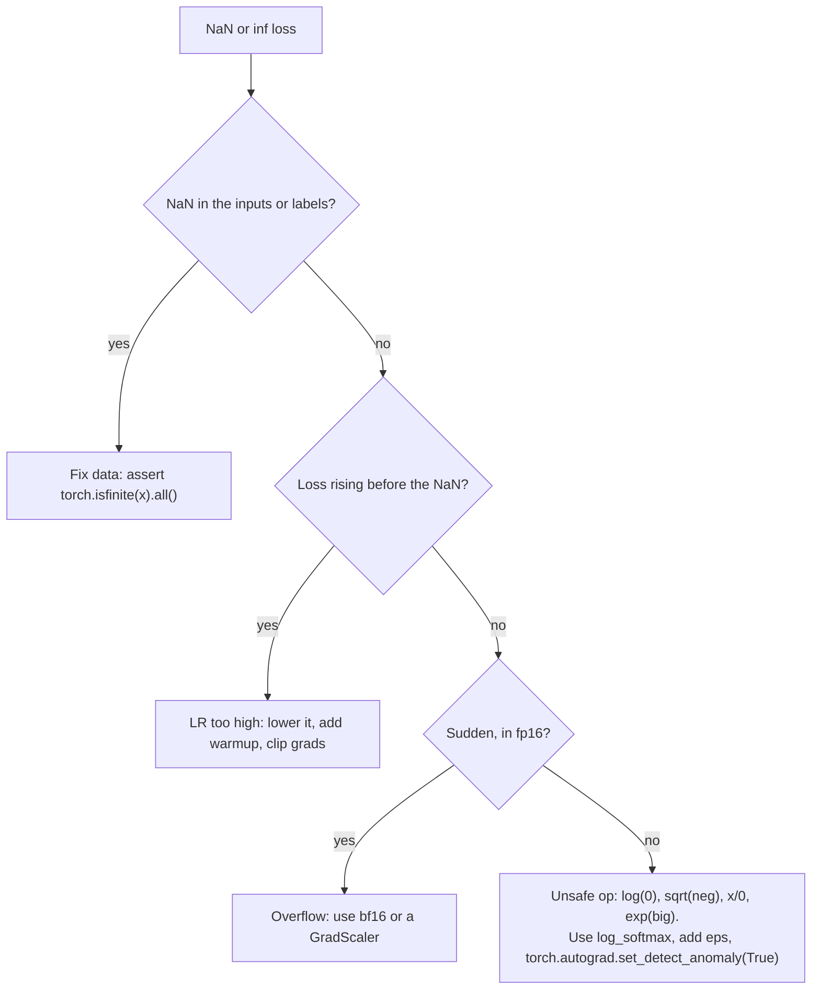

# 05 · PyTorch & the Craft of Training
> **Goal:** train any model reliably, and know what to do when it doesn't train. · **Time:** 20–30 h · **Needs:** 04

> [!GOAL]
> By the end of this chapter you can:
>
> - write a complete PyTorch training loop from memory (tensors, autograd, `nn.Module`, `DataLoader`, optimizer);
> - choose and explain **SGD + momentum, Adam and AdamW**, and design a **learning-rate schedule**;
> - explain **BatchNorm, LayerNorm, RMSNorm**, residual connections, dropout and label smoothing;
> - debug a model that won't train (the NaN checklist, overfitting one batch, reading loss curves);
> - speed training up with mixed precision, gradient clipping and gradient accumulation.

## Skip test
- [ ] Write a full training loop from memory: `Dataset`/`DataLoader`, `nn.Module`, loss, optimizer, `zero_grad → backward → step`, eval with `torch.no_grad()` + `model.eval()`.
- [ ] Explain SGD + momentum vs Adam vs **AdamW** (and why decoupled weight decay matters).
- [ ] Explain what BatchNorm and LayerNorm normalize over, and the train/eval difference for BatchNorm.
- [ ] Explain why a LR warmup + cosine decay schedule is standard.
- [ ] Your loss is NaN at step 200. List five things to check.
- [ ] Explain mixed precision (bf16/fp16) and gradient clipping.
- [ ] Write the Adam update from memory, and explain why plain Adam + L2 is not the same as AdamW.

## 1 · Tensors and autograd

PyTorch is NumPy (module 02) plus two things: arrays that can live on a **GPU**, and **automatic differentiation** (module 04) built in.

> [!DEF] Tensor
> A `torch.Tensor` is an n-dimensional array with a `shape`, a `dtype` (default `float32`) and a `device` (`"cpu"` or `"cuda"`). Almost every NumPy operation has a PyTorch twin: `x.sum(dim=0)`, `x @ y`, `x.view(...)`, broadcasting works the same way.

> [!DEF] Autograd
> If a tensor has `requires_grad=True`, PyTorch records every operation on it into a computational graph. Calling `.backward()` on a scalar result runs reverse-mode autodiff and **adds** the gradient into each leaf tensor's `.grad`.

> [!CODE] Autograd in four lines
> ```python
> w = torch.tensor([2.0], requires_grad=True)
> x, y = torch.tensor([1.0]), torch.tensor([1.0])
> loss = (torch.sigmoid(w * x - 1) - y) ** 2
> loss.backward(); print(w.grad)   # tensor([-0.1058]), the single-neuron example from module 04
> ```

> [!WARN] Things that silently cut the graph
> `.item()`, `.detach()`, `.numpy()`, and doing math in NumPy or Python floats all produce values with no gradient history. If a parameter's `.grad` stays `None` after `backward()`, one of these is usually why.

## 2 · Models, data and the training loop

> [!DEF] nn.Module
> The base class for every layer and model. Create sub-layers in `__init__` and describe the computation in `forward`. Any `nn.Parameter` or sub-module you assign as an attribute is registered automatically, so `model.parameters()` finds them all.
> ```python
> class MLP(nn.Module):
>     def __init__(self, d_in, d_hidden, n_classes):
>         super().__init__()
>         self.net = nn.Sequential(nn.Linear(d_in, d_hidden), nn.ReLU(), nn.Linear(d_hidden, n_classes))
>     def forward(self, x):
>         return self.net(x)          # returns logits
> ```

> [!DEF] Dataset and DataLoader
> A `Dataset` knows how many examples there are (`__len__`) and how to fetch example `i` (`__getitem__`). A `DataLoader` wraps it to produce shuffled mini-batches, optionally using several worker processes to load data in parallel.

> [!CODE] The canonical training loop
> ```python
> device = "cuda" if torch.cuda.is_available() else "cpu"
> model = MLP(784, 256, 10).to(device)
> opt = torch.optim.AdamW(model.parameters(), lr=1e-3, weight_decay=0.01)
> loss_fn = nn.CrossEntropyLoss()                       # expects logits
> train_dl = DataLoader(train_ds, batch_size=128, shuffle=True)
>
> for epoch in range(10):
>     model.train()                                     # dropout/BatchNorm in training mode
>     for x, y in train_dl:
>         x, y = x.to(device), y.to(device)
>         loss = loss_fn(model(x), y)
>         opt.zero_grad(set_to_none=True)               # clear old gradients
>         loss.backward()                               # compute new ones
>         opt.step()                                    # update the parameters
>
>     model.eval()                                      # inference mode for dropout/BatchNorm
>     with torch.no_grad():                             # no graph: faster, less memory
>         correct = sum((model(x.to(device)).argmax(1) == y.to(device)).sum().item() for x, y in val_dl)
>     print(epoch, correct / len(val_ds))
> ```

> [!KEY] train() vs eval(), and devices
> `model.train()` / `model.eval()` switch **dropout** and **BatchNorm** between their training and inference behaviour. `torch.no_grad()` separately turns off graph building. The model *and* every batch must be on the same device: most "Expected all tensors to be on the same device" errors come from forgetting one `.to(device)`.

> [!NOTE] torch.compile
> `model = torch.compile(model)` often speeds training up with a one-line change by fusing operations into optimized GPU kernels. The first few steps are slow while it compiles.

> [!FORMULA] Which loss for which task
> | Task | Final layer | PyTorch loss |
> |---|---|---|
> | multi-class classification | $C$ logits | `nn.CrossEntropyLoss` (log-softmax inside; pass **logits**) |
> | binary / multi-label | 1 logit per label | `nn.BCEWithLogitsLoss` (sigmoid inside) |
> | regression | linear output | `nn.MSELoss`, `nn.L1Loss`, `nn.HuberLoss` |

## 3 · Optimizers

> [!FORMULA] SGD with momentum
> $$\mathbf v \leftarrow \beta\mathbf v + \mathbf g,\qquad \theta\leftarrow\theta-\eta\,\mathbf v \qquad(\beta\approx0.9)$$
> A heavy ball rolling downhill 🔭: it smooths out zig-zags and builds speed along consistent directions. Still the strongest choice for many CNNs when well tuned.

> [!FORMULA] Adam
> Keep running averages of the gradient and of its square, per parameter:
> $$\mathbf m\leftarrow\beta_1\mathbf m+(1-\beta_1)\mathbf g,\qquad \mathbf v\leftarrow\beta_2\mathbf v+(1-\beta_2)\mathbf g^2$$
> $$\hat{\mathbf m}=\frac{\mathbf m}{1-\beta_1^t},\qquad \hat{\mathbf v}=\frac{\mathbf v}{1-\beta_2^t},\qquad \theta\leftarrow\theta-\eta\,\frac{\hat{\mathbf m}}{\sqrt{\hat{\mathbf v}}+\epsilon}$$
> Defaults $\beta_1=0.9,\ \beta_2=0.999,\ \epsilon=10^{-8}$. Dividing by $\sqrt{\hat{\mathbf v}}$ gives every parameter its own step size: parameters with consistently large gradients take smaller steps. The hats correct the bias from starting $\mathbf m,\mathbf v$ at zero.

> [!EXAMPLE] Adam's first step has size ≈ η, whatever the gradient's scale
> Take one parameter, $g_1=0.01$. Then $m=0.1\cdot0.01=0.001$, $v=0.001\cdot10^{-4}=10^{-7}$, $\hat m=0.001/0.1=0.01$, $\hat v=10^{-7}/0.001=10^{-4}$, step $=\eta\cdot0.01/(0.01+10^{-8})\approx\eta$. With $g_1=100$ you get the same step. That's why Adam's LR is a *step size* in parameter units, why it needs less tuning than SGD's, and why early steps can be too big without warmup.

> [!DEF] AdamW (decoupled weight decay)
> $$\theta\leftarrow\theta-\eta\Big(\frac{\hat{\mathbf m}}{\sqrt{\hat{\mathbf v}}+\epsilon}+\lambda\theta\Big)$$
> The decay is applied *directly* to the weights ([Loshchilov & Hutter, 2019](https://arxiv.org/abs/1711.05101)). With plain Adam + an L2 term in the loss, the penalty's gradient $\lambda\theta$ gets divided by $\sqrt{\hat{\mathbf v}}$, so weights with large gradients are barely regularized. **AdamW is the default for transformers.** Don't decay biases and normalization gains.

> [!TRY] [Optimizer Landscape](interactive/gradient-descent.html)
> Race SGD, momentum and Adam on a narrow valley and on a saddle. Notice how Adam's per-parameter scaling straightens the path.

## 4 · The learning rate and its schedule

> [!KEY] The learning rate is the #1 hyperparameter
> If you tune only one thing, tune the LR, on a log scale (e.g. 1e-4, 3e-4, 1e-3, 3e-3). A good LR is usually a bit below the value where training becomes unstable.

> [!FORMULA] Warmup + cosine decay
> Linear **warmup** for the first $T_w$ steps, then **cosine decay** to $\eta_{\min}$ at step $T$:
> $$\eta_t = \eta_{\max}\frac{t}{T_w}\ \ (t<T_w),\qquad \eta_t = \eta_{\min}+\tfrac12(\eta_{\max}-\eta_{\min})\Big(1+\cos\frac{\pi(t-T_w)}{T-T_w}\Big)\ \ (t\ge T_w)$$
> **Warmup** avoids huge early steps while Adam's statistics are still noisy and the weights are random. **Decay** lets the model settle into a minimum at the end. Linear decay and "warmup–stable–decay" schedules are common alternatives.

> [!DEF] LR range test
> Train for a few hundred steps while increasing the LR exponentially from tiny to huge, and plot loss against LR. Pick a value somewhat below where the loss is falling fastest, well before it blows up.

> [!DEF] Batch size and the learning rate
> Larger batches mean less gradient noise, so you can take bigger steps. Rules of thumb: scale the LR linearly with batch size for SGD ([Goyal et al., 2017](https://arxiv.org/abs/1706.02677)) and roughly with √(batch size) for Adam. Both stop working past a *critical batch size*, after which bigger batches stop speeding up training.

> [!TRY] [LR Schedule Designer](interactive/lr-schedules.html)
> Shape a warmup + decay schedule, compare cosine, linear and step decay, and copy the generated PyTorch code.

## 5 · Normalization and residual connections

Deep networks train much better when activations keep a sensible scale. Normalization layers enforce that explicitly.

> [!FORMULA] Batch normalization
> For each channel, compute the mean $\mu_B$ and variance $\sigma_B^2$ **over the batch** (and over spatial positions in a CNN), then
> $$\hat x = \frac{x-\mu_B}{\sqrt{\sigma_B^2+\epsilon}},\qquad y = \gamma\hat x + \beta$$
> $\gamma,\beta$ are learned, so the layer can undo the normalization if that helps. At **eval** time BatchNorm uses running averages of $\mu,\sigma^2$ collected during training. Common in CNNs; fragile with tiny batches.

> [!FORMULA] Layer normalization and RMSNorm
> **LayerNorm** normalizes over the **features of each example (token)**, independently of the rest of the batch:
> $$y = \gamma\odot\frac{\mathbf x-\mu(\mathbf x)}{\sqrt{\sigma^2(\mathbf x)+\epsilon}}+\beta$$
> **RMSNorm** skips the mean: $y = \mathbf g\odot\mathbf x\,/\sqrt{\tfrac1d\sum_i x_i^2+\epsilon}$. Both behave the same in training and eval and don't care about batch size, which is why transformers use them (module 08).

> [!DEF] Residual (skip) connection
> Instead of $\mathbf y = F(\mathbf x)$, compute $\mathbf y = \mathbf x + F(\mathbf x)$. The layer only has to learn a *correction* to its input, and in the backward pass the gradient flows straight through the "+" (its local gradient is 1), giving it a highway back to early layers. This is what makes 100+ layer networks trainable (ResNets, module 06; transformers, module 08).

> [!TRY] [Normalization Explorer](interactive/norm-explorer.html)
> Click through a batch tensor and highlight exactly which numbers BatchNorm, LayerNorm, RMSNorm and GroupNorm average over.

> [!VIDEO] P6sfmUTpUmc | Building makemore Part 3: Activations & Gradients, BatchNorm | Andrej Karpathy · 1 h 56 min

## 6 · Regularization in deep nets

> [!FORMULA] Dropout (inverted dropout)
> During training, zero each activation with probability $p$ and scale the survivors up:
> $$\tilde h = \frac{m\cdot h}{1-p},\qquad m\sim\text{Bernoulli}(1-p)$$
> The scaling keeps the expected value unchanged, so at eval time dropout simply does nothing. It stops units from relying on each other and acts like averaging many thinned networks.

> [!FORMULA] Label smoothing
> Replace the one-hot target by $\mathbf y' = (1-\varepsilon)\,\mathbf y + \varepsilon/C$ (e.g. $\varepsilon=0.1$). The model is no longer pushed to infinite logits, which often improves calibration and generalization. In PyTorch: `nn.CrossEntropyLoss(label_smoothing=0.1)`.

> [!DEF] Other regularizers
> - **Weight decay** (AdamW's $\lambda$, section 3).
> - **Data augmentation:** random crops, flips, colour jitter, mixup… new training examples for free (module 06).
> - **Early stopping:** keep the checkpoint with the best validation score.

## 7 · Debugging: when training goes wrong

> [!KEY] Karpathy's recipe
> 1. Get to know the data: look at samples and label distributions.
> 2. Build a dumb baseline, fix random seeds, check the **initial loss** (≈ $\ln C$ for $C$ classes).
> 3. **Overfit a single batch** to ~0 loss. If you can't, there's a bug.
> 4. Then add regularization and scale up. Change **one thing at a time**.
> 5. Track everything: loss curves (train and val), LR, gradient norms. Use **Weights & Biases** or TensorBoard.

> [!EXAMPLE] "Loss is NaN at step 200": the checklist
> Work through the flowchart below from the top.



> [!DEF] Reading loss curves
> | What you see | Likely cause |
> |---|---|
> | loss flat from the start | LR far too small, gradients not flowing (detached tensor), or wrong labels |
> | loss explodes or oscillates wildly | LR too high; add warmup or clipping |
> | train ↓, validation ↑ after a while | overfitting: regularize, augment, stop early |
> | both high and close together | underfitting: bigger model, train longer |
> | regular sawtooth pattern | data not shuffled |

> [!TRY] [Training Doctor](interactive/training-doctor.html)
> Diagnose 11 realistic failure modes from their loss curves alone, then check your answer.

## 8 · Speed and memory

> [!DEF] Mixed precision
> Run most of the forward and backward pass in 16-bit floats (`torch.autocast`) while keeping a float32 copy of the weights. On GPUs with tensor cores this often gives up to ~2× speed and roughly halves activation memory. Prefer **bf16**: it has float32's exponent range, so it needs no loss scaling. **fp16** has a tiny range (max 65 504) and needs `torch.amp.GradScaler` to avoid underflow and overflow.

> [!FORMULA] Gradient clipping (by global norm)
> $$\mathbf g\leftarrow\mathbf g\cdot\min\Big(1,\ \frac{c}{\|\mathbf g\|}\Big)$$
> If the gradient's total norm exceeds $c$ (e.g. 1.0), scale it down to length $c$; the direction is unchanged. It stops one bad batch from wrecking the weights. `torch.nn.utils.clip_grad_norm_(model.parameters(), 1.0)`.

> [!EXAMPLE] Gradient accumulation (effective batch = 4 × 32 = 128)
> ```python
> accum = 4
> opt.zero_grad(set_to_none=True)
> for i, (x, y) in enumerate(loader):              # loader batch size 32
>     loss = loss_fn(model(x), y) / accum          # average over the 4 micro-batches
>     loss.backward()                              # grads add up in .grad
>     if (i + 1) % accum == 0:
>         torch.nn.utils.clip_grad_norm_(model.parameters(), 1.0)
>         opt.step(); sched.step()
>         opt.zero_grad(set_to_none=True)
> ```
> Not identical to a real batch of 128 if the model has BatchNorm (its statistics still see 32 at a time).

> [!CODE] Checkpointing
> Save everything needed to resume, not just the weights:
> ```python
> torch.save({"model": model.state_dict(), "opt": opt.state_dict(),
>             "sched": sched.state_dict(), "step": step}, "ckpt.pt")
> ```

## Practice (answers hidden)

1. You evaluate a CNN with BatchNorm and get 10% accuracy, though training accuracy was 95%. One line fixes it. Which?
<details><summary>Answer</summary>

`model.eval()` before evaluating (and `model.train()` before training again). In train mode BatchNorm normalizes with the current test batch's statistics and dropout stays on. Also wrap evaluation in `torch.no_grad()` (or `torch.inference_mode()`) to save memory.
</details>

2. AdamW with lr = 1e-3 and weight_decay = 0.1. By what factor does weight decay alone shrink a weight each step?
<details><summary>Answer</summary>

PyTorch's AdamW multiplies the weight by $1-\eta\lambda = 1-10^{-4}$ per step. Over 10 000 steps that's $(1-10^{-4})^{10^4}\approx e^{-1}$ if nothing pushed back. The decay strength depends on the product $\eta\lambda$, so changing the LR also changes the effective regularization.
</details>

3. Your training loss is a perfectly regular sawtooth and validation loss stays above ln C. What's wrong?
<details><summary>Answer</summary>

The training data isn't shuffled (it's sorted by class): `DataLoader(..., shuffle=True)`.
</details>

4. Why can't you overfit a single batch of 32 examples, and what does that tell you?
<details><summary>Answer</summary>

A healthy model + pipeline should drive the loss on 32 fixed examples to ~0 within a few hundred steps. If it can't, the bug is in the code, not the hyperparameters: labels misaligned, a detached tensor (`.detach()`, `.item()`, NumPy round-trip) blocking gradients, wrong loss input (probabilities fed to `CrossEntropyLoss`, which expects logits), or the optimizer built on the wrong parameters.
</details>

5. `nn.CrossEntropyLoss()(torch.softmax(logits, -1), y)`: what's wrong?
<details><summary>Answer</summary>

`CrossEntropyLoss` applies log-softmax internally and expects raw **logits**. Applying softmax first squashes the inputs to [0, 1], so gradients become tiny and training stalls. Pass `logits` directly.
</details>

6. With dropout $p=0.5$, an activation is $h=3$. What values can $\tilde h$ take during training, and what is its expected value?
<details><summary>Answer</summary>

$0$ (probability 0.5) or $3/0.5=6$ (probability 0.5). Expected value $0.5\cdot6=3=h$, which is why no rescaling is needed at eval time.
</details>

7. A cosine schedule with $\eta_{\max}=10^{-3}$, $\eta_{\min}=0$, no warmup and $T=1000$ steps. What is the LR at steps 0, 500 and 1000?
<details><summary>Answer</summary>

$10^{-3}\cdot\tfrac12(1+\cos 0)=10^{-3}$; at 500: $\tfrac12(1+\cos\tfrac\pi2)\cdot10^{-3}=5\times10^{-4}$; at 1000: $\tfrac12(1+\cos\pi)\cdot10^{-3}=0$.
</details>

## Build
1. Re-implement your MNIST MLP in PyTorch. Compare it to your NumPy version.
2. **Fashion-MNIST/CIFAR-10 ablation study:** run SGD vs Adam vs AdamW, ± BatchNorm, ± dropout, three LR schedules. Plot everything in W&B and write a one-page conclusion.
3. Deliberately break training (huge LR, no normalization, bad init, forgetting `zero_grad`) and record what each failure *looks like* on the curves.

## Traps
- Forgetting `model.eval()` → BatchNorm/dropout are wrong at test time.
- Calling `.item()` or moving tensors to the CPU every step slows everything down.
- Tuning ten things at once. You learn nothing from that.
- Passing probabilities (after softmax) to `CrossEntropyLoss`, which expects logits.
- Calling `sched.step()` per epoch for a schedule defined in steps (or vice versa). Plot the LR you actually used.

## Go deeper (all optional)
- ⭐ **[Dive into Deep Learning (d2l.ai)](https://d2l.ai/)**: free, PyTorch, math + code. Ch. 2–5, 8 (modern CNNs), 12 (optimization).
- ⭐ **[A Recipe for Training Neural Networks (Karpathy)](https://karpathy.github.io/2019/04/25/recipe/)**: read twice.
- **[Understanding Deep Learning (Simon Prince, 2023)](https://udlbook.github.io/udlbook/)**: free, beautifully illustrated, and strong on theory. Ch. 6–9 (training, init, regularization).
- **[PyTorch: Learn the Basics](https://docs.pytorch.org/tutorials/beginner/basics/intro.html)** + **[Zero to Mastery PyTorch](https://www.learnpytorch.io/)**.
- **[Deep Learning Tuning Playbook (Google)](https://github.com/google-research/tuning_playbook)**: a systematic way to tune hyperparameters.
- Alt. top-down style: **[fast.ai Practical Deep Learning](https://course.fast.ai/)**. Great if you want quick wins before theory.

## Done when
- [ ] Training loop written from memory · [ ] ablation report done · [ ] you recognize failure modes from the loss curves alone
