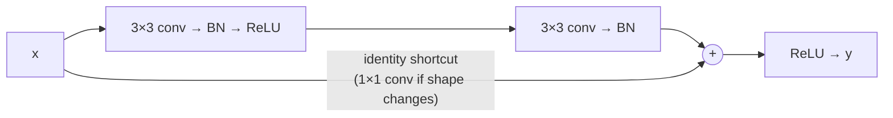

# 06 · CNNs & Computer Vision
> **Goal:** understand convolution, the classic architectures, and modern vision. · **Time:** 20–25 h · **Needs:** 05

## Skip test
If you can do ALL of these without notes, skip the module.
- [ ] Compute the output size of a conv: input 32, kernel 5, stride 2, padding 2. Then the same with dilation 2.
- [ ] Count the parameters of `Conv2d(64, 128, kernel_size=3)` and of the dense layer that maps the same 64×32×32 input to a 128×32×32 output.
- [ ] Compute the receptive field of three stacked 3×3 convs (stride 1), and of 7×7/2 conv → 3×3/2 max-pool.
- [ ] Explain **translation equivariance**, **weight sharing**, and **receptive field**, and say which common layers *break* exact equivariance.
- [ ] Explain why ResNet's skip connections made 100+ layer nets trainable (two reasons: optimization and gradient flow).
- [ ] Explain transfer learning: when to freeze, when to fine-tune, and why you reuse the backbone's normalization stats.
- [ ] Compute the token count of a ViT-B/16 on a 224×224 image, and explain how it turns pixels into tokens.

Answers (check yourself after trying)

- $\lfloor(32+4-5)/2\rfloor+1 = 16$. With dilation 2 the kernel spans $2\cdot4+1=9$ pixels: $\lfloor(32+4-9)/2\rfloor+1 = 14$.
- Conv: $64\cdot128\cdot9 + 128 = 73{,}856$. Dense: $(64\cdot1024)(128\cdot1024) \approx 8.6\times10^9$ weights, ~116,000× more.
- 3×(3×3): $1+2+2+2 = 7$. Stem: $r = 1+6 = 7$, jump 2, then $r = 7 + 2\cdot2 = 11$.
- Equivariance: shift the input → the conv output shifts the same way. Striding/pooling (aliasing), padding at borders, and the final flatten/linear layer break it. Global average pooling gives approximate *invariance*.
- $224/16 = 14$, so $14^2 = 196$ patch tokens + 1 `[CLS]` token = 197.

## Core ideas
- **Convolution** = sliding the same small filter everywhere. This builds in the *prior* that local patterns matter anywhere in the image.
  - **Output size** (per spatial dim): $\displaystyle \left\lfloor \frac{n + 2p - d(k-1) - 1}{s} \right\rfloor + 1$. With dilation $d=1$ this is the familiar $\lfloor (n + 2p - k)/s \rfloor + 1$. "Same" padding at stride 1: $p = d(k-1)/2$.
  - **Params:** $C_{in}\cdot C_{out}\cdot k^2 + C_{out}$ (independent of image size). **FLOPs:** $\approx 2\,C_{in}C_{out}k^2 H_{out}W_{out}$ (dependent on image size).
  - 🔭 A convolution is the discrete version of what you know from Green's functions and signal filtering. In DL it's technically **cross-correlation** (the kernel isn't flipped). Since kernels are learned, the difference doesn't matter.
- **Receptive field (RF)** = the input region one output unit can see. Stack layers with the recursion $r \leftarrow r + d(k-1)\,j,\ \ j \leftarrow j\,s$ (start $r=j=1$; $j$ is the "jump", the product of strides so far). Strides multiply the jump, so RF grows fast after downsampling. The *effective* RF (where gradients are large) is smaller and roughly Gaussian (Luo et al. 2016).
- **Pooling / strided conv** downsample. **Feature hierarchy:** edges → textures → parts → objects ([Feature Visualization](https://distill.pub/2017/feature-visualization/)).
- **1×1 convolution** = a per-pixel linear layer across channels. Used to change the channel count cheaply (Inception, ResNet bottlenecks, MobileNet).
- **Depthwise-separable conv:** one $k\times k$ filter per channel, then a 1×1 conv to mix channels. Cost falls from $C_{in}C_{out}k^2$ to $C_{in}k^2 + C_{in}C_{out}$ (≈8–9× fewer for $k=3$).
- **Architecture timeline (know the *idea* of each):**
  - **LeNet** (1998): conv + pool. **AlexNet** (2012): ReLU, GPU, dropout, the "ImageNet moment".
  - **VGG** (2014): stacks of 3×3 convs. Two 3×3 = one 5×5 receptive field with 18 instead of 25 weights per channel pair, plus an extra nonlinearity.
  - **GoogLeNet/Inception** (2014): parallel branches, 1×1 convs to cut channels.
  - **ResNet** (2015): $\mathbf y = \mathbf x + F(\mathbf x)$. **The most important architecture idea in DL.** Two reasons it works: (1) a block can learn $F \approx 0$, so a deeper net is never forced to be worse than a shallow one (it fixes the *degradation problem*: plain 56-layer nets had higher **training** error than 20-layer ones); (2) $\partial\mathbf y/\partial\mathbf x = I + \partial F/\partial\mathbf x$, so gradients have an identity path to early layers.
  - **MobileNet/EfficientNet** (2017/2019): depthwise-separable convs, compound scaling of depth/width/resolution.
  - **ViT** (2020): split the image into 16×16 patches → linear embeddings (+ position embeddings, + a `[CLS]` token) → transformer. Weaker inductive bias than a CNN, so it needs large-scale (pre)training or strong augmentation (DeiT) to win.
  - **ConvNeXt** (2022): a ResNet modernized with transformer-era design and training tricks (big 7×7 depthwise kernels, LayerNorm, GELU, AdamW, heavy augmentation). Matches Swin/ViT, which shows much of ViT's edge was the *training recipe*.
- **Data augmentation:** flips, crops, color jitter, Mixup/CutMix, RandAugment. Often worth more than architecture changes.
- **Transfer learning:** take an ImageNet-pretrained backbone and replace the head. Small data → freeze most layers (train the head, maybe the last stage). More data → fine-tune all at a low LR (e.g. 10× smaller for the backbone than the head).
- **Tasks beyond classification:**
  - **Detection** (boxes): two-stage (Faster R-CNN), one-stage (YOLO family), transformer-based (DETR). Metric: mAP at IoU thresholds.
  - **Segmentation** (pixels): **U-Net** (encoder-decoder + skip connections, also the classic backbone of diffusion models, module 10), Mask R-CNN, SAM.
- **Foundation vision models:** CLIP (image–text), DINOv2 (self-supervised features), SAM / SAM 2 (promptable segmentation for images and video). Grab them from `timm` / Hugging Face.

*A ResNet basic block. The shortcut is a plain identity unless the stride or channel count changes; then a 1×1 conv (stride s) matches shapes.*

## Interactive
- 🧪 **[Convolution Explorer](interactive/conv-explorer.html)**: step a kernel over an image (stride, padding, dilation), stack layers to compute receptive fields, and compare conv vs dense parameter counts.
- ✅ [Architectures → RL Quiz](interactive/advanced-quiz.html): auto-graded questions for modules 06–11 with explanations; filter by this module.

## Worked example: shapes through a small CNN
Input `(B, 3, 32, 32)` (CIFAR-10).

| Layer | Output shape | Params |
|---|---|---|
| `Conv2d(3, 32, 3, padding=1)` | (B, 32, 32, 32) | 3·32·9 + 32 = 896 |
| `MaxPool2d(2)` | (B, 32, 16, 16) | 0 |
| `Conv2d(32, 64, 3, padding=1)` | (B, 64, 16, 16) | 32·64·9 + 64 = 18,496 |
| `MaxPool2d(2)` | (B, 64, 8, 8) | 0 |
| `AdaptiveAvgPool2d(1)` + flatten | (B, 64) | 0 |
| `Linear(64, 10)` | (B, 10) | 650 |

Total 20,042 parameters. If you flatten `(64, 8, 8)` into `Linear(4096, 10)` instead of global average pooling, the head alone is 40,970 parameters and the model only accepts 32×32 inputs. Global average pooling makes the network resolution-agnostic.

## Practice
1. A 3×3 conv with stride 1 and no padding is applied 5 times to a 28×28 image. What is the output size, and what is the receptive field of one output pixel?
2. ResNet-50's first layer is `Conv2d(3, 64, 7, stride=2, padding=3)` on a 224×224 image. Output size? Parameters (it has no bias, because BN follows)?
3. Replace a `Conv2d(256, 256, 3)` with a depthwise-separable version. How many times fewer weights (ignore biases)?
4. Why does the pretrained model's accuracy drop sharply if you feed it images in [0, 255] instead of normalized with the ImageNet mean/std?

Solutions

1. Each layer removes 2: $28 - 10 = 18$, so 18×18. RF $= 1 + 5\cdot2 = 11$.
2. $\lfloor(224+6-7)/2\rfloor+1 = 112$, so 112×112×64. Params $3\cdot64\cdot49 = 9{,}408$.
3. Standard: $256\cdot256\cdot9 = 589{,}824$. Separable: $256\cdot9 + 256\cdot256 = 67{,}840$. ≈ 8.7× fewer. (In general the ratio is $1/C_{out} + 1/k^2$.)
4. The first-layer filters and every BatchNorm's running stats were learned for inputs with mean ≈ 0, std ≈ 1 per channel. Inputs ~200× larger saturate activations and shift every BN layer's statistics.

## Learn from
- ⭐ **[Stanford CS231n](https://cs231n.stanford.edu/)**: [course notes](https://cs231n.github.io/) + lecture videos (YouTube) + **assignments 1–2**. A gold standard.
- **[d2l.ai](https://d2l.ai/)** ch. 7–8 (CNNs, modern CNNs) and ch. 14 (computer vision).
- **[CNN Explainer (interactive)](https://poloclub.github.io/cnn-explainer/)**: see a conv net run in your browser.
- **[Feature Visualization (Distill)](https://distill.pub/2017/feature-visualization/)**: what CNN neurons actually detect.
- **[PyTorch Image Models (timm)](https://github.com/huggingface/pytorch-image-models)**: pretrained models for transfer learning.
- Papers: [ResNet](https://arxiv.org/abs/1512.03385) · [ViT](https://arxiv.org/abs/2010.11929) · [ConvNeXt](https://arxiv.org/abs/2201.03545).

## Build
1. **ResNet-18 from scratch** on CIFAR-10. Target ≥ 93% with augmentation (random crop + flip) and a good LR schedule.
2. **Transfer learning:** fine-tune a pretrained model on a small custom dataset (e.g. 5 classes, ~100 photos each). Compare frozen vs full fine-tuning.
3. Visualize filters, feature maps, and a saliency map / Grad-CAM for your model's predictions.
4. Stretch: a small **U-Net** for segmentation (e.g. Oxford-IIIT Pets masks).

## Traps
- Off-by-one shape errors. Print shapes after every block while developing (or use `torchinfo.summary`).
- Forgetting ImageNet normalization (mean/std) when using a pretrained model, or using the wrong channel order (RGB vs BGR from OpenCV).
- Evaluating with train-time augmentation turned on, or forgetting `model.eval()` (BatchNorm then uses batch stats and dropout stays on).
- Fine-tuning a pretrained BN backbone with batch size 2–4: the batch statistics are noise. Freeze BN (keep it in eval mode) or use GroupNorm.
- Assuming CNNs are perfectly shift-invariant. Strided layers alias, so a 1-pixel shift can change the prediction.

## Done when
- [ ] ResNet on CIFAR-10 ≥ 93% · [ ] fine-tuned model works on your own photos · [ ] every skip-test item answered on paper
