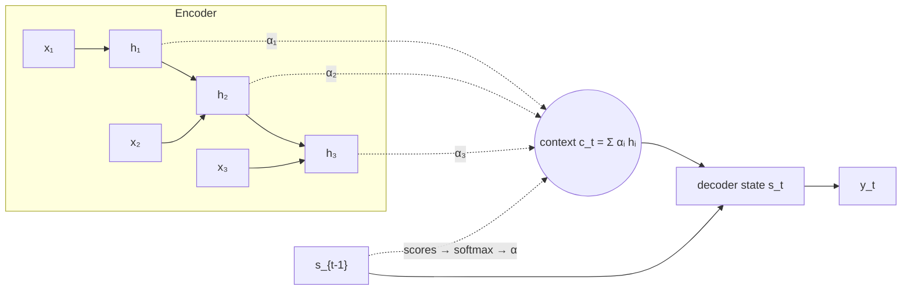

# 07 · Sequences, Embeddings & RNNs
> **Goal:** learn how to model sequences, and why attention replaced recurrence. · **Time:** 10–15 h · **Needs:** 05

This module is deliberately **short**. RNNs are mostly history now, but the problems they ran into explain every transformer design choice. (Modern state-space models such as Mamba bring recurrence back. See module 12.)

## Skip test
If you can do ALL of these without notes, skip the module.
- [ ] Explain tokenization and embeddings: why one-hot is bad, and why an embedding lookup equals a one-hot vector times a matrix.
- [ ] Write the vanilla RNN update and the Jacobian $\partial\mathbf h_t/\partial\mathbf h_{t-1}$. Explain when gradients vanish or explode through time.
- [ ] Write the LSTM equations (forget/input/output gates, cell state) and explain why the cell path fixes vanishing gradients.
- [ ] Count the parameters of `nn.LSTM(input_size=100, hidden_size=256)` (one layer).
- [ ] Explain the seq2seq encoder-decoder bottleneck and how **attention** removes it.
- [ ] Explain teacher forcing, exposure bias, and autoregressive generation.

Answers (check yourself after trying)

- One-hot vectors are huge ($V$-dimensional), sparse, and all equally far apart, so "cat" is no closer to "dog" than to "carburetor". $\text{onehot}(i)^\top E = E_i$, so an embedding table is a linear layer applied to a one-hot input, implemented as an index lookup.
- $\partial\mathbf h_t/\partial\mathbf h_{t-1} = \operatorname{diag}(\tanh'(\mathbf z_t))\,W_h$. The gradient from step $T$ to step $k$ is a product of $T-k$ of these. If $\sigma_{\max}(W_h) < 1$ it must vanish (tanh' ≤ 1); explosion needs $\sigma_{\max}(W_h) > 1$ (Pascanu et al. 2013).
- $\partial\mathbf c_t/\partial\mathbf c_{t-1} = \operatorname{diag}(\mathbf f_t)$ along the cell path: no squashing nonlinearity and no weight matrix. With $f \approx 1$ the signal passes almost unchanged.
- 4 gates × (256·100 + 256·256 + 256) = 4 × 91,392 = 365,568, plus PyTorch's second bias vector (4·256 = 1,024) → **366,592**.
- Teacher forcing: during training, feed the *true* previous token. Exposure bias: at test time the model sees its own (possibly wrong) tokens, a distribution it never trained on.

## Core ideas
- **Language modeling** = predicting the next token: $p(x_1..x_T) = \prod_t p(x_t\mid x_{<t})$. This one objective powers GPT.
- **Tokens:** characters, words, or subwords (BPE, see module 09). **Embedding** = a learned lookup table $E \in \mathbb R^{V\times d}$, where similar meanings end up as nearby vectors.
- **word2vec** (Mikolov et al. 2013): learn embeddings by predicting context words (skip-gram) with negative sampling. Famous vector arithmetic: king − man + woman ≈ queen (only when the three query words are excluded from the candidates, a detail that makes analogies look better than they are).
- **Vanilla RNN:** $\mathbf h_t = \tanh(W_h\mathbf h_{t-1} + W_x\mathbf x_t + \mathbf b)$. **BPTT** multiplies $T-k$ Jacobians $\operatorname{diag}(\tanh'(\mathbf z_t))W_h$ to send the gradient from step $T$ back to step $k$. Its size behaves roughly like $(\sigma_{\max}(W_h)\cdot\overline{\tanh'})^{T-k}$: below 1 it **vanishes** exponentially, above 1 it can **explode**. Saturated units ($|h|\approx1$, $\tanh'\approx0$) make vanishing worse.
  - **Exploding** gradients are easy to treat: **clip the gradient norm**. **Vanishing** ones need an architecture change.
- **LSTM** (Hochreiter & Schmidhuber 1997; forget gate added by Gers et al. 2000):
  $$\mathbf f_t,\mathbf i_t,\mathbf o_t = \sigma(\cdot),\quad \tilde{\mathbf c}_t = \tanh(W_c[\mathbf h_{t-1},\mathbf x_t] + \mathbf b_c)$$
  $$\mathbf c_t = \mathbf f_t\odot\mathbf c_{t-1} + \mathbf i_t\odot\tilde{\mathbf c}_t,\qquad \mathbf h_t = \mathbf o_t\odot\tanh(\mathbf c_t)$$
  The **additive** cell update creates a gradient highway, the same idea as residual connections (module 06). Initialize the forget-gate bias to ~1 so the highway starts open.
- **GRU** (Cho et al. 2014): two gates (update, reset), no separate cell. Similar accuracy, fewer parameters.
- **Seq2seq** (Sutskever et al. 2014): an encoder squeezes the input into one vector, and a decoder generates from it. **Bottleneck:** one fixed-size vector for a whole sentence, so quality drops on long inputs.
- **Attention (Bahdanau et al. 2014):** at each decoder step, take a weighted average of *all* encoder states, with weights = softmax(similarity). → "Attention Is All You Need" (2017) drops recurrence entirely.
- **Why transformers won:** RNNs are sequential (no parallelism over time) and the path between distant tokens is $O(T)$ steps long. Attention connects all positions with a path of length 1 and trains in parallel, at the cost of $O(T^2)$ work per layer.
- **Generation:** autoregressive sampling. Train with **teacher forcing** (feed the ground-truth previous token). Decoding: greedy, beam search, temperature, top-k, top-p.

*Seq2seq with attention: the decoder looks at every encoder state at every step instead of one squeezed vector.*

## Interactive
- 🧪 **[RNN Gradient Flow](interactive/rnn-gradients.html)**: watch $|\partial h_T/\partial h_k|$ vanish or explode as you change the recurrent weight, compare with the LSTM cell path $\prod f$, and compare RNN vs attention path lengths.
- [Attention & Sampling](interactive/attention.html): greedy vs temperature / top-k / top-p decoding.

## Worked example: how fast does a gradient vanish?
Scalar RNN $h_t = \tanh(w h_{t-1} + x_t)$ with $w = 0.9$, and suppose $|h_t| \approx 0.5$ on average, so $\tanh' = 1 - h^2 \approx 0.75$. Each step multiplies the gradient by about $0.9 \times 0.75 = 0.675$. After 20 steps: $0.675^{20} \approx 3.9\times10^{-4}$. After 50: $\approx 3\times10^{-9}$. A dependency 50 tokens back is invisible to gradient descent.

An LSTM with forget gate $f = 0.98$ keeps $0.98^{50} \approx 0.36$ along the cell path. With $f = 0.9$ it keeps $0.9^{50} \approx 0.005$. So the forget gate is a learned, per-unit memory *time constant*: $\tau \approx 1/(1-f)$ steps. 🔭 It is an exponential decay $e^{-t/\tau}$, like an RC circuit.

## Practice
1. A GRU has 3 weight blocks where an LSTM has 4. How many parameters does `nn.GRU(100, 256)` have in PyTorch (two bias vectors per gate)?
2. You train an RNN and the loss suddenly becomes `nan` after a spike. What is the likely cause and the one-line fix?
3. Why can't you parallelize an RNN's forward pass over time steps during training, while a causal transformer can?
4. A char-level model trained with teacher forcing produces fluent text for 30 characters and then degenerates into "the the the …". Name the phenomenon and two mitigations.

Solutions

1. 3 × (256·100 + 256·256 + 256 + 256) = 3 × 91,648 = **274,944**.
2. Exploding gradients. Clip the gradient norm: `torch.nn.utils.clip_grad_norm_(model.parameters(), 1.0)` before `optimizer.step()`.
3. $\mathbf h_t$ depends on $\mathbf h_{t-1}$, so step $t$ cannot start until step $t-1$ is done. A transformer with teacher forcing knows all inputs up front, and the causal mask lets one matrix multiply compute all $T$ predictions.
4. Exposure bias plus greedy/low-temperature decoding falling into a repetition loop. Mitigations: sample with temperature/top-p instead of greedy, add a repetition penalty, train longer/bigger, or (classically) scheduled sampling.

## Learn from
- ⭐ **[Karpathy Zero to Hero: makemore series](https://karpathy.ai/zero-to-hero.html)**: you'll already be partway through it from module 04. It builds bigram → MLP → WaveNet-style LMs.
- ⭐ **[Understanding LSTM Networks (colah)](https://colah.github.io/posts/2015-08-Understanding-LSTMs/)**: the classic diagrams.
- **[The Unreasonable Effectiveness of RNNs (Karpathy)](https://karpathy.github.io/2015/05/21/rnn-effectiveness/)**.
- **[Stanford CS224n](https://web.stanford.edu/class/cs224n/)**: lectures on word vectors, RNNs, seq2seq + attention.
- **[d2l.ai](https://d2l.ai/)** ch. 9–11 (RNNs, modern RNNs, attention and transformers).
- Papers: [word2vec](https://arxiv.org/abs/1301.3781) · [On the difficulty of training RNNs (Pascanu et al.)](https://arxiv.org/abs/1211.5063) · [Seq2seq](https://arxiv.org/abs/1409.3215) · [Bahdanau attention](https://arxiv.org/abs/1409.0473).

## Build
1. **Character-level LM** (makemore): bigram → MLP → small RNN/LSTM on a names or Shakespeare dataset. Compare samples and validation loss.
2. Train word2vec (skip-gram with negative sampling) on a small corpus. Show nearest neighbors and analogies.
3. Stretch: a seq2seq + attention model for date-format translation ("3rd of May 2021" → "2021-05-03"). Plot the attention heatmap.

## Traps
- Forgetting to detach the hidden state between truncated-BPTT chunks (`h = h.detach()`), so the graph grows until memory runs out.
- `nn.LSTM` defaults to `(T, B, C)` input. Pass `batch_first=True` if your tensors are `(B, T, C)`.
- Padding without masking: padded positions leak into the loss and the final hidden state. Use `pack_padded_sequence` or a loss mask.
- Treating word2vec analogies as proof of "understanding". They are linear regularities in co-occurrence statistics.

## Done when
- [ ] Char-LM produces plausible samples · [ ] you can explain the path from RNN → attention → transformer · [ ] every skip-test item answered on paper
