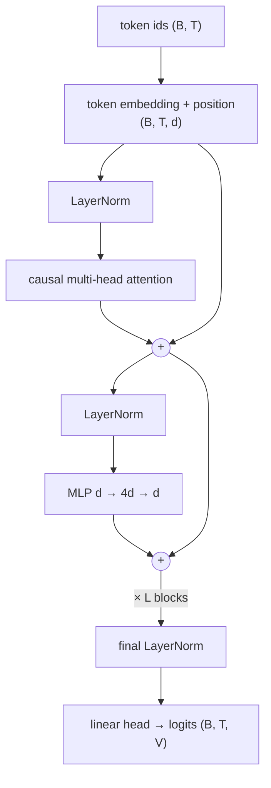

# 08 · Transformers
> **Goal:** be able to write a GPT from a blank file and explain every line. · **Time:** 20–30 h · **Needs:** 05, 07

## Skip test
If you can do ALL of these without notes, skip the module.
- [ ] Write scaled dot-product attention with shapes, and derive why we divide by $\sqrt{d_k}$.
- [ ] Explain causal masking, where the mask goes (before or after the softmax), and why it lets GPT train on $T$ predictions in one pass.
- [ ] Explain multi-head attention: why multiple heads, and the reshapes `(B,T,C) → (B,h,T,C/h)` and back.
- [ ] Draw one pre-norm transformer block and say how it differs from the original 2017 post-norm block.
- [ ] Explain why positional information is needed. Compare sinusoidal, learned, and **RoPE**, and show that RoPE scores depend only on $m-n$.
- [ ] Give the compute and memory complexity of attention in sequence length $T$, and what FlashAttention does and does *not* change.
- [ ] Count the parameters of GPT-2 small ($L=12,\ d=768,\ V=50257,\ T=1024$, tied embeddings) to within 1%.
- [ ] Explain encoder-only (BERT) vs decoder-only (GPT) vs encoder-decoder (T5).

<details><summary>Answers (check yourself after trying)</summary>

- If the components of $\mathbf q,\mathbf k$ are independent with mean 0 and variance 1, then $\operatorname{Var}(\mathbf q\cdot\mathbf k) = \sum_i \operatorname{Var}(q_ik_i) = d_k$. Dividing by $\sqrt{d_k}$ brings the scores back to variance 1, so the softmax isn't pushed into a near-one-hot (tiny-gradient) regime as $d_k$ grows.
- Add $-\infty$ to the scores above the diagonal **before** the softmax. Masking after the softmax leaves rows that don't sum to 1 and leaks future information through the normalization.
- Post-norm (2017): `x = LN(x + Sublayer(x))`. Pre-norm: `x = x + Sublayer(LN(x))`, plus a final LN before the head. Pre-norm keeps a clean identity path in the residual stream, so deep stacks train without careful warmup.
- RoPE: $\langle R_m\mathbf q, R_n\mathbf k\rangle = \mathbf q^\top R_m^\top R_n\mathbf k = \mathbf q^\top R_{n-m}\mathbf k$ because rotations compose and $R_m^\top = R_{-m}$.
- Compute $O(T^2 d)$, score memory $O(T^2)$ per head. FlashAttention is *exact*: it tiles $Q,K,V$ through on-chip SRAM with an online softmax, so memory drops to $O(T)$ and it is much faster (fewer HBM reads/writes), but the FLOPs are still $O(T^2 d)$.
- $12Ld^2 = 84.9$M (blocks) + $Vd = 38.6$M (token embedding, shared with the output head) + $Td = 0.8$M (positions) ≈ 124.3M. Biases and LayerNorms add ~0.1M → 124,439,808 exactly.
</details>

## Core ideas
- **Attention:** $\text{Attention}(Q,K,V) = \text{softmax}\!\left(\frac{QK^\top}{\sqrt{d_k}} + M\right)V$
  - $Q = XW_Q,\ K = XW_K,\ V = XW_V$. Each token *queries* every other token's *keys* and takes a weighted mix of their *values*.
  - **Why $\sqrt{d_k}$:** for independent zero-mean, unit-variance entries, $\mathbf q\cdot\mathbf k$ has variance $d_k$. Dividing keeps the softmax out of its saturated (zero-gradient) regime.
  - **Mask $M$:** $-\infty$ above the diagonal = **causal** (can't see the future). This lets one forward pass train on all $T$ next-token predictions at once.
  - Attention is a **set operation**: permutation-equivariant, with no built-in notion of order.
- **Multi-head:** split $d_{model}$ into $h$ heads of size $d_k = d_{model}/h$. Each head learns a different relation (syntax, coreference, position…). Concatenate, then project with $W_O$. Same parameter count as one big head.
- **Grouped-query attention (GQA):** several query heads share one K/V head (Llama 2 70B, Llama 3, Mistral). Multi-query attention (MQA) is the extreme of one K/V head. Shrinks the KV cache (module 09) with little quality loss.
- **Transformer block (modern pre-norm, GPT-style):**
  ```
  x = x + Attention(LayerNorm(x))
  x = x + MLP(LayerNorm(x))        # MLP: d → 4d → d, GELU (or SwiGLU in Llama-style models)
  ```
  The original 2017 Transformer was **post-norm** (`x = LN(x + Sublayer(x))`). GPT-2 moved to pre-norm, and nearly all LLMs use it (often with RMSNorm).

  **Residual stream view:** every layer *reads from and writes to* a shared residual stream. This is the basis of interpretability work (module 12).
- **Positional encoding:**
  - Sinusoidal (original), learned absolute (GPT-2), **RoPE** (rotates each 2D pair of Q/K dimensions by a position-dependent angle so attention depends on *relative* position; used by Llama, Qwen, Mistral and most modern LLMs). ALiBi (a linear distance penalty on scores) is another relative scheme.
  - 🔭 RoPE is a complex-phase rotation $e^{i m\theta}$: relative phase = relative position.
- **Complexity:** $O(T^2 d)$ compute and $O(T^2)$ memory for the score matrix. Fixes: **FlashAttention** (exact; tiles in fast GPU SRAM and never stores the $T\times T$ matrix, so memory is $O(T)$ though FLOPs stay $O(T^2 d)$), sliding-window/sparse attention, linear attention, and state-space models (module 12).
- **Three families:**
  - **Encoder-only (BERT):** bidirectional, masked-token objective → classification and embeddings.
  - **Decoder-only (GPT):** causal, next-token objective → generation. **Dominant today.**
  - **Encoder-decoder (T5, original Transformer):** the decoder cross-attends to the encoder output → translation and seq2seq.
- **Parameter count (decoder):** ≈ $12\,L\,d^2$ (attention $4d^2$ + MLP $8d^2$ per layer, with a $4d$ MLP; SwiGLU with $d_{ff}\approx\frac83 d$ keeps the same $8d^2$), plus embeddings $V d$ (×2 if the output head isn't tied).
- **Same block everywhere:** text, images (ViT), audio (Whisper), proteins (AlphaFold-style components), actions (robotics). Learn it once and it applies everywhere.


*A pre-norm GPT. The two `+` nodes are the residual stream; each sublayer reads a normalized copy and writes back an update.*

## Interactive
- 🧪 **[Attention & Sampling](interactive/attention.html)**: drag $\mathbf q$ and $\mathbf k$, see what $\sqrt d$ does, and the causal mask.
- 🧪 **[Positional Encodings & RoPE](interactive/positional-encoding.html)**: sinusoidal heatmap, RoPE rotation dials (shift both positions and the score doesn't change), long-range decay vs RoPE base.
- 🧪 **[Transformer Calculator](interactive/llm-calculator.html)**: parameter counts for GPT-2 and Llama 3 configs, with the $12Ld^2$ breakdown.

## Worked example: attention by hand
One query $\mathbf q = (1, 0)$ attends over three tokens with keys $\mathbf k_1=(1,0),\ \mathbf k_2=(0,1),\ \mathbf k_3=(1,1)$ and values equal to the keys. $d_k = 2$.
1. Scores $\mathbf q\cdot\mathbf k_j/\sqrt2 = (0.707,\ 0,\ 0.707)$.
2. Softmax: $e^{0.707} = 2.028$, so weights $= (2.028, 1, 2.028)/5.056 = (0.401,\ 0.198,\ 0.401)$.
3. Output $= 0.401\,\mathbf v_1 + 0.198\,\mathbf v_2 + 0.401\,\mathbf v_3 = (0.802,\ 0.599)$.

If this query sits at position 2 under a causal mask, $\mathbf k_3$ is masked: weights $(0.670, 0.330)$, output $(0.670, 0.330)$.

**Shapes in multi-head attention** (GPT-2 small, $B=4,\ T=1024,\ d=768,\ h=12$):
```
x            (4, 1024, 768)
qkv = x@W    (4, 1024, 2304)  → split → q, k, v each (4, 1024, 768)
view+transpose            q   (4, 12, 1024, 64)
scores q@k^T/8            (4, 12, 1024, 1024)   ← the T² tensor (~50M floats)
softmax(scores+mask) @ v  (4, 12, 1024, 64)
transpose+view            (4, 1024, 768) → @W_O → (4, 1024, 768)
```

## Practice
1. Why is the scaling $\sqrt{d_k}$ and not $d_k$? What would dividing by $d_k$ do for large heads?
2. A model has $d = 4096$, 32 query heads and 8 KV heads. What are the shapes of $W_Q$ and $W_K$? How much smaller is its KV cache than with 32 KV heads?
3. Without positional information, what does a transformer output for the sequences "dog bites man" and "man bites dog" (consider the final token's representation in a non-causal encoder)?
4. Your attention outputs are identical for every position. Name two bugs that could cause it.

<details><summary>Solutions</summary>

1. The standard deviation of $\mathbf q\cdot\mathbf k$ is $\sqrt{d_k}$, so dividing by $\sqrt{d_k}$ normalizes it to 1. Dividing by $d_k$ would shrink the scores toward 0 as $d_k$ grows, making attention nearly uniform (washing out what the model wants to attend to).
2. Head dim $= 4096/32 = 128$. $W_Q$: $4096\times4096$. $W_K$: $4096\times(8\cdot128) = 4096\times1024$. The KV cache is $32/8 = 4\times$ smaller.
3. A bidirectional encoder with no positions is permutation-equivariant, so each token's output is the same in both sentences: "dog" gets the same vector in both, and so on. A pooled (e.g. mean) representation is identical. The model cannot tell who bit whom.
4. (a) Softmax over the wrong dimension (over the batch or head dimension instead of keys), giving uniform-ish weights. (b) A wrong `view` without `transpose` that mixes heads and positions. (c) Scores multiplied by 0 (e.g. the mask applied by multiplication), so softmax is uniform.
</details>

## Learn from
- ⭐ **[Let's build GPT: from scratch, in code, spelled out (Karpathy)](https://www.youtube.com/watch?v=kCc8FmEb1nY)** + **[nanoGPT](https://github.com/karpathy/nanoGPT)** / **[build-nanogpt](https://github.com/karpathy/build-nanogpt)** (the "Let's reproduce GPT-2 (124M)" video).
- ⭐ **[The Illustrated Transformer (Jay Alammar)](https://jalammar.github.io/illustrated-transformer/)**: read before the video.
- **[Attention Is All You Need (2017)](https://arxiv.org/abs/1706.03762)**: read the paper *after* building it. It'll be easy by then.
- **[The Annotated Transformer (Harvard NLP)](https://nlp.seas.harvard.edu/annotated-transformer/)**: the paper line by line in PyTorch.
- **[3Blue1Brown: Transformers & Attention](https://www.3blue1brown.com/topics/neural-networks)** (chapters 5–7): superb visual intuition.
- **[Transformer Explainer (interactive)](https://poloclub.github.io/transformer-explainer/)**: GPT-2 running live in the browser.
- Understanding Deep Learning (Prince) ch. 12.
- Papers for the details: [RoPE (RoFormer)](https://arxiv.org/abs/2104.09864) · [GQA](https://arxiv.org/abs/2305.13245) · [FlashAttention](https://arxiv.org/abs/2205.14135) · [On Layer Normalization in the Transformer (pre- vs post-norm)](https://arxiv.org/abs/2002.04745).

## Build
1. **Single-head attention in NumPy**, checked against `torch.nn.functional.scaled_dot_product_attention`.
2. **nanoGPT from a blank file** on Tiny Shakespeare (char-level). Then add: multi-head, pre-norm, dropout, weight tying, LR warmup + cosine, AdamW.
3. Swap learned positions for **RoPE** and compare validation loss. Try a longer context.
4. Stretch: reproduce **GPT-2 124M** on FineWeb-Edu following build-nanogpt (needs a rented GPU: roughly 1–2 h on 8×A100, or a day-plus on a single GPU).

## Traps
- Mixing up `(B, T, C)` and `(B, heads, T, head_dim)` reshapes/transposes. Write the shapes in comments.
- A causal mask applied *after* the softmax (wrong) instead of before (right).
- Using `float('-inf')` in fp16 and getting `nan` for fully masked rows (e.g. padding). Use a large negative finite number or `scaled_dot_product_attention`'s masks.
- Forgetting the final LayerNorm before the LM head in a pre-norm model.
- Thinking you understand it after watching. Close the video and rebuild from nothing.

## Done when
- [ ] GPT written from a blank file without referencing code · [ ] every skip-test item answered on paper
