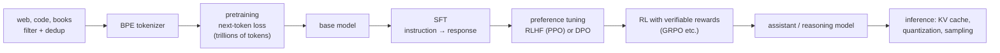

# 09 · Large Language Models
> **Goal:** understand the full LLM pipeline (data → pretraining → post-training → inference → evaluation) and be able to do each step at small scale. · **Time:** 25–40 h · **Needs:** 08

## Skip test
- [ ] Explain how BPE tokenization is trained, and give two LLM quirks it causes.
- [ ] State what **scaling laws** predict, and the Chinchilla rule of thumb (~20 tokens per parameter).
- [ ] Explain the pipeline: pretraining → SFT → preference tuning (RLHF / DPO) → (RL for reasoning).
- [ ] Explain **LoRA** and why it cuts fine-tuning memory.
- [ ] Explain the **KV cache** and why inference is memory-bandwidth-bound.
- [ ] Explain RAG and when to use it instead of fine-tuning.
- [ ] Explain why benchmark scores can mislead (contamination, saturation).
- [ ] Compute the KV-cache size per token for Llama 3 8B ($L=32$, 8 KV heads, head dim 128, bf16) and the Chinchilla-optimal token count for a 1B model.

Answers (check yourself after trying)

- BPE: start from bytes (or characters), count adjacent pairs over the corpus, merge the most frequent into a new token, repeat until the vocabulary size is reached. Quirks: letter counting ("strawberry" is 1–3 tokens, not 10 letters), inconsistent number splits, extra cost for non-English text, `" hello"` ≠ `"hello"`.
- Scaling laws: test loss falls as a smooth power law in parameters $N$, data $D$ and compute $C\approx6ND$. Chinchilla: for a fixed compute budget, scale $N$ and $D$ together, $D\approx20N$.
- LoRA trains only $A\in\mathbb R^{r\times k}$, $B\in\mathbb R^{d\times r}$. The frozen base needs no gradients or optimizer state, so the ~16 bytes/param of AdamW apply only to ~0.1–1% of the weights.
- KV cache: $2 \times 32 \times (8\cdot128) \times 2$ bytes $= 131{,}072$ B = **128 KiB per token**, so 8,192 tokens = 1 GiB per sequence. Chinchilla for 1B: **~20B tokens** (Llama 3 8B was trained on 15T, ~1,900 tokens/param, far past compute-optimal, because inference cost favors small models).
- Contamination (test questions in the training data), saturation (top models all score ~90%+), and prompt/format sensitivity. Build your own eval.

## Core ideas

### Data & tokenization
- **BPE:** start from the 256 byte values (byte-level BPE, GPT-2 onward) or from characters with byte fallback (SentencePiece, Llama 1–2), and repeatedly merge the most frequent adjacent pair → a vocabulary of ~32k–200k tokens (Llama 2: 32k, Llama 3: 128k, GPT-4o: ~200k). A regex **pre-tokenizer** first splits text into word-like chunks so merges don't cross them.
  - Quirks: odd arithmetic (numbers split strangely), letter-counting failures, weaker non-English efficiency, and the space-before-word trick.
- **Pretraining data:** trillions of tokens of web text (filtered, deduplicated), code, books, math. **Data quality > data quantity** (e.g. FineWeb-Edu).

### Pretraining
- Next-token cross-entropy on a decoder-only transformer. **Loss in nats; perplexity** $= e^{\text{loss}}$.
- **Scaling laws** (Kaplan 2020, **Chinchilla** 2022): loss falls as a power law in parameters $N$, data $D$, and compute $C \approx 6ND$ FLOPs. Compute-optimal is about $D \approx 20N$ (modern models train far *past* this, because smaller models are cheaper to serve).
- 🔭 Power laws, universality, and "emergence" debates resemble critical phenomena in statistical physics.
- **Architecture upgrades (Llama-style):** RMSNorm, SwiGLU, RoPE, grouped-query attention (GQA), no biases. **Mixture-of-Experts (MoE):** each token activates only a few expert MLPs, so there are many params but cheap compute per token.
- **Systems:** data/tensor/pipeline parallelism, FSDP/ZeRO, bf16, FlashAttention (see module 12).

### Post-training (turning a base model into an assistant)
1. **SFT (supervised fine-tuning):** train on (instruction, good response) pairs. Mostly teaches *format and behavior*.
2. **Preference tuning:**
   - **RLHF:** train a reward model on human comparisons → optimize the policy with **PPO** plus a KL penalty to the SFT model (see module 11).
   - **DPO:** optimizes preferences directly with a classification-style loss, no separate reward model or RL loop. Simpler, and very common.
   - DPO loss (Rafailov et al. 2023), for a prompt $x$ with preferred answer $y_w$ and rejected $y_l$:
     $\mathcal L = -\log\sigma\!\Big(\beta\log\frac{\pi_\theta(y_w|x)}{\pi_{ref}(y_w|x)} - \beta\log\frac{\pi_\theta(y_l|x)}{\pi_{ref}(y_l|x)}\Big)$. It raises the likelihood of $y_w$ relative to the reference model more than that of $y_l$; $\beta$ plays the role of the KL penalty.
3. **RL for reasoning:** RL with *verifiable rewards* (math answers, unit tests) produces long chain-of-thought "thinking" models. **GRPO** (introduced in DeepSeekMath, 2024; used to train DeepSeek-R1, 2025) samples a group of answers per prompt and uses each answer's reward relative to the group mean as its advantage, so no value network is needed (module 11). **This is the research frontier.**
- **Parameter-efficient fine-tuning:** **LoRA** freezes $W\in\mathbb R^{d\times k}$ and learns $W + \frac{\alpha}{r}BA$ with $B\in\mathbb R^{d\times r}$ (initialized to 0, so training starts exactly at the base model), $A\in\mathbb R^{r\times k}$, rank $r \ll d$ (≈0.1–1% of params). After training, $BA$ can be merged into $W$, so inference costs nothing extra. **QLoRA** = LoRA on a 4-bit-quantized base model, so it can run on a single consumer GPU.

### Inference
- **Autoregressive decoding:** one forward pass per token. The **KV cache** stores past keys and values so each new token costs $O(T)$ attention work instead of recomputing all $T$ positions. Size per token $= 2\cdot L\cdot n_{kv}\cdot d_{head}\cdot$ bytes, which is why GQA (module 08) matters.
- **Prefill vs decode:** processing the prompt (prefill) is one big parallel, compute-bound pass. Generating (decode) reads all weights and the cache for every single token, so at small batch sizes it is memory-bandwidth-bound: tokens/s ≈ bandwidth ÷ bytes read per step.
- It's bottlenecked by **memory bandwidth** (reading the weights + cache each token), not FLOPs. Hence **quantization** (int8/int4), **speculative decoding**, batching (vLLM, PagedAttention).
- **Sampling:** temperature, top-k, top-p (nucleus). Low $T$ = deterministic, high $T$ = creative.

### Using & extending LLMs
- **Prompting:** few-shot examples, chain-of-thought, structured outputs.
- **RAG:** retrieve relevant documents (embeddings + vector search) and put them in the context. Use it for *knowledge*; use fine-tuning for *behavior/style*.
- **Agents & tool use:** the LLM calls functions/tools in a loop (code execution, search).
- **Evaluation:** perplexity; benchmarks (MMLU, GSM8K, HumanEval, SWE-bench…); LLM-as-judge; **always build your own task-specific eval**. Watch for test-set contamination.
- **Safety & alignment:** jailbreaks, reward hacking, honesty, interpretability (module 12). This is a serious open problem worth caring about.

*The modern LLM pipeline. Each stage starts from the previous checkpoint.*

## Interactive
- 🧪 **[BPE Tokenizer Lab](interactive/bpe-lab.html)**: train BPE merge by merge on your own text, then encode new strings and see the strawberry/number/language quirks.
- 🧪 **[Transformer Calculator](interactive/llm-calculator.html)**: parameters, $6ND$ compute, Chinchilla data, training memory, KV cache and bandwidth-bound decode speed for GPT-2 and Llama 3 configs.
- [Attention & Sampling](interactive/attention.html): temperature, top-k, top-p.
- ✅ [Architectures → RL Quiz](interactive/advanced-quiz.html): auto-graded questions for modules 06–11 with explanations; filter by this module.

## Worked example: budgeting a small pretraining run
You want a compute-optimal model for a budget of $C = 10^{20}$ FLOPs.
1. $C = 6ND$ and $D = 20N$ ⇒ $C = 120N^2$ ⇒ $N = \sqrt{10^{20}/120} \approx 9.1\times10^{8}$ ≈ 0.9B parameters, $D \approx 18$B tokens.
2. On 8 H100s (989 TFLOP/s bf16 dense each) at 40% MFU: $10^{20} / (8 \times 9.89\times10^{14} \times 0.4) \approx 3.2\times10^4$ s ≈ 9 hours.
3. Training memory ≈ 16 bytes/param ≈ 15 GB, which fits on one 80 GB GPU (plus activations). Data parallelism over 8 GPUs then just multiplies throughput.
4. Serving it in bf16: 1.8 GB of weights; on one H100 (3.35 TB/s) batch-1 decoding is bounded by ≈ 3.35e12 / 1.8e9 ≈ 1,800 tokens/s.

## Practice
1. Perplexity is 20 on a validation set. What is the loss in nats? In bits per token?
2. A LoRA adapter with $r = 16$ is applied to $W_Q$ and $W_V$ ($4096\times4096$ each) in all 32 layers of Llama 2 7B (no GQA, so both are square). How many trainable parameters?
3. Why does doubling the batch size during decoding nearly double throughput (tokens/s) at first, but not forever?
4. You fine-tuned a model on your company's docs. It now talks fluently about your new product but invents its price. Fine-tune more, or use RAG? Why?

Solutions

1. Loss $= \ln 20 \approx 3.00$ nats $= \log_2 20 \approx 4.32$ bits per token.
2. Per matrix $r(d+k) = 16\cdot8192 = 131{,}072$. × 2 matrices × 32 layers = **8,388,608** ≈ 8.4M (≈0.12% of 6.7B).
3. Each decode step reads all weights once regardless of batch, so more sequences per step reuse the same bytes: throughput grows ~linearly while memory-bound. Eventually the step becomes compute-bound (arithmetic intensity passes the GPU's ridge point) or the KV caches fill GPU memory.
4. RAG. Facts that change or must be exact belong in retrieved context, which can be updated and cited. Fine-tuning shapes behavior and style and is unreliable for injecting facts (it encourages confident hallucination of nearby facts).

## Learn from
- ⭐ **[Stanford CS336: Language Modeling from Scratch](https://cs336.stanford.edu/)**: lectures + assignments (tokenizer, transformer, systems, scaling, data, alignment). The deepest modern course. Do it after nanoGPT.
- ⭐ **Karpathy:** [Let's build the GPT Tokenizer](https://www.youtube.com/watch?v=zduSFxRajkE) · [Deep Dive into LLMs like ChatGPT](https://www.youtube.com/watch?v=7xTGNNLPyMI) · [nanochat](https://github.com/karpathy/nanochat) (a full ChatGPT-style pipeline, from tokenizer through SFT/RL to a web UI, in one small repo).
- **[Hugging Face LLM Course](https://huggingface.co/learn/llm-course)**: the `transformers`, `datasets`, and PEFT ecosystem in practice.
- **Build a Large Language Model (From Scratch)**, Sebastian Raschka (book + [repo](https://github.com/rasbt/LLMs-from-scratch)).
- **[The Smol Training Playbook (HF)](https://huggingface.co/spaces/HuggingFaceTB/smol-training-playbook)** and **[The Ultra-Scale Playbook](https://huggingface.co/spaces/nanotron/ultrascale-playbook)**: how real LLMs get trained.
- Key papers (in order): GPT-2 → GPT-3 → Scaling Laws → Chinchilla → InstructGPT → LoRA → Llama → DPO → DeepSeek-R1. Links in [resources.md](resources.md#paper-reading-order).
- Stay current: [Sebastian Raschka's newsletter](https://magazine.sebastianraschka.com/), [Lilian Weng's blog](https://lilianweng.github.io/).

## Build
1. **BPE tokenizer from scratch** (train, encode, decode). Match GPT-2's tokenizer (`tiktoken`) output.
2. **Fine-tune with LoRA** a small open model (~0.5–3B, e.g. Qwen/Llama/SmolLM) on a custom instruction dataset in Colab. Evaluate before and after on your own eval set.
3. **DPO** on a small preference dataset with Hugging Face `trl`. Compare outputs with the SFT model.
4. **RAG app:** embed your own notes (e.g. this repo!), retrieve, answer questions with citations.
5. Stretch: implement a **KV cache** in your nanoGPT and measure the tokens/sec speedup. Run **nanochat** end to end.

## Traps
- Fine-tuning to add *knowledge* (use RAG) instead of *behavior*.
- Fine-tuning a chat model without its **chat template** (special tokens around roles). The model then sees a format it never learned.
- Comparing perplexities across different tokenizers. Loss per token depends on what a token is; compare bits per byte instead.
- Trusting public benchmarks over your own evals.
- Chasing every new model release. Fundamentals change slowly, so read papers selectively.

## Done when
- [ ] Tokenizer matches tiktoken · [ ] LoRA fine-tune shows a measurable gain on your eval · [ ] you can explain the whole ChatGPT pipeline end to end
