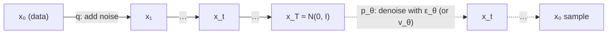

# 10 · Generative Models
> **Goal:** learn the four big ideas for modeling $p(x)$: autoregressive, VAE, GAN, diffusion/flow. · **Time:** 25–35 h · **Needs:** 01, 05

🔭 This module is where physics pays off most: diffusion is Langevin dynamics, score matching is about gradients of log-densities, flow matching moves probability mass by ODEs (continuity equation), and energy-based models are Boltzmann distributions.

## Skip test
- [ ] Derive the **ELBO**: $\log p(x) \ge \mathbb E_{q(z|x)}[\log p(x|z)] - D_{KL}(q(z|x)\,\|\,p(z))$.
- [ ] Explain the **reparameterization trick** and why it's needed.
- [ ] Write the GAN min-max objective. Explain mode collapse.
- [ ] Describe the DDPM forward process $q(x_t\mid x_0)$ in closed form, and what the network predicts.
- [ ] Explain classifier-free guidance.
- [ ] Explain the idea of flow matching / rectified flow in one paragraph.
- [ ] Write the closed-form KL between $\mathcal N(\mu,\sigma^2)$ and $\mathcal N(0,1)$, and the exact relation between the noise prediction $\epsilon_\theta$ and the score $\nabla_x\log p_t(x)$.

Answers (check yourself after trying)

- ELBO: $\log p(x) = \log\mathbb E_{q(z|x)}\big[\tfrac{p(x,z)}{q(z|x)}\big] \ge \mathbb E_q\big[\log\tfrac{p(x|z)p(z)}{q(z|x)}\big]$ by Jensen, which splits into reconstruction − KL. The gap is exactly $D_{KL}(q(z|x)\,\|\,p(z|x))$.
- Reparameterization: write $z = \mu_\phi(x) + \sigma_\phi(x)\odot\epsilon$ with $\epsilon\sim\mathcal N(0,I)$ independent of $\phi$, so $\nabla_\phi\mathbb E[f(z)] = \mathbb E[\nabla_\phi f(\mu+\sigma\epsilon)]$: a low-variance pathwise gradient through the sample.
- GAN: $\min_G\max_D \mathbb E_x[\log D(x)] + \mathbb E_z[\log(1-D(G(z)))]$. Mode collapse: $G$ maps many $z$ to a few outputs that fool $D$, ignoring other modes.
- $q(x_t|x_0) = \mathcal N(\sqrt{\bar\alpha_t}x_0, (1-\bar\alpha_t)I)$ with $\bar\alpha_t = \prod_{s\le t}(1-\beta_s)$. The network predicts the added noise $\epsilon$ (equivalently $x_0$, the score, or the velocity).
- CFG: train one network with the condition randomly dropped (~10–20%), then extrapolate $\hat\epsilon = \epsilon_{uncond} + s(\epsilon_{cond}-\epsilon_{uncond})$ with $s>1$: sharper, more on-prompt, less diverse samples.
- Flow matching: pick a path from noise to data (straight line), regress a network onto the path's velocity, then integrate the ODE with a few steps.
- $D_{KL} = \tfrac12(\mu^2 + \sigma^2 - 1 - \log\sigma^2)$. $\nabla_x\log p_t(x) = -\,\mathbb E[\epsilon\mid x_t=x]/\sqrt{1-\bar\alpha_t} \approx -\epsilon_\theta(x,t)/\sqrt{1-\bar\alpha_t}$.

## Core ideas

### The landscape
| Family | Idea | Pros | Cons | Used in |
|---|---|---|---|---|
| **Autoregressive** | $p(x)=\prod p(x_t\mid x_{<t})$ | exact likelihood, simple | slow sequential sampling | GPT, audio LMs |
| **VAE** | latent $z$, maximize ELBO | fast, smooth latent space | blurry samples | latent space for Stable Diffusion |
| **GAN** | generator vs discriminator game | sharp, fast sampling | unstable, mode collapse | StyleGAN, super-resolution |
| **Diffusion / flow** | learn to reverse a noising process | top quality, stable training | many sampling steps | Stable Diffusion, image/video/audio models |

### Autoencoders & VAEs
- **Autoencoder:** encoder → bottleneck $z$ → decoder, trained to reconstruct. It compresses, but it isn't a generative model.
- **VAE:** encoder outputs $q_\phi(z\mid x) = \mathcal N(\mu,\sigma^2)$, prior $p(z)=\mathcal N(0,I)$.
  - Loss = −ELBO = reconstruction + KL. **Reparameterize** $z = \mu + \sigma\odot\epsilon,\ \epsilon\sim\mathcal N(0,I)$ so gradients flow through the sampling step.
  - 🔭 The ELBO is the (negative) **variational free energy** from statistical mechanics.

### GANs
- $\min_G\max_D\ \mathbb E[\log D(x)] + \mathbb E[\log(1 - D(G(z)))]$, a two-player game.
- Problems: unstable training, **mode collapse**. Fixes: WGAN (Wasserstein distance), spectral norm, StyleGAN tricks. Mostly displaced by diffusion, but the ideas live on (adversarial losses in VAE decoders, distillation).

### Diffusion models (DDPM)
- **Forward:** gradually add Gaussian noise, $q(x_t\mid x_0) = \mathcal N(\sqrt{\bar\alpha_t}\,x_0,\ (1-\bar\alpha_t)I)$. So $x_t = \sqrt{\bar\alpha_t}\,x_0 + \sqrt{1-\bar\alpha_t}\,\epsilon$.
- **Train:** a network $\epsilon_\theta(x_t, t)$ predicts the noise. Loss $\|\epsilon - \epsilon_\theta(x_t,t)\|^2$ with $t$ uniform. **Literally an MSE regression.** (Ho et al. 2020 call this the "simple" loss: a reweighted ELBO that gives better samples than the exact ELBO weighting.)
- **Sample:** start from pure noise and denoise step by step.
- **Score view:** $\nabla_x \log p_t(x) \approx -\epsilon_\theta(x,t)/\sqrt{1-\bar\alpha_t}$ (the **score**; this is Tweedie's formula, and it's exact for the optimal $\epsilon_\theta$). Sampling = **Langevin dynamics** / a reverse-time SDE (Song et al.). 🔭 Fokker–Planck, Brownian motion.
- **Speedups:** DDIM (deterministic ODE sampling, fewer steps), consistency models, distillation.
- **Conditioning:** text via cross-attention (CLIP/T5 embeddings). **Classifier-free guidance:** $\hat\epsilon = \epsilon_{uncond} + s(\epsilon_{cond} - \epsilon_{uncond})$, where $s$ is the `guidance_scale` in `diffusers` (typically 3–8 for images). Ho & Salimans (2022) write the same thing as $(1+w)\epsilon_{cond} - w\,\epsilon_{uncond}$, so $s = 1+w$; check which convention a paper uses.
- **Latent diffusion (Stable Diffusion):** diffuse in a VAE's latent space → much cheaper. Backbone: U-Net → **Diffusion Transformer (DiT)** in modern models.

### Flow matching / rectified flow (current state of the art)
- Learn a velocity field $v_\theta(x,t)$ whose ODE $\dot x = v_\theta$ carries noise to data along (nearly) straight paths. With $x_0$ = noise and $x_1$ = data, interpolate linearly $x_t = (1-t)x_0 + t x_1$ and regress $v_\theta(x_t,t)$ onto $x_1 - x_0$. That's again a plain MSE.
- Why it works: the per-sample target $x_1 - x_0$ is noisy, but its regression optimum is the conditional expectation $v^*(x,t) = \mathbb E[x_1-x_0\mid x_t=x]$, whose ODE provably transports noise to the data distribution.
- **Convention warning:** Stable Diffusion 3's rectified flow runs the other way ($t=0$ is data, $t=1$ is noise). Same idea, flipped sign of $v$.
- 🔭 A continuity equation $\partial_t p + \nabla\cdot(p v) = 0$ is transporting probability mass. Used in Stable Diffusion 3, Flux, and many video models.

### Also know
- **Normalizing flows:** invertible maps with exact likelihood via the change of variables $\log p(x) = \log p(z) + \log|\det \partial z/\partial x|$.
- **Energy-based models:** $p(x) \propto e^{-E(x)}$ (🔭 Boltzmann). Hard to normalize, sampled with MCMC.

*Forward process is fixed and has a closed form at any $t$; only the reverse needs a network.*

## Interactive
- 🧪 **[Diffusion & Flow Lab](interactive/diffusion-lab.html)**: 2D data with an *exact* score, so you can compare DDPM, DDIM and flow-matching samplers at 1–200 steps, watch the forward process and the score field, and push classifier-free guidance to see the diversity trade-off.
- ✅ [Architectures → RL Quiz](interactive/advanced-quiz.html): auto-graded questions for modules 06–11 with explanations; filter by this module.

## Worked example: one DDPM training step by hand
Linear schedule ($\beta_1=10^{-4}\to\beta_{1000}=0.02$). At $t=250$, $\bar\alpha_t\approx0.524$, so $\sqrt{\bar\alpha_t}\approx0.724$ and $\sqrt{1-\bar\alpha_t}\approx0.690$.
1. Take a data point $x_0 = (2, 0)$ and draw $\epsilon = (0.5, -1)$.
2. $x_t = 0.724\,(2,0) + 0.690\,(0.5,-1) = (1.793,\ -0.690)$.
3. The network sees $(x_t, t=250)$ and outputs, say, $\epsilon_\theta = (0.4, -0.8)$. Loss $= 0.1^2 + 0.2^2 = 0.05$.
4. Its implied clean-image guess is $\hat x_0 = (x_t - 0.690\,\epsilon_\theta)/0.724 = (2.10, -0.19)$: noise prediction and denoising are the same thing.

## Practice
1. A VAE encoder outputs $\mu = 1,\ \sigma = 0.5$ for one latent dimension. What is its KL term against $\mathcal N(0,1)$?
2. At which $\bar\alpha_t$ is the signal-to-noise ratio of $x_t$ exactly 1? Roughly what $t$ is that for the linear schedule? (Use the lab.)
3. Why does DDPM need ~1000 steps in the original paper while flow matching or DDIM can work with 20–50?
4. You raise the CFG scale from 4 to 15. What happens to the images, and why?

Solutions

1. $\tfrac12(1 + 0.25 - 1 - \ln 0.25) = \tfrac12(0.25 + 1.386) \approx 0.818$ nats.
2. SNR $= \bar\alpha/(1-\bar\alpha) = 1$ ⇒ $\bar\alpha = 0.5$; for the linear schedule that is around $t \approx 260$.
3. Ancestral DDPM sampling is a discretized SDE that injects fresh noise each step, so each step must be small to stay accurate. DDIM and flow matching integrate a deterministic ODE that higher-order or straighter-path solvers handle with far fewer steps (and distillation/consistency models go to 1–4 steps).
4. Over-saturated colors, exaggerated features, and much less diversity: the extrapolation pushes samples beyond the conditional distribution toward the regions where the conditional/unconditional ratio is largest, and off the data manifold.

## Learn from
- ⭐ **[Understanding Deep Learning (Prince)](https://udlbook.github.io/udlbook/)** ch. 14–18 (unsupervised, GANs, flows, VAEs, diffusion). The clearest unified treatment, with notebooks.
- ⭐ **[MIT 6.S184: Introduction to Flow Matching and Diffusion Models](https://diffusion.csail.mit.edu/)**: lecture notes + labs. Built on SDEs/ODEs, perfect for a physics mind.
- **Lilian Weng:** [What are Diffusion Models?](https://lilianweng.github.io/posts/2021-07-11-diffusion-models/) · [From Autoencoder to Beta-VAE](https://lilianweng.github.io/posts/2018-08-12-vae/) · [From GAN to WGAN](https://lilianweng.github.io/posts/2017-08-20-gan/).
- **[Yang Song: Generative Modeling by Estimating Gradients of the Data Distribution](https://yang-song.net/blog/2021/score/)**: the score/SDE view.
- **[Hugging Face Diffusion Models Course](https://github.com/huggingface/diffusion-models-class)** + the `diffusers` library.
- Papers: [VAE](https://arxiv.org/abs/1312.6114) · [GAN](https://arxiv.org/abs/1406.2661) · [DDPM](https://arxiv.org/abs/2006.11239) · [Score SDE](https://arxiv.org/abs/2011.13456) · [Latent Diffusion](https://arxiv.org/abs/2112.10752) · [CFG](https://arxiv.org/abs/2207.12598) · [DiT](https://arxiv.org/abs/2212.09748) · [Flow Matching](https://arxiv.org/abs/2210.02747).

## Build
1. **VAE on MNIST:** visualize the 2D latent space and interpolate between digits.
2. **DCGAN** on a small image dataset. Observe instabilities and mode collapse.
3. **DDPM from scratch** (small U-Net) on MNIST/Fashion-MNIST, then add **class conditioning + classifier-free guidance**.
4. **Flow matching on 2D toy data** (e.g. moons → spiral), then on MNIST. Compare sampling steps with DDPM.
5. Stretch: fine-tune Stable Diffusion with LoRA/DreamBooth on your own images using `diffusers`.

## Traps
- Off-by-one or mismatched timestep conventions between the training noise schedule and the sampler (and $t$ in $[0,1]$ vs $\{1,\dots,1000\}$).
- Evaluating generative models only by eye. Use FID (images) or held-out likelihood, and compare at equal sampling steps (NFE).
- Calling a VAE with blurry samples "broken": the Gaussian decoder's MSE term averages over plausible outputs. That's why latent diffusion uses a VAE only as a compressor with adversarial + perceptual losses.
- Forgetting EMA weights: diffusion models are usually sampled from an exponential moving average of the parameters, which looks much better than the raw weights.

## Done when
- [ ] ELBO derived on paper · [ ] your DDPM generates recognizable digits · [ ] you can explain diffusion in both the noise-prediction and the score/SDE views
