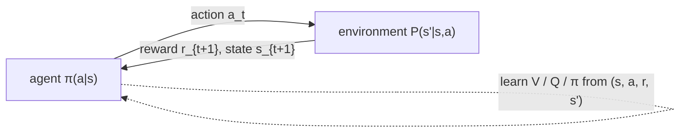

# 11 · Reinforcement Learning
> **Goal:** learn the core ideas of RL, deep RL algorithms, and RL's role in modern LLMs. · **Time:** 25–35 h · **Needs:** 01, 05

## Skip test
- [ ] Define an MDP $(S, A, P, R, \gamma)$, return, policy, $V^\pi$, $Q^\pi$.
- [ ] Write the Bellman expectation and optimality equations.
- [ ] Explain exploration vs exploitation and ε-greedy.
- [ ] Explain Q-learning's update, and what DQN adds (replay buffer, target network).
- [ ] Derive the policy gradient $\nabla J = \mathbb E[\nabla\log\pi_\theta(a|s)\,A(s,a)]$. Explain why baselines reduce variance.
- [ ] Explain PPO's clipped objective, and how RLHF/GRPO use it for LLMs.
- [ ] Do one Q-learning update by hand: $Q(s,a)=0.5$, $r=1$, $\gamma=0.9$, $\max_{a'}Q(s',a')=2$, $\alpha=0.1$.

Answers (check yourself after trying)

- $V^\pi(s) = \mathbb E_\pi[G_t\mid S_t=s]$, $Q^\pi(s,a) = \mathbb E_\pi[G_t\mid S_t=s, A_t=a]$, with $G_t=\sum_{k\ge0}\gamma^k r_{t+k+1}$.
- Expectation: $V^\pi(s) = \sum_a\pi(a|s)\sum_{s',r}p(s',r|s,a)[r+\gamma V^\pi(s')]$. Optimality: $V^*(s) = \max_a\sum_{s',r}p(s',r|s,a)[r+\gamma V^*(s')]$.
- Q-learning: $Q(s,a) \leftarrow Q(s,a) + \alpha[r + \gamma\max_{a'}Q(s',a') - Q(s,a)]$. DQN adds a replay buffer (breaks correlations, reuses data) and a slowly updated target network (stops the target from chasing itself).
- Policy gradient: $\nabla_\theta J = \mathbb E[\sum_t \nabla_\theta\log\pi_\theta(a_t|s_t)\,\Psi_t]$ with $\Psi_t$ = return, $Q$, or advantage. Subtracting a state-dependent baseline $b(s)$ leaves it unbiased because $\mathbb E_a[\nabla\log\pi(a|s)]\,b(s) = b(s)\nabla\sum_a\pi(a|s) = 0$, and it lowers the variance.
- PPO: maximize $\mathbb E[\min(\rho_t A_t,\ \text{clip}(\rho_t,1-\epsilon,1+\epsilon)A_t)]$ with $\rho_t=\pi_\theta(a_t|s_t)/\pi_{old}(a_t|s_t)$, so one batch can be reused for several epochs without the policy moving too far.
- Target $= 1 + 0.9\cdot2 = 2.8$; TD error $= 2.3$; new $Q = 0.5 + 0.1\cdot2.3 = 0.73$.

## Core ideas
- **Setup:** an agent observes state $s$, takes action $a$, gets reward $r$ and next state $s'$. Goal: maximize the expected **return** $G_t = \sum_{k\ge0} \gamma^k r_{t+k+1}$ (Sutton & Barto indexing: the reward for the step from $t$ arrives as $r_{t+1}$).
- **Value functions:** $V^\pi(s) = \mathbb E_\pi[G_t\mid s]$, $Q^\pi(s,a) = \mathbb E_\pi[G_t\mid s,a]$. **Advantage** $A = Q - V$.
- **Bellman equation:** $Q^*(s,a) = \mathbb E[r + \gamma\max_{a'}Q^*(s',a')]$. A recursive consistency condition. 🔭 Analogous to the principle of optimality / Hamilton–Jacobi–Bellman.
- **Dynamic programming** (known model): value iteration, policy iteration.
- **Model-free, value-based:**
  - **TD learning:** bootstrap from your own estimate, $V(s) \leftarrow V(s) + \alpha[r + \gamma V(s') - V(s)]$.
  - **Q-learning:** off-policy TD on $Q$. **DQN** (Atari, 2013/15) = Q-learning + a neural net + **replay buffer** + **target network**.
- **Policy-based:**
  - **REINFORCE / policy gradient:** increase the log-probability of actions with high advantage. Unbiased but high-variance → subtract a **baseline** $V(s)$.
  - **Actor-critic:** the actor = policy, the critic = value estimate. **GAE** for advantage estimation.
  - **PPO:** maximize $\mathbb E\big[\min(\rho_t A_t,\ \text{clip}(\rho_t, 1-\epsilon, 1+\epsilon)A_t)\big]$ with ratio $\rho_t = \pi_\theta(a_t|s_t)/\pi_{old}(a_t|s_t)$, $\epsilon\approx0.2$. The `min` removes any incentive to move the ratio outside the clip range, so several epochs on one batch stay stable. **The workhorse algorithm.**
  - **SAC:** max-entropy RL for continuous control. 🔭 Free-energy / temperature again.
- **Model-based RL:** learn a world model and plan with it (MuZero, Dreamer). **AlphaGo/AlphaZero** = MCTS + policy/value nets + self-play.
- **RL ↔ LLMs:**
  - **RLHF:** reward = a learned human-preference model. PPO + KL penalty to stay close to the SFT model.
  - **RL with verifiable rewards:** reward = a correct math answer or passing unit tests. **GRPO** (DeepSeekMath, 2024) drops the critic: sample $G$ answers per prompt, and give answer $i$ the advantage $A_i = (r_i - \text{mean}(r))/\text{std}(r)$, then apply a PPO-style clipped update with a KL penalty. This is what produced DeepSeek-R1-style "reasoning" models.
  - Risk: **reward hacking**. The policy exploits flaws in the reward.
- **Why RL is hard:** sparse/delayed rewards, credit assignment, non-stationary data, high variance, and extreme sensitivity to hyperparameters and seeds.

*The agent–environment loop. Model-based methods also learn or are given $P$; model-free methods only see samples.*

## Interactive
- 🧪 **[Gridworld RL](interactive/gridworld-rl.html)**: edit a stochastic gridworld, run value iteration sweep by sweep (watch the Bellman residual contract by γ), then train Q-learning with ε-greedy and compare the learned policy and its learning curve.

## Worked example: value iteration on a 3-state chain
States A → B → C (terminal). From A or B the only action moves right; entering C gives reward +1, other steps give 0. $\gamma = 0.9$. Start with $V = 0$.
- Sweep 1: $V(B) = 1 + 0.9\cdot0 = 1$, $V(A) = 0 + 0.9\cdot V_{old}(B) = 0$.
- Sweep 2: $V(B) = 1$, $V(A) = 0.9\cdot1 = 0.9$. Converged: $V(A) = \gamma$, $V(B) = 1$.

Information flows backward one step per sweep. Now add a second action at A, "stay", with reward 0.1: $Q(A,\text{stay}) = 0.1 + 0.9\,V(A)$. At the fixed point $V(A) = \max(0.9,\ 0.1 + 0.9V(A))$; staying forever is worth $0.1/(1-0.9) = 1 > 0.9$, so the optimal policy loops and never reaches the goal. Reward design matters, and $\gamma$ changes the answer (with $\gamma = 0.5$: stay $= 0.2$ < go $= 0.5$).

## Practice
1. With $\gamma = 0.99$ and reward $-1$ per step until the goal, what is the value of a state 10 steps from the goal? What does $1/(1-\gamma)$ tell you about the "horizon"?
2. Why is Q-learning *off-policy* while SARSA is *on-policy*? Which one learns the risky shortest path along a cliff edge in CliffWalking with ε-greedy exploration?
3. REINFORCE on CartPole learns, but its learning curve is very noisy. Name two changes that reduce variance.
4. In GRPO, all 8 sampled answers to a prompt get reward 0. What advantages do they get, and what does the model learn from that prompt?

Solutions

1. $-\sum_{k=0}^{9}0.99^k = -(1-0.99^{10})/0.01 \approx -9.56$. $1/(1-\gamma) = 100$ is the effective horizon: rewards much further away than ~100 steps barely count.
2. Q-learning's target uses $\max_{a'}Q(s',a')$ (the greedy policy), not the action the behavior policy will take; SARSA uses the actual next action $a'$. Q-learning learns the cliff-edge path (optimal for the greedy policy) and falls off often while exploring; SARSA learns the safer path, accounting for its own exploration.
3. Subtract a learned baseline $V(s)$ (actor-critic / advantages, e.g. GAE), use reward-to-go instead of the full return, normalize advantages per batch, and use larger batches.
4. Mean 0 and std 0, so all advantages are 0 (implementations add a small ε to the std): no gradient. Prompts that are too hard (or too easy, all 1) carry no learning signal, which is why curricula filter for prompts with mixed outcomes.

## Learn from
- ⭐ **[Sutton & Barto: Reinforcement Learning, an Introduction (2nd ed.)](http://incompleteideas.net/book/the-book-2nd.html)**: free. Ch. 1–6, 9, 13. *The* foundational text.
- ⭐ **[OpenAI Spinning Up in Deep RL](https://spinningup.openai.com/)**: the bridge to deep RL. Read "Introduction to RL" parts 1–3, then the algorithm docs.
- **[David Silver's RL course (UCL/DeepMind)](https://www.davidsilver.uk/teaching/)**: classic lectures that pair with Sutton & Barto.
- **[Hugging Face Deep RL Course](https://huggingface.co/learn/deep-rl-course)**: hands-on and free.
- **[CleanRL](https://github.com/vwxyzjn/cleanrl)**: single-file, readable implementations to study. **[Gymnasium](https://gymnasium.farama.org/)** for environments.
- **[The 37 Implementation Details of PPO](https://iclr-blog-track.github.io/2022/03/25/ppo-implementation-details/)**: why your PPO doesn't work.
- Advanced: [UC Berkeley CS285 (Sergey Levine)](https://rail.eecs.berkeley.edu/deeprlcourse/).

## Build
1. **Tabular Q-learning** on FrozenLake / CliffWalking. Visualize the value function.
2. **DQN** on CartPole (then Atari Pong if you have a GPU).
3. **REINFORCE → actor-critic → PPO** on CartPole/LunarLander, each written by you and compared against CleanRL.
4. Stretch: a **GRPO-style** RL fine-tune of a tiny LM on arithmetic problems with a verifiable reward (`trl` has a `GRPOTrainer`).
5. 🔭 Fun: train an agent on a physics environment (MuJoCo via Gymnasium: Hopper, Ant).

## Traps
- Off-by-one in the return: bootstrapping from a **terminal** state ($V(\text{terminal})$ must be 0), or treating a time-limit truncation as a true terminal (Gymnasium separates `terminated` and `truncated` for this reason).
- Comparing algorithms on one seed. RL results vary wildly between seeds: use 5+ and report confidence intervals.
- Forgetting that the policy gradient needs *on-policy* data: reusing old trajectories without importance ratios (that's what PPO's ratio is for).
- Rewards on very different scales: normalize or clip them, or the value function struggles.

## Done when
- [ ] Your PPO solves LunarLander · [ ] you can explain how RL is used to post-train LLMs
