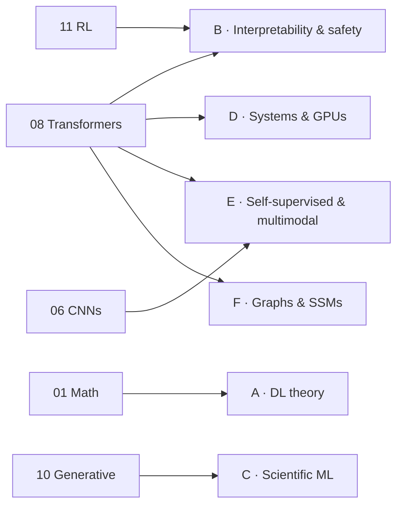

# 12 · Advanced Frontiers & Specializations
> **Goal:** move from *student* to *researcher/engineer*: read papers, go deep in one area. · **Time:** open-ended · **Needs:** 08 (+ 10/11 for some tracks)

There's no skip test here. Pick **1–2 tracks** that excite you and go deep, and treat the rest as awareness. Each track lists the core ideas and the ⭐ entry point.

---

## How to read papers (do this first)
- **Three passes** (Keshav, ["How to Read a Paper"](https://www.cs.princeton.edu/courses/archive/fall10/cos597B/papers/howtoread-keshav.pdf)): (1) title/abstract/figures/conclusion, 10 min → (2) the main method, skipping proofs, 1 h → (3) re-derive and re-implement it.
- **Reimplement > reread.** The best way to understand a paper is to reproduce its key result at small scale.
- Find papers and code: [arXiv](https://arxiv.org/) (cs.LG, cs.CL, cs.CV), [Hugging Face Papers](https://huggingface.co/papers) (daily trending, with linked code), [alphaXiv](https://www.alphaxiv.org/) (discussion), and authors' blogs.
- Keep a **paper log** in `progress.md`: one line per paper (problem → idea → result → my doubt).

---

*Which earlier modules each track builds on. Pick tracks whose prerequisites you already enjoy.*

## Track A · Deep learning theory 🔭 (great fit for a math/physics mind)
- **Optimization landscape:** saddle points, flat vs sharp minima, edge of stability (GD with step size η drives the sharpness λ_max up to ≈ 2/η and hovers there; see the [Optimizer Landscape](interactive/gradient-descent.html) tool).
- **Generalization puzzles:** over-parameterized nets fit random labels yet generalize; **double descent**; **grokking**; implicit bias of SGD.
- **Infinite-width limits:** **Neural Tangent Kernel (NTK)** (lazy regime ↔ kernel regression) vs **μP / mean-field** (feature learning). μP also lets you transfer hyperparameters across model sizes.
- **Scaling laws** and statistical-physics approaches to learning.
- ⭐ **[Understanding Deep Learning (Prince)](https://udlbook.github.io/udlbook/)** ch. 20 ("Why does deep learning work?") → **[The Principles of Deep Learning Theory (Roberts, Yaida & Hanin)](https://arxiv.org/abs/2106.10165)** (literally effective field theory for neural nets; written by physicists).
- Also: [Deep Learning, Bishop & Bishop (2024)](https://www.bishopbook.com/), [Telgarsky's Deep Learning Theory notes](https://mjt.cs.illinois.edu/dlt/).

## Track B · Mechanistic interpretability & AI safety
- Reverse-engineer *how* networks compute: **circuits**, **induction heads**, **superposition** (more features than neurons), **sparse autoencoders (SAEs)** to extract interpretable features, attribution graphs.
- Safety: alignment, reward hacking, scalable oversight, evals for dangerous capabilities.
- ⭐ **[ARENA curriculum](https://www.arena.education/)** (hands-on, free notebooks) + **[TransformerLens](https://github.com/TransformerLensOrg/TransformerLens)**.
- Read: [Transformer Circuits Thread](https://transformer-circuits.pub/) (A Mathematical Framework, Toy Models of Superposition, Scaling Monosemanticity), [Neel Nanda's getting-started guide](https://www.neelnanda.io/mechanistic-interpretability/getting-started), [BlueDot Impact courses](https://bluedot.org/).

## Track C · Scientific ML & physics-informed DL 🔭
- **PINNs:** put the PDE residual in the loss. **Neural operators** (FNO, DeepONet): learn maps between function spaces.
- **Equivariant networks:** build symmetries (rotation, translation, permutation) into the architecture → molecules, particle physics. **Geometric deep learning.**
- **Neural ODEs**, Hamiltonian/Lagrangian neural networks (energy-conserving by construction).
- Applications: AlphaFold (proteins), weather (GraphCast), ML for particle physics and cosmology, molecular dynamics potentials.
- ⭐ **[Geometric Deep Learning (Bronstein et al.)](https://geometricdeeplearning.com/)** (book + lectures) and **[Steve Brunton's Physics-Informed ML lectures (YouTube)](https://www.youtube.com/@Eigensteve)**. Also [DeepXDE](https://github.com/lululxvi/deepxde) for PINNs.

## Track D · ML systems, GPUs & efficiency 💻 (where your C++ shines)
- **GPU fundamentals:** SMs, warps, memory hierarchy (HBM → L2 → shared memory/SRAM → registers), memory-bound vs compute-bound, **roofline model**, arithmetic intensity.
- **Kernels:** write CUDA (C++) and **Triton** (Python) kernels: tiled matmul, softmax, fused ops, FlashAttention.
- **Distributed training:** data parallel (DDP), FSDP/ZeRO, tensor and pipeline parallelism. Communication collectives (all-reduce).
- **Efficiency:** quantization (int8/int4, GPTQ/AWQ), pruning, distillation, speculative decoding, `torch.compile`.
- ⭐ **[Programming Massively Parallel Processors (Hwu, Kirk, El Hajj)](https://www.elsevier.com/books/programming-massively-parallel-processors/hwu/978-0-323-91231-0)** + the **[GPU MODE](https://github.com/gpu-mode/lectures)** lecture series & Discord.
- Also: [How to Scale Your Model (Google DeepMind, JAX/TPU book)](https://jax-ml.github.io/scaling-book/), [Triton tutorials](https://triton-lang.org/main/getting-started/tutorials/index.html), [Horace He: Making Deep Learning Go Brrrr](https://horace.io/brrr_intro.html), [The Ultra-Scale Playbook](https://huggingface.co/spaces/nanotron/ultrascale-playbook), [llm.c (Karpathy, GPT-2 in raw C/CUDA)](https://github.com/karpathy/llm.c).

## Track E · Self-supervised, multimodal & representation learning
- **Contrastive learning:** SimCLR, MoCo. InfoNCE loss pulls positives together and pushes negatives apart.
- **Masked modeling:** BERT (text), MAE (images). **Self-distillation:** DINO/DINOv2. **JEPA** (predict in latent space).
- **Multimodal:** CLIP (image–text contrastive), vision-language models (LLaVA-style: vision encoder + projector + LLM), audio (Whisper), video.
- ⭐ **[Lilian Weng: Contrastive Representation Learning](https://lilianweng.github.io/posts/2021-05-31-contrastive/)** + the [CLIP paper](https://arxiv.org/abs/2103.00020). Course: [CMU Multimodal ML (11-777)](https://cmu-mmml.github.io/).

## Track F · Graphs & beyond-transformer architectures
- **GNNs:** message passing $\mathbf h_v' = \phi(\mathbf h_v, \textstyle\bigoplus_{u\in N(v)}\psi(\mathbf h_u))$. GCN, GAT, graph transformers. Used for molecules, social networks, physics simulation.
- **State-space models:** S4 → **Mamba** (selective SSM, linear-time sequence modeling). Hybrids with attention. 🔭 Discretized linear ODEs.
- ⭐ **[Stanford CS224W: ML with Graphs](https://web.stanford.edu/class/cs224w/)** + **[PyTorch Geometric](https://pytorch-geometric.readthedocs.io/)**. For SSMs: [The Annotated S4](https://srush.github.io/annotated-s4/), the [Mamba paper](https://arxiv.org/abs/2312.00752).

## Track G · Other frameworks worth knowing
- **JAX** (functional NumPy + `grad`/`jit`/`vmap`/`pmap`). Popular in research and on TPUs. Try it once you know PyTorch well: [JAX docs](https://docs.jax.dev/).

---

## Becoming a contributor (high-school senior edition)
- **Portfolio:** 3–5 polished GitHub projects with READMEs and results (e.g. GPT from scratch, a DDPM, a paper reproduction). These count more than certificates.
- **Competitions:** the **[International Olympiad in AI (IOAI)](https://ioai-official.org/)** is a science olympiad *for high-school students* (first held in 2024; IOAI 2026 drew teams from 100+ countries, and Singapore hosts 2027), so check whether your country runs a national selection. Its contest tasks are hands-on ML problems solved in notebooks (training, fine-tuning and analyzing models), which modules 03–10 prepare you for. Also [Kaggle](https://www.kaggle.com/) and [AIcrowd](https://www.aicrowd.com/).
- **Write:** blog your reimplementations. Teaching forces understanding (the Feynman technique).
- **Community:** EleutherAI, GPU MODE, and Hugging Face Discords. Open-source contributions (docs, bug fixes) to `transformers`, `diffusers`, `TransformerLens`.
- **Research programs for students:** look for summer research programs at universities, MATS / ARENA (safety), and reaching out to grad students with a concrete reproduction you've done.
