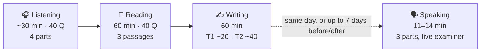

# 01 · Test Strategy & Scoring
> **Goal:** know exactly what is graded so you practice the right things. · **Time:** ~2 h

👉 Play with the numbers: [Band calculator](interactive/band-calculator.html) (raw → band, rounding visualizer, "what do I need?")

## Skip test
If you can do ALL of these without notes, skip the module. Answers are in the folds.
- [ ] Name the 4 Writing criteria and the 4 Speaking criteria.
- [ ] Your four bands are L 7.5, R 7.0, W 6.5, S 6.0. What is your overall band? And for L 7.0, R 6.5, W 6.0, S 6.0?
- [ ] Which writing task carries more weight, and what does the official descriptor say a Task 1 response needs for band 7 that a band 6 lacks?
- [ ] What is IELTS One Skill Retake, which test mode is it for, and how long after the full test can you use it?

Answers

- **Writing:** Task Achievement (T1) / Task Response (T2) · Coherence & Cohesion · Lexical Resource · Grammatical Range & Accuracy. **Speaking:** Fluency & Coherence · Lexical Resource · Grammatical Range & Accuracy · Pronunciation. Each is 25% of its skill.
- (7.5 + 7 + 6.5 + 6) / 4 = **6.75 → 7.0**. (7 + 6.5 + 6 + 6) / 4 = 6.375 → **6.5**.
- **Task 2** carries more weight. A band 7 Task 1 "presents a **clear overview**" with main trends/differences identified; band 6 only has "a relevant overview is **attempted**".
- Retaking a single skill (L, R, W or S) once per full test, **within 60 days**, only if your full test was **IELTS on computer** at a centre offering it, and only useful if your target university accepts it.

## The test day at a glance

- **Listening, Reading, Writing** are taken back to back, with no breaks. **Speaking** can be on the same day or up to a week before or after (face-to-face, or by video call with a live examiner).
- **Test modes:** *IELTS on computer* (results usually in **1–2 days**) or *on paper* (only at some centres; the British Council no longer offers paper IELTS). The content and difficulty are the same. Do your mocks in the mode you will take.
- **Listening transfer time:** on paper you get extra time at the end to copy answers onto the answer sheet; on computer you type answers as you go and get a short review period instead. Reading has **no** transfer time in either mode.

## How the scores are calculated
**Listening and Reading:** 1 mark per question, raw /40 → band. The exact cut-offs vary slightly by test version (each is equated for difficulty). Official averages ([ielts.org](https://ielts.org/organisations/ielts-for-organisations/ielts-scoring-in-detail)):

| Band | Listening | Academic Reading |
|---|---|---|
| 5 | 16/40 | 15/40 |
| 6 | 23/40 | 23/40 |
| **7** | **30/40** | **30/40** |
| 8 | 35/40 | 35/40 |

**Writing:** each task gets a band from 4 equally weighted criteria. Officially, "Task 2 carries more weight in marking than Task 1". The exact formula is not published (it is commonly estimated as about 2 : 1). So **a weak Task 2 hurts more than a weak Task 1**: give it 40 of your 60 minutes.

**Overall band** = the average of the four skill bands, rounded to the nearest half band. In practice: an average ending in **.25 rounds up** to .5, one ending in **.75 rounds up** to the next whole band, and anything else rounds to the nearest half (6.125 → 6.0, 6.375 → 6.5, 6.625 → 6.5, 6.875 → 7.0).

Worked example: is it worth pushing Speaking from 6.0 to 6.5?

L 7.0 · R 7.5 · W 6.5 · S 6.0 → average 6.75 → **7.0**.
L 7.0 · R 7.0 · W 6.5 · S 6.0 → average 6.625 → **6.5**.
One raw Reading mark (e.g. 32 vs 33/40) can be the difference between 6.5 and 7.0 overall. But if your university also needs **"no band below 6.5"**, Speaking 6.0 fails it either way, so fixing Speaking is the real priority. Always check *both* the overall and the per-skill minimum.

## What examiners grade
Read the official public band descriptors (links in [resources](resources.md); the Writing descriptors were revised in **May 2023**). Everything in modules 04–06 follows from them.

**Writing** (each criterion is 25% of the task):
| Criterion | Band 7 in plain words | Typical band-6 gap |
|---|---|---|
| Task Achievement (T1) / Task Response (T2) | covers every part of the task. T1: a **clear overview**, data sensibly grouped, main trends/differences identified. T2: a **clear and developed position**, main ideas extended and supported | T1: overview only "attempted", details irrelevant or inaccurate. T2: position present but conclusions unclear or repetitive |
| Coherence & Cohesion | logical organization, clear progression, a **range** of linking devices (some over/under-use allowed), paragraphing used effectively | mechanical or faulty linking, paragraphs without a clear central idea |
| Lexical Resource | enough range for flexibility and precision, some **less common vocabulary**, awareness of style and **collocation**, only occasional errors | adequate range but frequent errors in word choice/spelling |
| Grammatical Range & Accuracy | a **variety of complex structures** with some flexibility, grammar and punctuation generally well controlled, **error-free sentences are frequent** | complex structures attempted but less accurate |

**Speaking** (each 25%): Fluency & Coherence · Lexical Resource · Grammatical Range & Accuracy · Pronunciation.
Band 7 = speaks at length without noticeable effort or loss of coherence, uses some less common and idiomatic vocabulary, produces frequent error-free sentences, and is easy to understand throughout.

## General strategy
- **Accuracy beats ambition.** A simple sentence with no errors is better than a complex sentence that breaks. Band 7 needs *frequent error-free* sentences.
- **Answer the question asked.** Off-topic content caps Task Response no matter how good the English is.
- **Never memorize whole answers.** The descriptors explicitly penalize memorized language and formulaic chunks, and a fully memorized answer can score band 0. Words copied from the prompt are not counted. Memorize *structures* and *collocations* instead.
- **Fix the cheapest half band first.** Usually that's your weakest skill, especially if it is below your university's per-skill minimum.
- **One Skill Retake:** if your full test was IELTS on computer, some centres let you retake **one** skill **once**, within **60 days**. Results come in 3–5 days. **Not every university accepts it**, so check before relying on it ([ielts.org](https://ielts.org/organisations/ielts-for-organisations/verifying-ielts-results/one-skill-retake)).

## Traps
- "Task 2 is exactly double" → not officially stated; just treat it as the bigger task.
- Assuming 30/40 is always band 7 → it is an *average* cut-off; one version may need 29, another 31.
- Looking only at the overall band → many universities also set a minimum for each skill (e.g. "7.0 overall, no band below 6.5").

## Done when
- [ ] You know your target overall band **and** per-skill minimum for every university on your list (write them in [progress.md](progress.md)).
- [ ] You can do the rounding in your head.
