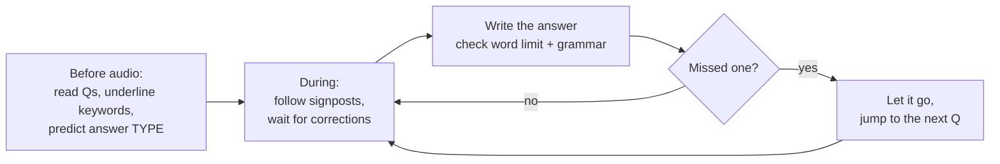

# 02 · Listening
> **Goal:** ≥ 30/40 consistently (band 7), 32+ for 7.5. · **Time:** 1–2 weeks, then maintenance

👉 Drill it: [Listening drills](interactive/listening-drills.html) (numbers & spelling dictation, distractor detector, word-limit judge)

## Skip test
Skip the module if **all** of these are true:
- [ ] Your last two full Listening practice tests (recent Cambridge books, under real conditions) were **≥ 31/40**.
- [ ] You lost **0** marks to spelling, plurals, or word limits in those tests.
- [ ] Without notes: is *"north-west entrance"* acceptable for "NO MORE THAN TWO WORDS"? Is *"equipments"* acceptable? What does "double three, oh" mean?

Answers

*north-west entrance* = 2 words (a hyphenated word counts as one) ✓ · *equipments* ✗ (uncountable; marked as wrong) · "double three, oh" = **330**.

## The format
**~30 minutes, 40 questions (10 per part), the audio plays once.** Difficulty rises from Part 1 to Part 4. On paper you get extra time at the end to transfer answers; on computer you type as you go and get a short review period instead, so **don't plan to "tidy up later" on computer**.

| Part | Situation | Typical tasks | What usually goes wrong |
|---|---|---|---|
| 1 | Conversation, everyday social (booking, enquiry) | form / note completion | spelling of names, numbers, dates |
| 2 | Monologue, everyday (tour, radio, induction talk) | maps / plans, MCQ, matching | losing your place on the map |
| 3 | Conversation, education/training (up to 4 speakers: students + tutor) | MCQ, matching opinions | speakers agree/disagree and change their minds |
| 4 | Monologue, academic lecture | note / summary completion (often one word) | speed, academic vocabulary, no break in the middle |

## Core techniques
- **Predict before listening:** use the reading time to underline keywords, and predict the *type* of answer (number? noun? plural? a name to be spelled?) and the grammar of the gap.
- **Follow the signposts:** "however", "actually", "but then", "the main reason", "finally". Answers often follow a correction.
- **Distractors:** speakers often say a wrong answer first and then correct it ("Tuesday… no, sorry, Thursday"). In Part 3, one student suggests something and the other rejects it. Wait for the final, agreed answer.
- **Paraphrase:** the question rarely uses the same words as the audio ("cheap" ↔ "won't cost much"). Train your ear for synonyms.
- **Spelling and word limits count:** "NO MORE THAN TWO WORDS" means a 3-word answer is wrong, even if it contains the right words. Hyphenated words count as one word; numbers can be written as digits. Practice spelling *accommodation, environment, necessary, government, equipment* and the months/days.
- **Numbers:** *fifTEEN* (stress at the end) vs *FIFty* (stress at the start); "oh" = 0; "double four" = 44.
- **Don't get stuck:** if you miss one, move on immediately or you lose the next three.
- **Maps:** orient yourself first (where is "you are here"/the entrance, which way is north), then follow the speaker's route: *opposite, next to, on your left, at the far end, just past*.

Worked example: a Part 3 distractor

**Question:** Which topic do the students choose for their presentation? A) urban farming B) water recycling C) solar roofs

> *Student 1:* What about solar roofs? There's loads of data.
> *Student 2:* Too much, maybe. Everyone did that last year. Water recycling's more original.
> *Student 1:* True, but we'd struggle to find local examples. Urban farming, though, there's that project by the station…
> *Student 2:* Oh, good point. Let's go with that.

**Answer: A.** All three options are mentioned (that's normal). B is proposed and rejected, C is rejected first. The answer is the one both speakers **agree** on at the end ("Let's go with that").

## Practice routine
1. Do one section under test conditions (one play only).
2. Mark it. For **every** error, listen again with the transcript and label the cause: *spelling / word limit / distractor / missed paraphrase / lost place / vocabulary*.
3. Log the causes in [progress.md](progress.md). Fix the most frequent one first (the [drills](interactive/listening-drills.html) target the first three).
4. Daily ear training: 15 min of podcasts/lectures at natural speed (BBC *6 Minute English* → TED talks → university lectures). Include non-British accents: IELTS uses a range.

## Traps
- Writing an answer that is *true* but isn't the one asked about (e.g. the old price instead of the new one).
- Changing a correct answer during transfer because you "hear it again" in your head. Trust the first final answer.
- Forgetting the plural *-s*, or writing the article inside a tight word limit.

## Learn from
- ⭐ **Cambridge IELTS Academic** books (official practice tests; the newest volumes are IELTS 20 (2025) and IELTS 21 (2026)) 💲. Use the newest first; the recordings and transcripts are the gold standard.
- **[IELTS official sample test questions (Academic)](https://ielts.org/take-a-test/preparation-resources/sample-test-questions/academic-test)** and the free **[IELTS trial test](https://ielts.org/take-a-test/preparation-resources/ielts-trial-test)**.
- **[British Council: free IELTS practice tests](https://takeielts.britishcouncil.org/take-ielts/prepare/free-ielts-english-practice-tests/listening)** (also the free IELTS Ready course).

## Done when
- [ ] Two consecutive full Listening tests at ≥ 30/40 (≥ 32 for a 7.5 target).
- [ ] Zero "silly" errors (spelling, plural, word limit) in the last test.
