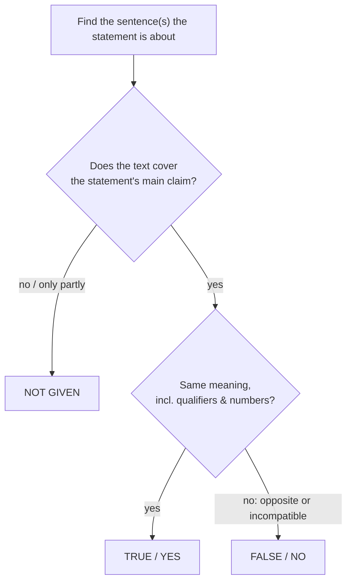

# 03 · Reading (Academic)
> **Goal:** ≥ 30/40 (band 7), 33+ for 7.5. · **Time:** 2 weeks, then maintenance

👉 Practise: [Reading lab](interactive/reading-lab.html) (T/F/NG, Y/N/NG and matching headings with the evidence highlighted)

## Skip test
Skip the module if **all** of these are true:
- [ ] Your last two full Academic Reading tests (recent Cambridge books, 60 min, no extra time) were **≥ 31/40**, and you finished with time to spare.
- [ ] You can explain, with an example, the difference between **False** and **Not Given**.
- [ ] Text: *"Some farmers report that beavers have flooded fields."* Statement: *"Most farmers dislike beavers."* What's the answer and why?

Answer

**Not Given.** "Some" farmers report flooding; nothing says what *most* farmers think. It isn't False either, because the text doesn't say most farmers *like* beavers. Qualifier traps (some/most/all/only) are the #1 source of T/F/NG errors.

## Format
3 long passages (from journals, books, magazines and newspapers; about **2,150–2,750 words in total**), 40 questions, **60 minutes, with no extra transfer time** (on paper, you write answers on the answer sheet within the 60 minutes). Passages get harder, so aim for roughly **17 / 20 / 23 min**.

## Question types & tactics
| Type | Tactic |
|---|---|
| **True / False / Not Given** (facts) · **Yes / No / Not Given** (writer's views) | **False/No** = the text contradicts it. **Not Given** = the text doesn't say enough to decide. Don't use outside knowledge. Watch qualifiers: *all/some/most/always/usually/only/first*. Answers come in text order. |
| **Matching headings** | Read the headings first. Skim each paragraph's first and last sentences for its *main idea*, not a detail. Do it before the detail questions. |
| **Matching information** (which paragraph contains…) | Not in order and hardest. Do it **last**, after you know the text. A paragraph can be used more than once. |
| **Sentence / summary / note completion** | Respect the word limit, and copy words exactly as spelled in the text. Answers usually come in text order. Check the grammar of the gap (noun? plural?). |
| **Multiple choice** | Find the relevant part, then eliminate. The correct option is usually a *paraphrase*, while wrong options often reuse words from the text. |
| **Diagram labelling / short answer** | Scan for keywords and numbers. |

### The T/F/NG decision tree

Worked example: the three answers from one sentence

Text: *"The dams also trap sediment, although researchers have not yet measured how much."*
- "Beaver dams hold back sediment." → **True** (paraphrase: trap ↔ hold back).
- "Beaver dams let all sediment pass through." → **False** (contradicts "trap").
- "Beaver dams trap more sediment than concrete weirs." → **Not Given** (no comparison anywhere, and the amount is explicitly unknown).

## Core techniques
- **Skim** (2–3 min per passage): get the topic and the paragraph structure. **Scan**: hunt for names, numbers, capitals and keywords.
- **Paraphrase awareness:** "decline" ↔ "fall", "a growing number of" ↔ "increasingly", "not until" ↔ "only after". The question rarely repeats the text's words.
- **Time discipline:** never spend > 2 min on one question. Guess, mark it, and return. There is **no penalty for wrong answers**, so never leave a blank.
- **Read widely daily** (academic register): *The Economist*, *Scientific American*, *New Scientist*, *The Conversation*. Your physics/math reading counts if it's in English!

## Practice routine
- Do one passage a day under time pressure. For each error, find the exact sentence that gives the answer, and write why you chose wrong (qualifier? paraphrase? outside knowledge? time?). Log it in [progress.md](progress.md).

## Traps
- Choosing False when the text simply doesn't mention it (→ Not Given).
- Choosing Not Given when the text says something *incompatible* in different words (→ False).
- Matching a heading because it shares a word with the paragraph. Headings match the *main idea*.
- Copying a word with a different form or spelling from the text in completion tasks.

## Learn from
- ⭐ **Cambridge IELTS Academic** books 💲 (IELTS 20 and 21 are the newest) + **[official sample questions](https://ielts.org/take-a-test/preparation-resources/sample-test-questions/academic-test)**.
- **[IELTS Liz: Reading tips](https://ieltsliz.com/ielts-reading-tips-strategies-and-comprehension/)** (free lessons per question type, e.g. [True/False/Not Given](https://ieltsliz.com/true-false-not-given-ielts-reading-practice/)).

## Done when
- [ ] Two consecutive full Reading tests at ≥ 30/40 (≥ 33 for 7.5) inside 60 minutes.
- [ ] ≥ 90% on the [Reading lab](interactive/reading-lab.html) T/F/NG sets with every answer justified by a quoted sentence.
