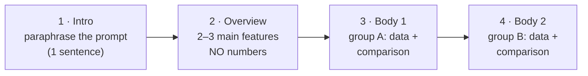

# 04 · Writing Task 1 (Academic)
> **Goal:** a reliable band 7 report in 20 minutes. · **Time:** 1–2 weeks

👉 Tools: [Task 1 trend lab](interactive/task1-trend-lab.html) (drag a chart, see the right trend language, spot valid overviews) · [Writing practice](interactive/writing-practice.html) (timed prompts + word count)

## Skip test
Skip the module if **all** of these are true:
- [ ] Your last two Task 1 reports, marked by a teacher against the public descriptors, scored **7+** on Task Achievement.
- [ ] Without notes, you can write an overview of the chart below in 2 sentences with **no numbers**, and you can describe 32%, 49% and 76% with fraction phrases.
- [ ] You know what to change in your language for a **process** diagram and for a **map**.

| % of adults who cycle weekly | 2005 | 2015 | 2025 |
|---|---|---|---|
| City X | 12 | 25 | 41 |
| City Y | 30 | 29 | 31 |

Model answers

*Overall, cycling became far more common in City X, whereas it remained almost unchanged in City Y. As a result, City X, which had the lower rate at the start of the period, had overtaken City Y by the end.*
32% = just under a third · 49% = just under half · 76% = just over three quarters.
Process → **passive** + sequencers (*is collected, is then heated…*); map → **past passive** of change verbs (*was demolished, was converted into*) and location language (*to the north of*).

## The task
Describe visual information (line/bar/pie chart, table, process, map, or a mix) in **at least 150 words** in **~20 min**. Report what is there: **no opinions, and no causes you invent**. Task 1 counts for less than Task 2, so don't let it eat into Task 2's 40 minutes.

What the official descriptors reward on Task Achievement (Academic):
- **Band 7:** a **clear overview**, data **appropriately categorised**, main trends or differences identified, key features covered (could be more fully extended).
- **Band 6:** a relevant overview is only **attempted**; some details may be irrelevant, inappropriate or inaccurate.
- So the overview is the single biggest lever on Task Achievement, and under-length answers rarely cover the key features well enough for band 6+. Words copied from the prompt are not counted.

## The 4-paragraph structure

1. **Introduction (1 sentence):** paraphrase the prompt. *"The line graph illustrates how … changed between 2000 and 2020."*
2. **Overview (2 sentences): the most important paragraph.** The 2–3 biggest trends or differences, **no specific numbers**. *"Overall, X rose steadily, whereas Y declined. X was the highest throughout."* Some writers put it at the end; it works either place, but at the start you can't run out of time before writing it.
3. **Body 1:** details + data for the first group of features.
4. **Body 2:** details + data for the second group, with **comparisons**.

**Grouping is the skill.** Before writing, decide your two groups: e.g. *the two rising series / the two falling ones*, *before 2010 / after 2010*, *the largest categories / the smallest*. Grouping is what the descriptor calls "appropriately categorised".

## Language toolkit
- **Trends:** rise / increase / grow / climb · fall / decrease / decline / drop · fluctuate · remain stable / level off · peak at · hit a low of. (See the [trend lab](interactive/task1-trend-lab.html): match the word to the *size* of the change.)
- **Degree:** dramatically, sharply, significantly · steadily, gradually · slightly, marginally.
- **Two patterns:** *"X rose sharply"* (verb + adverb) ↔ *"There was a sharp rise in X"* (adjective + noun). Alternate them.
- **Comparison:** *twice as high as*, *considerably more than*, *the largest share*, *by contrast*, *whereas*, *while*.
- **Approximation:** *just under a third*, *roughly half*, *approximately 40%*.
- **Percent vs percentage point:** a rise from 20% to 30% is **10 percentage points**, or a **50% increase**. Don't mix them up.
- **Processes:** the passive voice + sequencers. *"First, the beans are harvested. After that, they are dried…"* Count the stages and say so in the overview (*"…a six-stage process, beginning with … and ending with …"*).
- **Maps:** *was demolished / replaced by / converted into / extended to the north*; overview = the most striking overall change (*"the area became far more residential"*).

Worked example: a band-7-style answer to the skip-test table (≈ 165 words)

The table compares the proportion of adults who cycled at least once a week in two cities, X and Y, in 2005, 2015 and 2025.

Overall, cycling became far more common in City X, whereas it remained almost unchanged in City Y. As a result, City X, which had the lower rate at the start of the period, had overtaken City Y by the end.

In 2005, just 12% of adults in City X cycled weekly, less than half the figure for City Y. Over the following decade, this proportion roughly doubled to a quarter, and it then rose even more sharply, reaching 41% in 2025, over three times its original level.

City Y, by contrast, showed remarkable stability. Its rate was 30% in 2005, dipped marginally to 29% ten years later and recovered slightly to 31% by 2025. Consequently, although City Y's figure was 18 percentage points higher than City X's at the start, it was 10 points lower by the final year.

*Why it works:* clear overview with no numbers, two logical groups, comparisons in both body paragraphs, varied trend language, accurate data.

## Traps
- Listing every number with no grouping or comparison ("mechanical" description).
- Missing the overview, or filling it with numbers.
- Giving reasons or opinions (*"because people became more environmentally aware"*).
- Copying phrases from the prompt (paraphrase!); writing under 150 words.
- Wrong tense: past for past dates, future forms (*is projected/expected to*) for projections.

## Learn from
- ⭐ **[IELTS Liz: Writing Task 1](https://ieltsliz.com/category/ielts-writing-task-1/)** (free model answers for every chart type).
- **Cambridge IELTS** books' model answers with examiner comments 💲.
- The official **[Writing band descriptors](https://ielts.org/cdn/ielts-downloadable-assets/ielts-guidance-and-support/ielts-guides/ielts-writing-band-descriptors.pdf)** (May 2023 version).

## Done when
- [ ] 3 reports in a row with a clear overview, in ≤ 20 minutes, ≥ 150 words.
- [ ] One report of each type: line, bar, table, pie, process, map.
