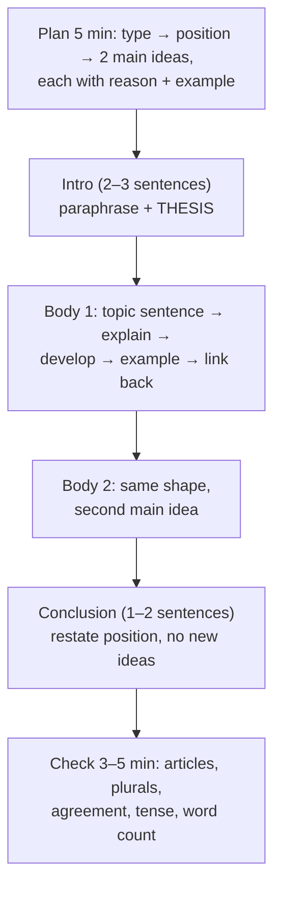

# 05 · Writing Task 2
> **Goal:** band 7+ essays in 40 minutes. Task 2 carries **more weight** than Task 1. · **Time:** 2–3 weeks, then 2 essays/week

👉 Tools: [Essay builder](interactive/essay-builder.html) (identify the type, pick the thesis, order a body paragraph) · [Writing practice](interactive/writing-practice.html) (timed prompts + word count + checklist)

## Skip test
Skip the module if **all** of these are true:
- [ ] Your last two essays, marked by a teacher against the public descriptors, scored **7+** on all four criteria, written in ≤ 40 minutes.
- [ ] For each prompt below, you can name the essay type and write a one-sentence thesis that answers **every** part in under 2 minutes:
  1. *"Many people now get their news from social media. Why is this happening? What effects might it have on society?"*
  2. *"Some say governments should pay for all medical treatment; others say individuals should pay. Discuss both views and give your opinion."*

Model answers

1. **Two-part.** *"People increasingly turn to social media for news because it is free, instant and personalised, but I would argue that the overall effect on society is harmful, as it rewards sensational stories over accurate ones."* (answers the *why* AND the *effects*)
2. **Discussion.** *"While some argue that individuals should bear the cost of their own care, I believe the state should fund essential treatment, since illness is rarely a matter of choice."* (both views + a clear personal view)

## Essay types (identify the type first!)
| Type | Prompt signal | What you must do |
|---|---|---|
| **Opinion** | "To what extent do you agree or disagree?" | A clear position in the intro, kept consistent to the end (partial agreement is fine if it is clear) |
| **Discussion** | "Discuss both views and give your own opinion." | Both sides + **your** view |
| **Advantages / disadvantages** | "Do the advantages outweigh the disadvantages?" | Both, plus a verdict on which one outweighs |
| **Problem / solution** (or cause / solution) | "What are the problems… What can be done?" | Answer **both** questions |
| **Two-part / direct questions** | Two separate questions | Answer each one explicitly |

## What band 7 means for Task Response
From the official descriptors (May 2023): band 7 addresses **the main parts of the prompt**, presents **a clear and developed position**, and **extends and supports** main ideas (perhaps with some over-generalisation). Band 6: a relevant position is presented, but the conclusions may be **unclear, unjustified or repetitive**, and some ideas are insufficiently developed. So the jump from 6 to 7 is mostly about **clarity of position + depth of development**, not vocabulary.

## Structure (4–5 paragraphs, ~270–300 words)

1. **Intro (2–3 sentences):** paraphrase the topic + **thesis** (your position / what the essay will do).
2. **Body 1 and Body 2:** a **topic sentence** → explanation → **example** (specific, realistic) → link back to the question. *One main idea per paragraph, developed deeply*, beats three shallow ideas. Practise the order in the [essay builder](interactive/essay-builder.html).
3. **Conclusion (1–2 sentences):** restate the position. No new ideas.

## Planning (5 min, the step that decides your band)
- Underline the topic + the task words. Decide your position.
- Write 2 main ideas, each with its explanation and example.
- Check: does every paragraph answer *this* question, including the specific angle (e.g. *compulsory*, *mainly*, *governments*)?

Worked example: from prompt to body paragraph

**Prompt:** *"Unpaid community service should be a compulsory part of high school programmes. To what extent do you agree or disagree?"*

**Plan (≈ 4 min):**
- Position: *partly agree* — worthwhile, but compulsion should be limited to a small number of hours with student choice.
- Idea 1 (agree): builds skills & empathy → e.g. students tutoring younger children learn communication + responsibility.
- Idea 2 (limit): forced, long programmes breed resentment and take time from exam study → keep it short and let students choose the cause.

**Body paragraph 1:**
> *The strongest argument for compulsory community service is that it develops skills that classrooms rarely teach. When teenagers help in their local community, they must communicate with people of different ages and backgrounds and take responsibility for real outcomes. These experiences build empathy and confidence, qualities employers increasingly value. For example, a student who spends a few hours a week tutoring younger children learns to explain ideas patiently and to keep commitments. For this reason, I believe some service should be a required part of school life.*

Topic sentence ✓ · explanation ✓ · development ✓ · specific example ✓ · link to the position ✓ · reference words (*These experiences*, *For this reason*) for cohesion ✓.

## Band 7 moves
- **Position throughout:** the same view in the intro, the body topic sentences, and the conclusion.
- **Extend ideas:** *"This is because…"*, *"As a result…"*, *"For instance, in countries such as…"*.
- **Cohesion without overuse:** vary the linkers, and use reference words (*this trend*, *such policies*). Not every sentence needs a linker.
- **Less common vocabulary used precisely:** *exacerbate*, *mitigate*, *a deterrent*, *disproportionately*. Collocations matter more than rare words.
- **Complex grammar, accurately:** conditionals, relative clauses, concessive clauses (*Although…*), passives, nominalization, and frequent error-free sentences.

## Common topics (build idea banks)
Education · technology · environment · health · work · globalization · government spending · crime · media · cities · science & research (your strong area!).

## Traps
- Memorized template intros ("In this modern era…", "This essay will discuss…"). The descriptors penalise memorised, formulaic language, and copied prompt words aren't counted.
- Answering a nearby question (e.g. writing about *volunteering* when the task is about making it *compulsory*).
- Sitting on the fence in an opinion essay, or forgetting your opinion in a discussion essay.
- Under 250 words, or no paragraphing. Spending 50 min on Task 2 and rushing Task 1.

## Learn from
- ⭐ **[IELTS Liz: Writing Task 2](https://ieltsliz.com/ielts-writing-task-2/)** + **[IELTS Advantage (Chris Pell)](https://www.ieltsadvantage.com/)** essay guides.
- ⭐ **Feedback:** have a teacher or a strong English user mark your essays against the [official descriptors](https://ielts.org/cdn/ielts-downloadable-assets/ielts-guidance-and-support/ielts-guides/ielts-writing-band-descriptors.pdf). Without feedback, writing improves slowly.
- **Cambridge IELTS** model essays with examiner comments 💲.

## Done when
- [ ] 6 essays (at least one of each type) written in ≤ 40 min, each with a thesis that answers every part.
- [ ] A marker rates two consecutive essays at 7+ on Task Response.
