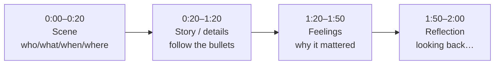

# 06 · Speaking
> **Goal:** band 7: speak at length, naturally, with flexible vocabulary. · **Time:** 15 min/day, 2–3 weeks focused

👉 Tools: [Speaking practice](interactive/speaking-practice.html) (random questions, timers with a Part 2 story guide, recording) · [Answer upgrader](interactive/answer-upgrader.html) (spot and build band-7 answers)

## Skip test
Skip the module if **all** of these are true:
- [ ] A teacher or experienced examiner-style partner rated your last full mock at **7+**.
- [ ] You can talk on any random Part 2 card for the **full 2 minutes** without long pauses (check with a recording).
- [ ] Listening back to a recording, you hear **no** repeated basic errors (tense, *he/she*, plurals) and you don't reuse the same 3–4 linkers.

## The 3 parts (11–14 minutes, a live examiner, face-to-face or by video call)
| Part | Time | What happens | How to answer |
|---|---|---|---|
| **1** | 4–5 min | Familiar topics (home, studies, hobbies…) | 2–3 sentences: **answer → reason → example/detail**. Don't give one-word answers, and don't give speeches. |
| **2** | 3–4 min: 1 min prep + 1–2 min talk | A cue card ("Describe a time when…"), with paper and pencil for notes | Speak until the examiner stops you (2 min). Use the prep minute to jot 4–5 keywords, not sentences. |
| **3** | 4–5 min | Abstract discussion linked to Part 2 | **Opinion → reason → example → (other side / future)**. Talk about society in general, not only you. |

## What band 7 means (official public descriptors, in plain words)
| Criterion | Band 7 | Typical band-6 gap |
|---|---|---|
| Fluency & Coherence | speaks **at length without noticeable effort** or loss of coherence; some language-related hesitation, repetition or self-correction is OK; uses a range of connectives flexibly | willing to speak at length but loses coherence at times; overuses some connectives |
| Lexical Resource | flexible vocabulary on many topics; **some less common and idiomatic vocabulary**, awareness of style and collocation (some inappropriate choices allowed); paraphrases effectively | enough vocabulary to discuss topics at length but less precise |
| Grammatical Range & Accuracy | a range of complex structures used with some flexibility; **frequent error-free sentences**, some errors remain | mix of simple and complex forms, but errors are more frequent |
| Pronunciation | all band-6 features + some (not all) band-8 features: **easy to understand throughout**, accent has minimal effect, flexible intonation and stress | generally understood, some mispronunciation reduces clarity at times |

## Part 2 structure (works for any cue card)

1. **Set the scene:** what/who/when/where (≈20 s).
2. **The story/details:** what happened, following the bullet points (≈60 s).
3. **Feelings & reflection:** why it mattered, how you feel now (≈30 s).
4. **Fillers you can always add:** a comparison ("Compared with…"), a hypothetical ("If I could do it again, I'd…").

The [speaking practice](interactive/speaking-practice.html) timer shows these four stages as you talk.

Worked example: prep notes → first 30 seconds

**Card:** *Describe a teacher who has influenced you.*
**Notes (≤ 1 min):** `Mr Lim · physics, Grade 10 · olympiad club after school · "explain it to me like I'm 5" · now: I explain to juniors`

**Opening:** *"I'd like to talk about Mr Lim, who taught me physics when I was in Grade 10. He wasn't the kind of teacher who stood at the front reading from slides. Instead, he ran an after-school olympiad club, and that's really where he made a difference to me…"*

Notice: past tenses for the story, a relative clause (*who taught me*), a contrast (*wasn't the kind… Instead*), and the notes are keywords, not sentences.

## Band 7 moves
- **Fluency over perfection.** Self-correct quickly. Use natural fillers (*"Well…"*, *"Let me think…"*, *"That's an interesting question…"*) rather than silence, but don't use them before every answer.
- **Extend:** *because… / for example… / on the other hand… / I suppose it depends on…*
- **Vocabulary:** topic-specific words + some idiomatic language **used naturally** (*"it boils down to"*, *"I get a real buzz from"*). Forced or overused idioms (*"every coin has two sides"*) don't help. Paraphrase when you don't know a word.
- **Grammar range:** mix the tenses (past for stories, present perfect for experiences, conditionals for hypotheticals, future forms for plans).
- **Pronunciation:** clear word stress, sentence stress, and intonation. Chunk your speech into meaningful groups. Your accent is fine; being easy to understand is what counts.
- **It's fine to ask:** you can ask the examiner to repeat a question, or (in Part 3) to explain a word.

## Practice routine
- Daily: 3 random Part 1 questions + 1 Part 2 card (timed) + 2 Part 3 questions, **out loud**.
- 2–3×/week: **record** a Part 2, listen back, and note 3 issues (hesitations, repeated words, grammar slips). Re-record once. Log them in [progress.md](progress.md).
- Weekly: a mock interview with a partner/teacher, ideally someone who'll interrupt and ask follow-ups.

## Traps
- Memorised answers: examiners are trained to spot them, and they usually sound unnatural and off-topic.
- Stopping at 1 minute in Part 2 (you lose the chance to show range).
- Talking only about yourself in Part 3 (it asks about people and society).
- Trying to sound "advanced" with rare words you can't pronounce or use accurately.

## Learn from
- ⭐ **[IELTS Liz: Speaking](https://ieltsliz.com/category/ielts-speaking/)** (question lists + model answers).
- ⭐ The official **[Speaking band descriptors](https://ielts.org/cdn/ielts-downloadable-assets/ielts-guidance-and-support/ielts-guides/ielts-speaking-band-descriptors.pdf)** and the official sample speaking videos on [ielts.org](https://ielts.org/take-a-test/preparation-resources/sample-test-questions/academic-test).
- **E2 IELTS** and **[IELTS Advantage](https://www.ieltsadvantage.com/)** (YouTube speaking strategies + mock tests).

## Done when
- [ ] 10 recorded Part 2 talks, each the full 2 minutes.
- [ ] A mock rated 7+ by a teacher or strong partner.
