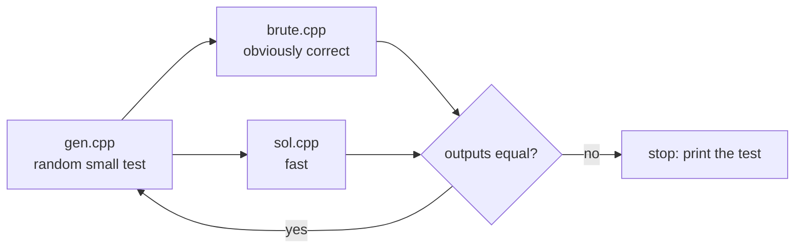

# 01 · C++ for Competitive Programming
> **Goal:** turn your STL knowledge into contest speed. · **Time:** ~1 week

## Skip test
If you can do ALL of these without notes, skip the module.
- [ ] Write a template with fast I/O, `long long` aliases, and a multi-test-case loop.
- [ ] Sort a `vector<pair<int,int>>` by second element descending with a lambda.
- [ ] Use `lower_bound` on a sorted vector and on a `set`, and explain why `std::lower_bound(s.begin(), s.end(), x)` on a `set` is **O(n)** while `s.lower_bound(x)` is O(log n).
- [ ] Say what `int x = 50000 * 50000;` does, and fix it. (Answer below.)
- [ ] Write a **stress test**: brute force vs fast solution on random inputs, stopping at the first mismatch.
- [ ] Implement an IOI-style task: a function `long long count_pairs(std::vector<int> a)` called by a grader you don't control.

## Core ideas
- **Template:**
  ```cpp
  #include <bits/stdc++.h>
  using namespace std;
  using ll = long long;
  int main() {
      ios::sync_with_stdio(false); cin.tie(nullptr);
      int t = 1; // cin >> t;
      while (t--) { /* solve */ }
  }
  ```
  `sync_with_stdio(false)` unties C++ streams from C `stdio` (so don't mix `cin` with `scanf` afterwards). `cin.tie(nullptr)` stops `cin` from flushing `cout` before every read.
- **STL you'll use constantly:** `vector`, `array`, `pair`/`tuple`, `sort` with a custom comparator, `lower_bound`/`upper_bound`, `set`/`multiset`/`map` (O(log n)), `unordered_map` (average O(1), but anti-hash tests can make it O(n) per operation), `priority_queue` (max-heap by default; use `greater<>` for a min-heap), `deque`, `bitset`, `__builtin_popcount` (`__builtin_popcountll` for 64-bit), `iota`, `accumulate`, `next_permutation`.
- **Integer limits:** `int` ≤ 2 147 483 647 ≈ 2.1·10⁹; `long long` ≤ ≈ 9.2·10¹⁸. The product of two values up to 10⁹ needs `ll`: write `1LL * a * b`, because `a * b` is computed in `int` **before** being stored.
- **Debugging:** compile locally with `-Wall -Wextra -fsanitize=address,undefined -D_GLIBCXX_DEBUG`. These catch out-of-bounds access, signed overflow, and invalid iterators. Print-debug to `cerr` (judges ignore stderr).
- **Stress testing:** a random generator + a brute force + a diff loop. This finds most wrong-answer bugs. IOI only shows the first failing test of a failed subtask, so your own stress test is the main way to find out *why* you failed.
- **IOI task format:** you implement **functions** declared in a header (no `main`). The grader calls them, sometimes more than once. Practise on oj.uz with the official graders.



## Worked example: the stress loop
```bash
# stress.sh: compile once, then loop until outputs differ
g++ -O2 -o sol sol.cpp && g++ -O2 -o brute brute.cpp && g++ -O2 -o gen gen.cpp
for i in $(seq 1 1000); do
  ./gen $i > in.txt                 # the seed makes a failing test reproducible
  ./sol < in.txt > out1.txt
  ./brute < in.txt > out2.txt
  if ! cmp -s out1.txt out2.txt; then echo "Mismatch on seed $i"; cat in.txt; exit 1; fi
done
echo "All tests passed"
```
```cpp
// gen.cpp: small tests find bugs faster and are easy to read by hand
#include <bits/stdc++.h>
int main(int argc, char** argv) {
    std::mt19937 rng(atoi(argv[1]));
    int n = rng() % 8 + 1;
    printf("%d\n", n);
    for (int i = 0; i < n; i++) printf("%d ", (int)(rng() % 10));
    printf("\n");
}
```
Use `mt19937`, not `rand()`: on some compilers `rand()` returns at most 32767.

## Worked example: an IOI-style function task
Statement: *implement `long long count_pairs(std::vector<int> a)`, returning the number of pairs i < j with a[i] + a[j] = 0.* The grader reads the input and calls your function. You submit **only** this file:
```cpp
#include "pairs.h"          // given by the task; declares count_pairs
#include <bits/stdc++.h>
using namespace std;

long long count_pairs(vector<int> a) {
    map<long long, long long> seen;   // ll keys: -a[i] overflows if a[i] = INT_MIN
    long long ans = 0;
    for (int x : a) { ans += seen[-(long long)x]; seen[x]++; }
    return ans;                        // no printing: the grader prints
}
```
Traps specific to this format: global variables keep their values if the grader calls your function twice (reset them inside the function), and printing to `stdout` can break the grader's protocol.

## Practice
1. <details><summary>What does <code>int x = 50000 * 50000;</code> do?</summary>

   2.5·10⁹ > 2³¹−1, so it is **signed overflow** (undefined behaviour; in practice you usually get a negative number). Fix: `long long x = 50000LL * 50000;`.
   </details>
2. <details><summary>Sort <code>vector&lt;pair&lt;int,int&gt;&gt; v</code> by <code>.second</code> descending, ties by <code>.first</code> ascending.</summary>

   ```cpp
   sort(v.begin(), v.end(), [](const auto& x, const auto& y) {
       if (x.second != y.second) return x.second > y.second;
       return x.first < y.first;
   });
   ```
   The comparator must be a *strict* weak ordering. Using `>=` is undefined behaviour and can crash `sort`.
   </details>
3. <details><summary>In a <code>multiset&lt;int&gt; s</code>, remove <b>one</b> copy of 5.</summary>

   `auto it = s.find(5); if (it != s.end()) s.erase(it);`. Calling `s.erase(5)` removes **every** copy.
   </details>
4. <details><summary>Your recursive DFS crashes on a path graph with n = 10⁶. Why, and what are the fixes?</summary>

   The recursion depth is 10⁶ frames, which overflows the stack. Fixes: an iterative DFS with an explicit `stack`, or BFS order. (Many judges, including IOI's, set a large stack limit; check the task's grading environment page.)
   </details>

## Learn from
- ⭐ **[USACO Guide: General](https://usaco.guide/general)**: setup, C++ basics for CP, debugging, and stress testing.
- **[Competitive Programmer's Handbook](https://cses.fi/book/book.pdf)** (Laaksonen), ch. 1–4 (introduction, time complexity, sorting, data structures).
- **[cppreference](https://en.cppreference.com/)** for exact STL semantics.

## Build
- Your personal template + a `stress.sh` script (generator, brute, solution, compare). Keep both in a repo.

## Traps
- `endl` flushes the output every time and is slow → use `'\n'`.
- `v.size() - 1` when `v` is empty → `size()` is unsigned, so this is about 1.8·10¹⁹. Cast it: `(int)v.size() - 1`.
- `memset(a, 1, sizeof a)` on an `int` array does **not** set it to 1 (it sets every byte to 1). Only 0 and −1 work. Use `fill`.
- Global arrays start at zero; local ones are full of garbage.

## Done when
- [ ] Template and stress script work  - [ ] solved 3 oj.uz tasks in the function-implementation format
