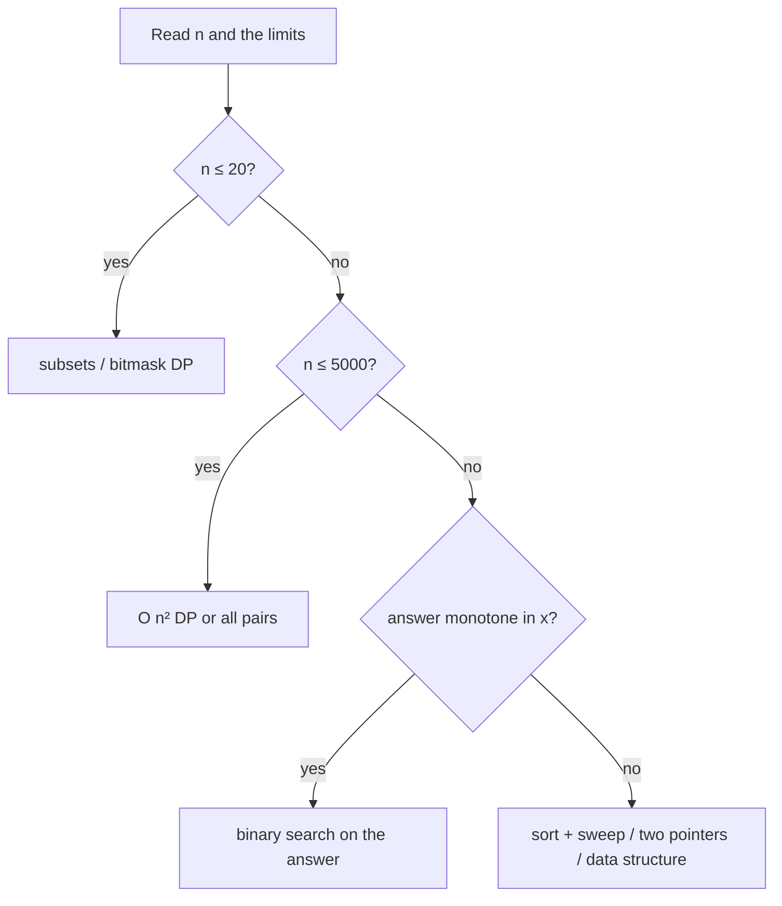

# 02 · Complexity & Core Techniques
> **Goal:** read the constraints, infer the target complexity, and use the standard techniques. · **Time:** 3–4 weeks

👉 Interactive: [Binary search on the answer](interactive/binary-search.html) · [Constraints → algorithm quiz](interactive/complexity-quiz.html)

## Skip test
If you can do ALL of these without notes, skip the module.
- [ ] Given n ≤ 2·10⁵, name an acceptable complexity and an unacceptable one.
- [ ] Binary search on the answer: the minimum possible maximum part sum when splitting an array into k contiguous parts.
- [ ] Two pointers: the longest subarray with sum ≤ S (positive numbers), in O(n).
- [ ] Prefix sums + difference arrays: apply q range-add updates, then print the array, in O(n + q).
- [ ] Prove a greedy algorithm correct with an exchange argument (e.g. activity selection).
- [ ] Generate all subsets of n ≤ 20 elements with bitmasks.
- [ ] Count the subarrays with sum exactly K when values can be **negative** (two pointers fails; what replaces it?).

## Core ideas
- **The constraints → complexity table.** Assume about 10⁸ simple operations per second (often 2–5·10⁸ with `-O2` and cache-friendly code, but plan with 10⁸):

  | n | target | typical algorithm |
  |---|---|---|
  | ≤ 10–12 | O(n!) | try all permutations |
  | ≤ 20–25 | O(2ⁿ · n) | subsets, bitmask DP |
  | ≈ 40 | O(2^(n/2)) | meet in the middle |
  | ≤ 500 | O(n³) | Floyd–Warshall, interval DP |
  | ≤ 5000 | O(n²) | 2D DP, all pairs |
  | ≤ 10⁵ | O(n√n) | sqrt decomposition, Mo's |
  | ≤ 10⁶ | O(n log n) | sorting, segment tree, binary search |
  | ≥ 10⁸ | O(n), O(log n), O(1) | math, formulas |
- **Sorting** + custom comparators. **Coordinate compression:** sort the distinct values, then replace each value by its index (`lower_bound`).
- **Binary search** on sorted arrays, and **on the answer**. If the predicate "is x feasible?" is monotone (false…false, true…true), find the first true value in O(log(range) · cost(check)). Write it the same way every time: `lo` always bad, `hi` always good.
- **Two pointers / sliding window:** works when moving the right end forward never requires moving the left end backward. This holds when the window property is monotone, e.g. all values positive.
- **Prefix sums** (1D/2D), **difference arrays**, prefix XOR/min. Count of subarrays with sum K = the number of pairs i < j with `pre[j] − pre[i] = K`. Use a hash map of prefix sums seen so far. This works with negative values too.
- **Greedy:** sort by the right key and prove it with an **exchange argument**: take an optimal solution that disagrees with greedy at the first step, swap in greedy's choice, and show it is no worse. If you can't prove it, stress-test it against a brute force.
- **Complete search / backtracking** with pruning. **Meet in the middle** for n ≈ 40: enumerate the two halves separately, then combine with sorting and binary search.
- **Bit manipulation:** `mask >> i & 1` tests bit i, `x & -x` is the lowest set bit, and `for (s = m; s; s = (s - 1) & m)` loops over all non-empty submasks of `m`.
- **Subtask thinking:** a brute force for small n is free points. Always submit it first.



## Worked example 1: binary search on the answer
*Split `a` (n ≤ 10⁵, aᵢ ≤ 10⁹) into k contiguous parts so that the largest part sum is as small as possible.*

1. **Predicate:** `ok(x)` = "a split into ≤ k parts with every part sum ≤ x exists". If `ok(x)` holds, then `ok(x+1)` holds too, so the predicate is monotone.
2. **Check in O(n), greedily:** extend the current part while its sum stays ≤ x, and start a new part when it would go over. Greedy uses the fewest parts, because ending a part earlier never helps.
3. **Range:** `lo = max(a) − 1` is infeasible (some element doesn't fit). `hi = sum(a)` is feasible (one part).
```cpp
bool ok(const vector<ll>& a, int k, ll x) {
    int parts = 1; ll cur = 0;
    for (ll v : a) {
        if (v > x) return false;
        if (cur + v > x) { parts++; cur = 0; }
        cur += v;
    }
    return parts <= k;
}
ll solve(const vector<ll>& a, int k) {
    ll lo = *max_element(a.begin(), a.end()) - 1, hi = accumulate(a.begin(), a.end(), 0LL);
    while (hi - lo > 1) { ll m = lo + (hi - lo) / 2; (ok(a, k, m) ? hi : lo) = m; }
    return hi;   // a = {7,2,5,10,8}, k = 2  →  18   ([7,2,5] | [10,8])
}
```
Total time: O(n log(sum)) ≈ 10⁵ × 47. Step through this exact algorithm in the [visualizer](interactive/binary-search.html).

## Worked example 2: two pointers vs. prefix sums
- **Positive values, longest subarray with sum ≤ S:** move `r` forward. While `sum > S`, move `l` forward. Each pointer moves at most n times, so this is O(n).
- **Values can be negative, count the subarrays with sum = K:** a window can't shrink safely here, so use prefix sums and a map:
```cpp
map<ll,int> cnt; cnt[0] = 1; ll pre = 0, ans = 0;
for (ll v : a) { pre += v; ans += cnt[pre - K]; cnt[pre]++; }
// a = {1, -1, 1, -1}, K = 0  →  4
```

## Worked example 3: an exchange argument
*Activity selection: choose the maximum number of non-overlapping intervals.* Greedy: sort by **end time** and take every interval that starts after the last one taken ends.
Proof: let O be an optimal solution, and let g be the interval with the earliest end. Replace the first interval of O by g. The new set is still valid (g ends no later, so it overlaps nothing that came after) and has the same size. Repeat on what is left. ∎ (Sorting by *start time* or by *length* fails. Find a counterexample for each.)

## Practice
1. <details><summary>n ≤ 2·10⁵: which of O(n²), O(n log² n), O(n√n) fit in about 1 s?</summary>

   n² = 4·10¹⁰: **no**. n log² n ≈ 2·10⁵ × 324 ≈ 6.5·10⁷: **yes**. n√n ≈ 9·10⁷: **yes, usually**, with a small constant.
   </details>
2. <details><summary>Apply q updates "add v to a[l..r]", then print a. Do it in O(n + q).</summary>

   Keep a difference array `d` of size n+1: `d[l] += v; d[r+1] -= v;`. At the end, `a[i] += d[0] + … + d[i]` (a running prefix sum).
   </details>
3. <details><summary>Counterexample for "sort activities by length, take the shortest first".</summary>

   Intervals [1,10], [9,12], [11,20]. The shortest, [9,12], blocks both others, so greedy takes 1 interval. The optimum is 2: [1,10] and [11,20].
   </details>
4. <details><summary>Meet in the middle: does a subset of n = 40 numbers sum to exactly X?</summary>

   Enumerate the 2²⁰ subset sums of each half. Sort one list. For each sum s in the other list, binary-search for X − s. Time: O(2^(n/2) · n). Brute force would be 2⁴⁰ ≈ 10¹².
   </details>
5. <details><summary>Your binary search on a real-valued answer never terminates. Fix?</summary>

   Don't loop `while (hi - lo > eps)`, because with large values floating-point error can stop the gap from ever shrinking below eps. Run a fixed 100 iterations instead.
   </details>

## Learn from
- ⭐ **[USACO Guide: Bronze → Silver](https://usaco.guide/)**: complete search, sorting, binary search, two pointers, prefix sums, greedy.
- ⭐ **[CSES Problem Set](https://cses.fi/problemset/)**: the "Introductory Problems" and "Sorting and Searching" sections. Do all of them. Since the 2025 update, each task links to a model solution under *Analysis*. Read it only after you've solved the task or spent 45 minutes on it.
- **[Competitive Programmer's Handbook](https://cses.fi/book/book.pdf)**: ch. 2 (complexity), 3 (sorting), 5 (complete search), 6 (greedy), 8 (amortized analysis / two pointers), 10 (bits).

## Build
- Finish CSES *Introductory* + *Sorting and Searching*. Track the time per problem.

## Traps
- Binary search with `while (lo < hi)` and `mid = (lo + hi) / 2` loops forever when you write `lo = mid`. Use the `lo`-bad / `hi`-good form.
- `(lo + hi) / 2` overflows for large `int` bounds → use `lo + (hi - lo) / 2`.
- Two pointers on arrays with negative numbers gives wrong answers. Use prefix sums + a map instead.
- A greedy that "obviously works" and passes the samples is the classic WA. Stress-test it.

## Done when
- [ ] CSES sections done  - [ ] can prove one greedy by exchange argument out loud
