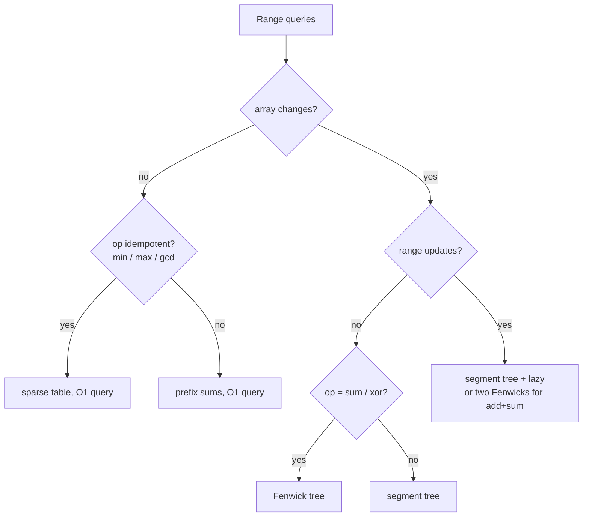

# 03 · Data Structures
> **Goal:** answer queries fast. These structures appear in a large share of IOI tasks. · **Time:** 4–5 weeks

👉 Interactive: [Segment tree](interactive/segment-tree.html) · [Fenwick tree](interactive/fenwick.html) · [Union-find (DSU)](interactive/dsu.html)

## Skip test
If you can do ALL of these without notes, skip the module.
- [ ] Implement DSU with path compression + union by size. State its complexity (amortized O(α(n))) and what happens with only one of the two optimizations.
- [ ] Implement a Fenwick tree (BIT) for point update / prefix sum. Explain what `i & -i` is and which indices `sum(13)` visits.
- [ ] Implement a segment tree with **lazy propagation** for range add + range sum.
- [ ] Answer static range-minimum queries in O(1) with a sparse table. Explain why this doesn't work for sums.
- [ ] Use a monotonic stack to find the next greater element for every index in O(n).
- [ ] Sliding-window maximum with a deque in O(n).
- [ ] Find the k-th smallest element of a dynamic multiset of values ≤ 10⁶ in O(log n).

## Core ideas
- **Stacks / queues / deques:** monotonic stack (next greater/smaller, largest rectangle in a histogram), monotonic deque (sliding window min/max). Every index is pushed and popped at most once, so the total is O(n).
- **Heaps** (`priority_queue`): k-th largest, merging sorted lists, event simulation.
- **Ordered sets/maps:** `set`, `multiset`, `map` in O(log n). The GNU policy-based `tree` (`ordered_set`) adds `find_by_order(k)` and `order_of_key(x)`. A Fenwick tree over compressed values does the same job portably.
- **DSU (union-find):** connectivity, Kruskal, offline queries. With **both** path compression and union by size/rank, a sequence of m operations takes O(m·α(n)), where α is the inverse Ackermann function (≤ 4 for any practical n). With only one of the two optimizations it is O(log n) amortized.
- **Fenwick tree:** node `i` stores the sum of the range `(i − lowbit(i), i]`, where `lowbit(i) = i & -i` is the lowest set bit. A prefix query strips the lowest bit repeatedly (13 → 12 → 8 → 0). An update adds the lowest bit repeatedly (5 → 6 → 8 → 16). Both are O(log n). Variants: range update/point query (BIT over the difference array), range update/range query (two BITs), 2D.
- **Segment tree:** works for any **associative** operation (sum, min, max, gcd, matrix product, custom merge of structs). **Lazy propagation** for range updates: store a pending tag on a node and push it to the children only when you need to go below that node. Walking down the tree finds the "first index with prefix ≥ k" in O(log n).
- **Sparse table:** `st[j][i] = op(a[i .. i + 2ʲ − 1])`. A query on [l, r] covers it with two overlapping blocks of length 2ᵏ, where k = ⌊log₂(r − l + 1)⌋. This is correct only for **idempotent** operations (min, max, gcd, and, or), where counting an element twice doesn't matter. Sums get double-counted.
- **Square root decomposition** and **Mo's algorithm** (offline range queries in O((n + q)√n)) are useful fallbacks.
- **Offline tricks:** sort the queries, sweep a line over events, reverse time (deletions become insertions with DSU).



## Worked example 1: which nodes a Fenwick tree touches
n = 16, `sum(13)`: 13 = 1101₂. Visit node 13 (covers (12, 13]), strip the low bit → 12 = 1100₂ (covers (8, 12]), strip → 8 = 1000₂ (covers (0, 8]), strip → 0, stop. That's three nodes for three set bits.
`add(5, v)`: 5 = 0101₂ → 6 = 0110₂ → 8 = 1000₂ → 16, so 4 nodes. These are exactly the nodes whose ranges contain index 5. See it in the [Fenwick visualizer](interactive/fenwick.html).

## Worked example 2: lazy segment tree (range add, range sum)
```cpp
struct Seg {
    int n; vector<ll> t, lz;
    Seg(int n) : n(n), t(4 * n), lz(4 * n) {}
    void apply(int v, int tl, int tr, ll x) { t[v] += x * (tr - tl + 1); lz[v] += x; }
    void push(int v, int tl, int tr) {               // hand the pending tag to both children
        if (!lz[v]) return;
        int tm = (tl + tr) / 2;
        apply(2 * v, tl, tm, lz[v]); apply(2 * v + 1, tm + 1, tr, lz[v]); lz[v] = 0;
    }
    void update(int v, int tl, int tr, int l, int r, ll x) {
        if (r < tl || tr < l) return;
        if (l <= tl && tr <= r) { apply(v, tl, tr, x); return; }
        push(v, tl, tr); int tm = (tl + tr) / 2;
        update(2 * v, tl, tm, l, r, x); update(2 * v + 1, tm + 1, tr, l, r, x);
        t[v] = t[2 * v] + t[2 * v + 1];
    }
    ll query(int v, int tl, int tr, int l, int r) {
        if (r < tl || tr < l) return 0;
        if (l <= tl && tr <= r) return t[v];
        push(v, tl, tr); int tm = (tl + tr) / 2;
        return query(2 * v, tl, tm, l, r) + query(2 * v + 1, tm + 1, tr, l, r);
    }
};
// usage: Seg s(n); s.update(1, 0, n-1, l, r, x); s.query(1, 0, n-1, l, r);
```
The array has size `4n` because the recursive tree's indices can go up to about 4n when n is not a power of two.

## Worked example 3: sparse table
```cpp
int K = __lg(n) + 1; vector<vector<int>> st(K, vector<int>(n));
st[0] = a;
for (int j = 1; j < K; j++)
    for (int i = 0; i + (1 << j) <= n; i++)
        st[j][i] = min(st[j-1][i], st[j-1][i + (1 << (j-1))]);
auto rmq = [&](int l, int r) { int j = __lg(r - l + 1); return min(st[j][l], st[j][r - (1 << j) + 1]); };
```

## Practice
1. <details><summary>Next greater element for every index, O(n).</summary>

   ```cpp
   vector<int> nge(n, -1); stack<int> s;           // s holds indices with decreasing values
   for (int i = 0; i < n; i++) {
       while (!s.empty() && a[s.top()] < a[i]) { nge[s.top()] = i; s.pop(); }
       s.push(i);
   }
   ```
   Each index is pushed once and popped at most once, so the total is O(n).
   </details>
2. <details><summary>Count inversions (i &lt; j, a[i] &gt; a[j]) for n = 2·10⁵.</summary>

   Compress the values to 1..m. Scan from left to right. For each `a[j]`, add `j − bit.sum(a[j])` (the number of earlier elements greater than a[j]), then `bit.add(a[j], 1)`. O(n log n). Merge sort also works.
   </details>
3. <details><summary>k-th smallest in a dynamic multiset (values ≤ 10⁶), without pbds.</summary>

   Use a Fenwick tree of counts and **walk down** it: start at `pos = 0`, and for `pw` from the highest power of two down to 1, if `pos + pw ≤ N` and `bit[pos + pw] < k`, set `pos += pw` and `k −= bit[pos]`. The answer is `pos + 1`. That's O(log N), with no binary search over prefix sums.
   </details>
4. <details><summary>Offline: edges are <i>deleted</i> one by one; after each deletion, how many components are there?</summary>

   Reverse time. Start from the final graph (every edge that is never deleted) and add the edges back in reverse deletion order with DSU, recording the component count before each addition. Print the counts in reverse.
   </details>
5. <details><summary>Why does a sparse table give the wrong answer for range sums?</summary>

   The two blocks overlap, so the elements in the overlap are counted twice. min(x, x) = x, but x + x ≠ x. For static sums, use prefix sums instead.
   </details>

## Learn from
- ⭐ **[USACO Guide: Silver → Gold](https://usaco.guide/)**: DSU, prefix sums, Fenwick/segment trees.
- ⭐ **[Codeforces EDU: Segment Tree (parts 1–2)](https://codeforces.com/edu/courses)**: lectures + graded practice (free, needs a Codeforces account).
- **[cp-algorithms: Data structures](https://cp-algorithms.com/)**: [segment tree](https://cp-algorithms.com/data_structures/segment_tree.html), [Fenwick](https://cp-algorithms.com/data_structures/fenwick.html), [DSU](https://cp-algorithms.com/data_structures/disjoint_set_union.html), [sparse table](https://cp-algorithms.com/data_structures/sparse-table.html).
- **CSES: "Range Queries"** section · **Competitive Programmer's Handbook** ch. 4, 9, 15.2 (union-find), 28.

## Build
- Write each structure from memory 3 times on different days. Solve all of CSES *Range Queries*.

## Traps
- Lazy segment tree: forgetting to `push` before recursing in the **query**, not only in the update.
- A tag on a node means "already applied to this node, not yet to its children". Mixing up the two conventions double-applies updates.
- Fenwick is 1-indexed: `add(0, v)` loops forever, because `0 & -0 = 0`.
- DSU `find` written recursively can blow the stack on a long chain created **without** union by size. Use both optimizations.
- A segment tree array of size `2n` with the recursive layout → out-of-bounds. Use `4n`.

## Done when
- [ ] Every structure above written from memory, stress-tested against brute force  - [ ] CSES Range Queries done
