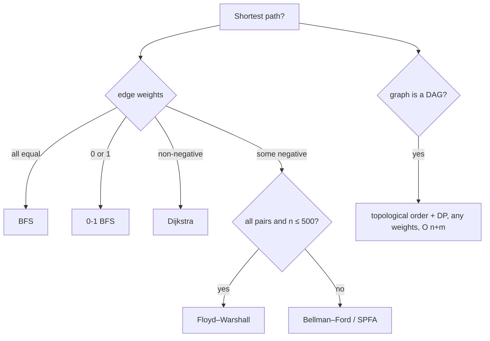

# 04 · Graphs & Trees
> **Goal:** model problems as graphs and pick the right traversal or shortest-path algorithm. · **Time:** 5–6 weeks

👉 Interactive: [Graph search visualizer](interactive/graph-search.html) · [LCA by binary lifting](interactive/lca.html)

## Skip test
If you can do ALL of these without notes, skip the module.
- [ ] BFS on a grid with walls: the shortest path length and the path itself.
- [ ] Explain why Dijkstra fails with negative edges (give a 3-vertex example), and what to use instead.
- [ ] Topological sort with Kahn's algorithm. Detect a cycle.
- [ ] Find strongly connected components (Tarjan or Kosaraju).
- [ ] LCA with binary lifting in O(log n) per query.
- [ ] Find the diameter of a tree with two BFS/DFS passes, and say why it fails if edge weights can be negative.
- [ ] Shortest path where you may use at most one "free" edge (hint: put extra state into the vertex).

## Core ideas
- **Representation:** adjacency lists `vector<vector<int>>` (or `pair<int,int>` for weights). Grids are implicit graphs.
- **DFS:** connected components, cycle detection (a back edge to a vertex still on the stack), entry/exit times, bridges and articulation points (low-link).
- **BFS:** unweighted shortest paths, multi-source BFS (push all sources with distance 0), **0-1 BFS** with a deque.
- **Shortest paths:**

  | Algorithm | Weights | Time | Use |
  |---|---|---|---|
  | BFS | all equal | O(n + m) | grids, unweighted |
  | 0-1 BFS | 0 or 1 | O(n + m) | "free" moves |
  | Dijkstra | ≥ 0 | O((n + m) log n) | the default |
  | Bellman–Ford | any | O(nm) | negative edges, detects negative cycles |
  | Floyd–Warshall | any (no negative cycles) | O(n³) | all pairs, n ≤ 500 |
- **DAGs:** topological sort, DP over a DAG (longest path, counting paths).
- **MST:** Kruskal (sort the edges + DSU) or Prim. Cut property: the lightest edge crossing any cut is in some MST.
- **SCC:** Tarjan/Kosaraju → the condensation DAG. **2-SAT** comes from SCC (x and ¬x in the same SCC → unsatisfiable).
- **Trees:** parent/depth arrays, subtree sizes, **Euler tour** (a subtree is a contiguous range [tin, tout] → segment tree), **binary lifting LCA**, distances via LCA, tree DP (rerooting), diameter, centroid.
- **Modeling tricks:** add a super-source, put states (node, extra info) in the vertex, reverse the edges, binary search + BFS.



## Worked example 1: why Dijkstra breaks on negative edges
Edges: A→B (2), A→C (3), C→B (−2). Dijkstra pops A, then **finalizes B with distance 2** (the smallest in the heap). Later it pops C (3) and finds A→C→B = 1 < 2, but B is already finalized, and anything computed from B's distance is now wrong. Bellman–Ford relaxes every edge n − 1 times, so it doesn't rely on finalization.

## Worked example 2: binary lifting LCA
`up[j][v]` = the 2ʲ-th ancestor of v. To find lca(u, v): (1) lift the deeper vertex by the depth difference, using its binary digits; (2) if they are now equal, done; (3) otherwise, for j from high to low, if `up[j][u] ≠ up[j][v]`, jump both. The answer is `up[0][u]`.
```cpp
const int LOG = 18;                        // 2^18 > 2·10^5
vector<int> g[N]; int up[LOG][N], dep[N];
void dfs(int v, int p) {                   // iterative version for deep trees: see traps
    up[0][v] = p;
    for (int j = 1; j < LOG; j++) up[j][v] = up[j-1][ up[j-1][v] ];
    for (int c : g[v]) if (c != p) { dep[c] = dep[v] + 1; dfs(c, v); }
}
int lca(int u, int v) {
    if (dep[u] < dep[v]) swap(u, v);
    for (int j = LOG - 1; j >= 0; j--) if (dep[u] - (1 << j) >= dep[v]) u = up[j][u];
    if (u == v) return u;
    for (int j = LOG - 1; j >= 0; j--) if (up[j][u] != up[j][v]) u = up[j][u], v = up[j][v];
    return up[0][u];
}
// root: dfs(root, root), so the root's ancestor is itself
// dist(u, v) = dep[u] + dep[v] - 2 * dep[lca(u, v)]
```
Step through both phases in the [LCA visualizer](interactive/lca.html).

## Worked example 3: Kahn's algorithm
```cpp
vector<int> indeg(n), order; queue<int> q;
for (int u = 0; u < n; u++) for (int v : g[u]) indeg[v]++;
for (int u = 0; u < n; u++) if (!indeg[u]) q.push(u);
while (!q.empty()) { int u = q.front(); q.pop(); order.push_back(u);
    for (int v : g[u]) if (--indeg[v] == 0) q.push(v); }
bool hasCycle = (int)order.size() < n;   // the vertices left over lie on or after a cycle
```
Use a `priority_queue` instead of the `queue` to get the lexicographically smallest order.

## Practice
1. <details><summary>Grid, you may break at most one wall. Shortest path?</summary>

   BFS over states (r, c, used ∈ {0, 1}). Stepping into a wall is allowed only from used = 0 and moves to used = 1. That's 2·R·C states, O(RC).
   </details>
2. <details><summary>Tree diameter in two passes: why does it work?</summary>

   With non-negative weights, the vertex farthest from **any** start vertex is an endpoint of some diameter. A second BFS/DFS from that endpoint finds the other end. With negative weights this fails; use the tree DP (the best two child depths at every vertex).
   </details>
3. <details><summary>Shortest paths from s to every vertex when the graph is a DAG with negative weights.</summary>

   Relax the edges in topological order: dist[v] = min(dist[u] + w) over the incoming edges. O(n + m). There can be no negative cycles, because there are no cycles at all.
   </details>
4. <details><summary>q queries: "is v in the subtree of u?" on a static tree, O(1) each.</summary>

   Euler tour: record tin[v] when the DFS enters v and tout[v] when it leaves. v is in u's subtree ⇔ tin[u] ≤ tin[v] and tout[v] ≤ tout[u].
   </details>
5. <details><summary>Dijkstra with a <code>set</code> vs a <code>priority_queue</code> with lazy deletion. Same complexity?</summary>

   Yes, both are O((n + m) log n). The lazy version may hold up to m stale entries, which you skip with `if (d > dist[u]) continue;`. Without that line, the worst case gets much slower.
   </details>

## Learn from
- ⭐ **[USACO Guide: Silver/Gold graphs & trees](https://usaco.guide/)**.
- ⭐ **[CSES](https://cses.fi/problemset/): "Graph Algorithms"** and **"Tree Algorithms"** sections.
- **[cp-algorithms: Graphs](https://cp-algorithms.com/)** ([Dijkstra](https://cp-algorithms.com/graph/dijkstra.html), [LCA with binary lifting](https://cp-algorithms.com/graph/lca_binary_lifting.html), [SCC](https://cp-algorithms.com/graph/strongly-connected-components.html)) · **Competitive Programmer's Handbook**, ch. 11–20.

## Build
- Solve the CSES *Graph Algorithms* and *Tree Algorithms* sections. Implement Dijkstra, LCA, and SCC from memory.

## Traps
- Recursive DFS on a path with n = 2·10⁵ to 10⁶ can overflow the stack. Know an iterative version (or check the grader's stack limit).
- Dijkstra `dist` arrays in `int` overflow once the path sums exceed about 2·10⁹. Use `ll` and `LLONG_MAX / 4` as infinity, so that `INF + w` doesn't overflow.
- In an undirected graph, the edge back to the parent isn't a cycle. Skip the parent **edge id**, not the parent vertex, if there are multi-edges.
- Binary lifting with `LOG` too small (2^LOG must be ≥ the depth of the tree).

## Done when
- [ ] CSES graph + tree sections done  - [ ] can say which shortest-path algorithm fits any weight pattern
