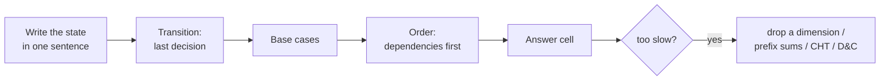

# 05 · Dynamic Programming
> **Goal:** IOI's favorite topic. Define states well, then optimize. · **Time:** 5–7 weeks

👉 Interactive: [DP table animator](interactive/dp-table.html) · [LIS in O(n log n)](interactive/lis.html)

## Skip test
If you can do ALL of these without notes, skip the module.
- [ ] 0/1 knapsack in O(nW) time and O(W) memory, and explain the loop direction.
- [ ] LIS in O(n log n), and change it to *non-decreasing* subsequences.
- [ ] Edit distance / LCS with path reconstruction.
- [ ] Interval DP: the minimum cost to merge adjacent stones / matrix-chain multiplication.
- [ ] Bitmask DP: TSP on n ≤ 20 in O(2ⁿn²).
- [ ] Tree DP: a maximum-weight independent set on a tree.
- [ ] Digit DP: count the integers in [0, N] with no two equal adjacent digits.

## Core ideas
- **Recipe:** (1) **state**: what do I need to know about the past? (2) **transition** (3) **base cases** (4) **order** of computation (5) **answer** location. Write the state in words first: "dp[i][w] = the best value using the first i items with total weight ≤ w".
- **Classic families:**
  - **Linear:** Fibonacci-like, max subarray (Kadane), coin change (count vs. minimize), LIS.
  - **Knapsack:** 0/1 (iterate weight *down*), unbounded (iterate *up*), bounded (binary splitting of the counts: 1, 2, 4, …, remainder).
  - **Grid / two-sequence:** paths, LCS, edit distance.
  - **Interval:** dp[l][r], with the split point inside. Order by increasing length.
  - **Bitmask:** dp[mask][last], subsets, SOS DP (sum over subsets in O(2ⁿ·n)).
  - **Tree DP:** dp[v][state] from children. **Rerooting** for "for every root".
  - **Digit DP:** count numbers ≤ N with a property, with state (pos, tight, …).
  - **DP on DAGs** = shortest/longest paths. Every DP is a DAG of states; if your states have a cycle, it isn't a DP.
- **Optimizations (IOI level):** prefix-sum transitions, monotonic deque, **convex hull trick / Li Chao tree**, divide & conquer DP, Knuth, and the **"Aliens" trick (Lagrangian relaxation)**, named after IOI 2016's *Aliens* task.
- **Memory:** rolling arrays. **Reconstruction:** store the choices, or backtrack through the table.
- **Subtasks often map to DP states:** O(n³) → O(n²) → O(n log n) as the subtasks get harder.



## Worked example 1: why knapsack loops go down
One item, weight 2, value 3, W = 4. Going **up** (`w = 2..4`): `dp[2] = 3`, then `dp[4] = dp[2] + 3 = 6`. The item was used twice, which is the *unbounded* knapsack. Going **down** (`w = 4..2`): `dp[4] = dp[2] + 3 = 3`, because dp[2] still holds the value from before this item. Then `dp[2] = 3`. Each item is used once.
```cpp
for (auto [wt, val] : items)
    for (int w = W; w >= wt; w--) dp[w] = max(dp[w], dp[w - wt] + val);
```

## Worked example 2: LIS in O(n log n)
`d[k]` = the smallest possible **tail** of an increasing subsequence of length k+1. `d` is always strictly increasing, so each new x replaces the first `d[k] ≥ x` (or is appended).
```cpp
vector<int> d;
for (int x : a) {
    auto it = lower_bound(d.begin(), d.end(), x);   // use upper_bound for non-decreasing
    if (it == d.end()) d.push_back(x); else *it = x;
}
// a = {3, 1, 4, 1, 5, 9, 2, 6}  →  d = {1, 2, 5, 6}, LIS length 4 (e.g. 1 4 5 6)
```
`d` itself is usually **not** a valid subsequence. To reconstruct one, store for each element the index of its predecessor. Watch it in the [LIS visualizer](interactive/lis.html).

## Worked example 3: bitmask TSP
`dp[mask][v]` = the minimum cost of a path that starts at 0, visits exactly the set `mask`, and ends at v.
```cpp
// dp[1][0] = 0, all other entries INF
for (int mask = 1; mask < (1 << n); mask++)
    for (int v = 0; v < n; v++) if (dp[mask][v] < INF && (mask >> v & 1))
        for (int u = 0; u < n; u++) if (!(mask >> u & 1))
            dp[mask | 1 << u][u] = min(dp[mask | 1 << u][u], dp[mask][v] + c[v][u]);
// tour = min over v of dp[(1<<n)-1][v] + c[v][0]
```
Increasing `mask` is a valid order, because every transition adds a bit, which makes the mask larger.

## Worked example 4: tree DP (max-weight independent set)
`dp[v][0]` = the best in v's subtree with v **not** taken; `dp[v][1]` = with v taken.
`dp[v][1] = w[v] + Σ dp[c][0]`, `dp[v][0] = Σ max(dp[c][0], dp[c][1])`. The answer is `max(dp[root][0], dp[root][1])`.

## Practice
1. <details><summary>Coin change: count the ways to make sum X when <i>order doesn't matter</i>, versus when it does.</summary>

   Order doesn't matter (combinations): loop over **coins on the outside**, then sums upward: `for c: for s = c..X: ways[s] += ways[s-c]`. Order matters (sequences): loop over **sums on the outside**: `for s: for c: ways[s] += ways[s-c]`.
   </details>
2. <details><summary>Edit distance recurrence.</summary>

   `dp[i][j] = min(dp[i-1][j] + 1, dp[i][j-1] + 1, dp[i-1][j-1] + (a[i] != b[j]))`, with `dp[i][0] = i` and `dp[0][j] = j`. Reconstruct by walking back from `dp[n][m]` along any move that achieves the minimum.
   </details>
3. <details><summary>Interval DP for merging adjacent stones (cost = the sum of the merged pile). Order of computation?</summary>

   `dp[l][r] = min over k of dp[l][k] + dp[k+1][r] + sum(l..r)`. Compute by **increasing length** r − l, so both halves are ready. That's O(n³). Knuth's optimization brings this cost function to O(n²).
   </details>
4. <details><summary>Digit DP: count the x in [0, N] with no two equal adjacent digits. What is the state?</summary>

   (pos, last digit, tight, started). `tight` says whether the prefix so far equals N's prefix, which limits the next digit to ≤ N[pos]. `started` handles leading zeros, which shouldn't count as "equal adjacent digits".
   </details>
5. <details><summary>dp[i] = min over j &lt; i of dp[j] + (s[i] − s[j])² with s increasing. How do you get below O(n²)?</summary>

   Expand: dp[j] + s[j]² − 2·s[j]·s[i] + s[i]². For a fixed i, each j is a line with slope −2s[j] and intercept dp[j] + s[j]², evaluated at x = s[i]. The slopes are monotone and the queries are monotone, so a convex hull trick with a deque runs in O(n).
   </details>

## Learn from
- ⭐ **[AtCoder Educational DP Contest](https://atcoder.jp/contests/dp)**: 26 classic problems A–Z. **Do all of them.**
- ⭐ **[USACO Guide: Gold DP sections](https://usaco.guide/gold)** + **CSES "Dynamic Programming"**.
- **[cp-algorithms: DP](https://cp-algorithms.com/)** ([divide & conquer DP](https://cp-algorithms.com/dynamic_programming/divide-and-conquer-dp.html), [Knuth](https://cp-algorithms.com/dynamic_programming/knuth-optimization.html), [convex hull trick](https://cp-algorithms.com/geometry/convex_hull_trick.html)) · **Competitive Programmer's Handbook** ch. 7 · Errichto's DP videos on YouTube.

## Build
- AtCoder DP contest A–Z + CSES DP section. For each, write the state in one sentence in your progress log.

## Traps
- An `int` dp for counting → overflow. Take the answer mod p **at every addition**.
- A `memset(dp, 0x3f, …)` "infinity" is about 1.06·10⁹ per `int`. Adding two of them overflows `int`. Check before you add, or use `ll`.
- Memoized recursion with depth n = 10⁵ or more can overflow the stack. Convert it to iterative order.
- dp arrays of `n × W = 10⁵ × 10⁵` don't fit in memory (≈ 40 GB). Roll them or change the state.

## Done when
- [ ] AtCoder DP A–Z  - [ ] can derive the state for a new problem in under 10 minutes
