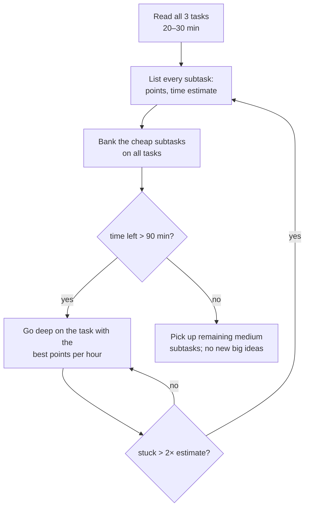

# 07 · IOI Skills & Advanced Topics
> **Goal:** convert knowledge into IOI points, and learn the advanced techniques that separate medal colors. · **Time:** ongoing

👉 Interactive: [IOI day planner (subtask knapsack)](interactive/subtask-planner.html) · [Constraints → algorithm quiz](interactive/complexity-quiz.html)

## Skip test
If you can do ALL of these without notes, skip the strategy half and go straight to the advanced techniques.
- [ ] State exactly how an IOI task score is computed across several submissions (answer below).
- [ ] You have 3 tasks and 5 h. Write a time plan *before* reading the tasks, and say when you stop working on one.
- [ ] Solve an interactive task with a query limit (e.g. find a hidden number in [1, 10⁹] with ≤ 30 queries).
- [ ] Explain heavy-light decomposition: why any root-to-leaf path crosses O(log n) light edges.
- [ ] Explain centroid decomposition: why its depth is O(log n).
- [ ] Explain small-to-large merging and why it is O(n log n) in total.

## How IOI scoring works (and what it means for strategy)
*(From the [IOI 2026 contest rules](https://www.ioi2026.uz/contest-rules). Check the current year's page before your contest.)*
- Each task = subtasks. In one submission, a subtask scores the **minimum** over its tests (so all of its tests must pass).
- Your final subtask score is the **maximum over all your submissions**, and the task score is the sum over subtasks. So a submission that solves only subtask 3 still adds those points, even if it breaks subtask 1.
- At most **50 submissions per task**, and at most **one per minute** (that limit is lifted in the last 15 minutes).
- **Feedback:** for each subtask, you see your score. For an unsolved subtask, you see only the **first lowest-scoring test** and its verdict. Your own stress test is how you find out *why* it failed.
- Language: **C++ only**. Submission size ≤ 50 KiB.

## Contest strategy (the highest-leverage skill)
- **First 20–30 min:** read **all three** tasks. Write every subtask, its points, and your gut estimate of time and difficulty.
- **Bank points:** implement the easy subtasks of *every* task before going deep. 3 × 40 points beats 1 × 100.
- **Subtasks are hints:** "n ≤ 1000", "the tree is a line", "all values distinct" each show a step toward the full solution.
- **Think before coding.** Prove (or at least stress-test) your idea. Because scores are max-per-subtask, a speculative submission never costs you points (only one of your 50 submissions and a minute).
- **Keep the brute force** for stress testing. Don't delete old working code.
- **Time-box:** if a subtask takes 2× your estimate, stop and re-plan. The [day planner](interactive/subtask-planner.html) shows what each choice costs.
- **Problem types to practice:** batch (function implementation), **interactive** (minimize the queries), **communication** (two programs; the first one's output is the second one's input), **output-only**, **constructive**.

## Worked example: plan a day
Task A: 7 + 18 + 35 + 40. Task B: 12 + 25 + 63. Task C: 5 + 20 + 75.
After reading: A1 and A2 are brute force and a line case (~25 min together). B1 is small n (~15 min). C1 is trivial (~5 min). That's **42 points in about 45 minutes**, banked before you think hard about anything. Then compare A3 (35 pts, ~60 min, likely) against B2 (25 pts, ~40 min, likely) against C3 (75 pts, an idea you don't have yet). Points per hour say A3 then B2. C3 is worth trying only if more than about 90 minutes are left. Rehearse this with your own numbers in the [planner](interactive/subtask-planner.html).

## Practice
1. 

Submission 1 scores subtasks (10, 0, 20); submission 2 scores (0, 30, 0). Your task score?

   max per subtask: 10 + 30 + 20 = **60**. At IOI, neither submission has to be correct on everything.
   

2. 

Interactive: find a hidden x in [1, 10⁹] with "is x ≤ m?" queries. Query limit?

   Binary search: ⌈log₂ 10⁹⌉ = **30** queries. If the limit is lower, the task wants a different question type (for example answers with three outcomes, giving log₃).
   

3. 

Why does HLD give O(log² n) per path query with a segment tree?

   Going down a light edge at least halves the subtree size, so a path has O(log n) light edges and therefore O(log n) heavy chains. Each chain is a contiguous range in the HLD order, so each chain costs one O(log n) segment-tree query.
   

4. 

Small-to-large: why is merging sets of children (always inserting the smaller set into the bigger) O(n log n)?

   Each time an element is moved, the set containing it at least doubles in size. So an element moves at most log₂ n times. (With `std::set` that's O(n log² n) in total time, because each move costs O(log n).)
   

## Advanced techniques (learn after 01–06)
- **Trees:** heavy-light decomposition (HLD), **centroid decomposition**, small-to-large merging (DSU on tree), virtual trees.
- **Data structures:** persistent segment tree, segment tree beats (rare), Li Chao tree, merge-sort tree, **parallel binary search**, offline divide & conquer (CDQ).
- **Sqrt techniques:** sqrt decomposition on queries, Mo's algorithm (with updates), heavy/light threshold splitting.
- **Graphs:** max flow / min cut / bipartite matching (rarer at IOI but useful), bridges/2-edge-connected components, Euler tours.
- **DP:** CHT, D&C optimization, the Aliens trick, DP over subsets / profiles.

## Learn from
- ⭐ **Past IOI problems on [oj.uz](https://oj.uz/problems)** (judged with subtasks) plus past **national/regional olympiads** (APIO, BOI, CEOI, JOI). The best practice material.
- ⭐ **[USACO Guide: Platinum & Advanced](https://usaco.guide/plat)**.
- **[IOI official site](https://ioinformatics.org/)**: the [syllabus](https://ioinformatics.org/page/syllabus/12), past tasks, and solutions. Check which topics are "excluded" or "not for IOI" before spending weeks on them.
- **[Codeforces](https://codeforces.com/)** (Div 1/2) and **[AtCoder](https://atcoder.jp/)** (ARC/AGC) for contest practice.

## Build
- Simulate full IOI days: 3 past-IOI problems, 5 h, scored by subtasks on oj.uz. Log the scores, and how your time plan compared with what actually happened.

## Traps
- Spending the first 2 hours on one task's full solution and leaving 40 easy points on the other two.
- Removing a working subtask's code path while adding the full solution. Keep the old submission; the max-per-subtask rule protects you, but only if that submission exists.
- Interactive tasks: forgetting to flush (`cout << endl` or `fflush`) when the task uses stdin/stdout interaction. Most IOI interactive tasks use function calls instead. Read the task's format.

## Done when
- [ ] 5 simulated IOI days logged  - [ ] can implement HLD and centroid decomposition from memory
