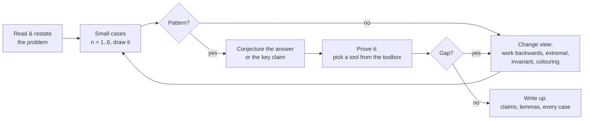

# 01 · Problem Solving & Proof Writing
> **Goal:** have a reliable process for attacking unfamiliar problems, and write proofs a grader can't fault. · **Time:** 2–3 weeks

👉 Drill technique recognition with the **[Which technique? quiz](interactive/technique-quiz.html)**, and play with invariants in the **[Invariant & pigeonhole lab](interactive/invariants-lab.html)**.

## Skip test
If you can do ALL of these without notes (and write each proof cleanly in under 15 min), skip the module.
- [ ] Prove by strong induction that every integer ≥ 2 is a product of primes.
- [ ] Prove $\sqrt 2$ is irrational by contradiction, and $\sqrt{2}+\sqrt{3}$ too.
- [ ] Use pigeonhole: among any 5 points in a unit square, two are within $\tfrac{\sqrt2}{2}$ of each other.
- [ ] Find an invariant: can a chessboard with two opposite corners removed be tiled by dominoes?
- [ ] Find a monovariant: integers are written on the vertices of a pentagon with positive sum; while some $y<0$ with neighbours $x,z$, replace $(x,y,z)\to(x+y,-y,z+y)$. Show the process stops (IMO 1986/3).
- [ ] Use the extremal principle: show a finite set of points, not all collinear, has a line through exactly 2 of them (Sylvester–Gallai).

## Core ideas
- **Process (Pólya):** understand → try small cases → find a pattern/conjecture → prove → check.

- **Small cases first.** Compute $n=1,2,3,4,5$. Most olympiad insights come from data.
- **Work backwards** from what's needed. **Draw a big, accurate figure** (geometry and combinatorics).
- **Proof toolbox:**
  - **Direct**, **contrapositive**, **contradiction**.
  - **Induction:** weak, strong, and "strengthen the hypothesis" (proving something stronger is often *easier*).
  - **Pigeonhole:** $n+1$ objects in $n$ boxes; more generally, some box has $\ge\lceil N/k\rceil$ of $N$ objects in $k$ boxes. The hard part is *choosing the boxes*.
  - **Extremal principle:** look at the largest/smallest/first object, then derive a contradiction or a structure.
  - **Invariants & monovariants:** a quantity that never changes, or changes in one direction only. This answers "can we reach state X?" and "does the process terminate?"
  - **Coloring / parity:** a 2-coloring or a mod-2/mod-3 argument rules things out.
  - **Infinite descent:** a minimal counterexample produces a smaller one, a contradiction.
- **Writing:** state what you prove. One claim per paragraph. Define every variable. Don't skip "obvious" steps the grader can't verify. **Partial credit comes from clearly proven lemmas**, so isolate them.

### Which tool? (recognition table)
| The problem says… | Reach for |
|---|---|
| "Can we ever reach…?" / "Is it possible to…?" | invariant (often mod 2, mod 3, or a colouring) |
| "Prove the process terminates" | monovariant: a non-negative integer that strictly decreases |
| "Show two of them…" / "at least one box…" | pigeonhole: design the boxes |
| "Prove for all $n$" with a recursive structure | induction (strengthen if it fails) |
| "No solutions exist" in integers | infinite descent / minimal counterexample, or mod $m$ |
| Points, sets, graphs with no obvious structure | extremal element (largest, smallest, closest pair, convex hull) |

## Worked examples

<b>Example 1 (invariant).</b> The numbers 1, 2, …, 10 are on a board. A move erases two numbers $a,b$ and writes $|a-b|$. After 9 moves one number remains. Can it be 0?

**Small cases:** $\{1,2\}\to1$; $\{1,2,3\}\to$ always even? Try: $(1,2)\to1$, then $\{1,3\}\to2$. $(2,3)\to1$, then $\{1,1\}\to0$. Even both times.

**Invariant:** $|a-b|\equiv a+b\pmod 2$, so the **parity of the sum** never changes. Initially $1+\dots+10=55$ is odd, so the final number is odd. **It can never be 0.**

*Key idea (1 line):* "a move that replaces $a,b$ by $f(a,b)$" → look for a quantity like the sum, product, or sum of squares that is preserved mod something.

<b>Example 2 (pigeonhole, choosing the boxes).</b> Prove that any set of 10 distinct two-digit numbers has two disjoint non-empty subsets with the same sum (IMO 1972/1).

There are $2^{10}-1=1023$ non-empty subsets. Each sum is at most $90+91+\dots+99=945$, so sums lie in $\{10,\dots,945\}$: fewer than 1023 values. By pigeonhole two different subsets $A\ne B$ have equal sum. Remove the common elements $A\cap B$ from both: the sums stay equal, the sets become disjoint, and neither becomes empty (if $A\setminus B=\varnothing$ then $A\subsetneq B$, so the sum of $B$ would be bigger).

*Key idea:* boxes = possible sums; then **repair** the pigeonhole output (remove the intersection).

<b>Example 3 (extremal principle).</b> Each of $n$ points in the plane is coloured red or blue, $n$ red and $n$ blue, no three collinear. Prove you can pair reds with blues by $n$ <i>non-crossing</i> segments.

Among all $n!$ pairings choose one with **minimal total length**. If two segments $R_1B_1$ and $R_2B_2$ crossed at $X$, then by the triangle inequality
$R_1B_2+R_2B_1 < (R_1X+XB_2)+(R_2X+XB_1) = R_1B_1+R_2B_2$,
so swapping gives a shorter pairing, a contradiction. (Strict because no three points are collinear.)

*Key idea:* "find a configuration with property P" → take the extremal one and show a violation could be improved.

<b>Example 4 (strengthen the induction).</b> Prove $\displaystyle \frac{1}{2}\cdot\frac{3}{4}\cdots\frac{2n-1}{2n} < \frac{1}{\sqrt{3n}}$ for all $n\ge1$… or is it easier to prove a stronger bound?

Induction on $<\frac1{\sqrt{3n}}$ directly needs $\frac{1}{\sqrt{3n}}\cdot\frac{2n+1}{2n+2}\le\frac{1}{\sqrt{3n+3}}$, i.e. $(2n+1)^2(3n+3)\le 3n(2n+2)^2$, i.e. $12n^3+24n^2+15n+3\le 12n^3+24n^2+12n$: **false**. Strengthen to $P_n\le\frac{1}{\sqrt{3n+1}}$. Base: $\frac12=\frac1{\sqrt4}$ ✓. Step needs $(2n+1)^2(3n+4)\le(3n+1)(2n+2)^2$, i.e. $12n^3+28n^2+19n+4\le12n^3+28n^2+20n+4$, i.e. $0\le n$ ✓. Then $P_n\le\frac1{\sqrt{3n+1}}<\frac1{\sqrt{3n}}$.

*Key idea:* when the step fails, look for a bound that is *tight at the base case*; it usually carries through.

## Practice (in rough order of difficulty)

P1. Can a 10×10 board be tiled by 1×4 rectangles?

Colour square $(i,j)$ with $(i+j)\bmod 4$. A 1×4 tile, horizontal or vertical, covers four consecutive values of $i+j$, so **one square of each colour**. A tiling would need equal colour counts. But on the 10×10 board the counts of colours 0, 1, 2, 3 are 25, 24, 25, 26. **No tiling.**

*Check your invariant separates the states:* with the four corners removed, the counts become 24, 24, 24, 24, so this colouring proves nothing for that board. A different idea is needed there.

P2. Prove that among any $n+1$ numbers from $\{1,2,\dots,2n\}$ one divides another.

Write each number as $2^k m$ with $m$ odd. There are only $n$ odd parts $m\in\{1,3,\dots,2n-1\}$, so two chosen numbers share the same $m$: $2^a m$ and $2^b m$ with $a<b$. The first divides the second.

P3. Show the equation $x^2+y^2=3z^2$ has no solution in positive integers.

Squares are $0$ or $1\pmod 3$, so $3\mid x^2+y^2$ forces $3\mid x$ and $3\mid y$. Then $9\mid 3z^2$, so $3\mid z$, and $(x/3,y/3,z/3)$ is a smaller solution. Infinite descent (take a solution with minimal $z$) gives a contradiction.

P4. On an 8×8 board, some squares are infected. Each minute, a square with ≥2 infected neighbours (sharing an edge) becomes infected. Show that if fewer than 8 squares are initially infected, the whole board never gets infected.

**Monovariant:** the perimeter of the infected region never increases. A newly infected square has ≥2 infected neighbours, so it removes at least 2 boundary edges and adds at most 2. The whole board has perimeter 32, and $k$ squares have perimeter ≤ $4k$. With $k\le7$, perimeter ≤ 28 < 32 forever.

P5. (IMO 1986/3, the Skip-test monovariant) Integers $x_1,\dots,x_5$ on a pentagon have positive sum. Show the move $(x,y,z)\to(x+y,-y,z+y)$ (applied when $y<0$) can only be done finitely often.

Let $S=\sum_i (x_{i+1}-x_{i-1})^2$ (indices mod 5). A direct expansion shows one move changes $S$ by $2y\cdot s$ where $s=\sum x_i>0$ and $y<0$, so $S$ strictly decreases by a positive integer each move. $S\ge0$ is an integer, so the process stops. (Many other monovariants work; checking the change by expansion is the main work.)

## Learn from
- ⭐ **The Art and Craft of Problem Solving**, Paul Zeitz 💲: ch. 1–3 (strategies, tactics). The best first book.
- **Problem-Solving Strategies**, Arthur Engel 💲: ch. 1–4 (invariants, coloring, extremal, pigeonhole). A huge problem bank.
- **[Evan Chen's handouts](https://web.evanchen.cc/handouts.html)**: see the proof-writing ("English") handout, and his **[OTIS Excerpts](https://web.evanchen.cc/textbooks/OTIS-Excerpts.pdf)** (free book; the first chapters on writing and on how to think about olympiad problems).
- **[How to Write Proofs, Larry Cusick (short guide)](https://zimmer.fresnostate.edu/~larryc/proofs/proofs.html)**.

## Build
- Write **10 complete proofs** of Engel ch. 1–4 problems. Have someone (or your future self, a week later) grade them strictly from 0–7.
- After each one, add a one-line key idea to the *Key-idea notebook* in `progress.md`.

## Traps
- "Proof by example": checking cases is **not** a proof.
- Pigeonhole with the wrong boxes: if the counts don't work, change the boxes, not the inequality.
- Induction that silently assumes the statement for $n+1$ (check the step goes *from* $n$ *to* $n+1$ with only proven facts).
- Invariants that are true but *don't separate* start and target (e.g. both have even sum). Test your invariant on both states first.
- Skipping writing practice. Many points are lost on correct ideas that are written up with gaps, so practise full write-ups from week 1.

## Done when
- [ ] 10 proofs graded ≥ 6/7 by a strict reader  - [ ] you can name the right tool for every row of the recognition table without looking
