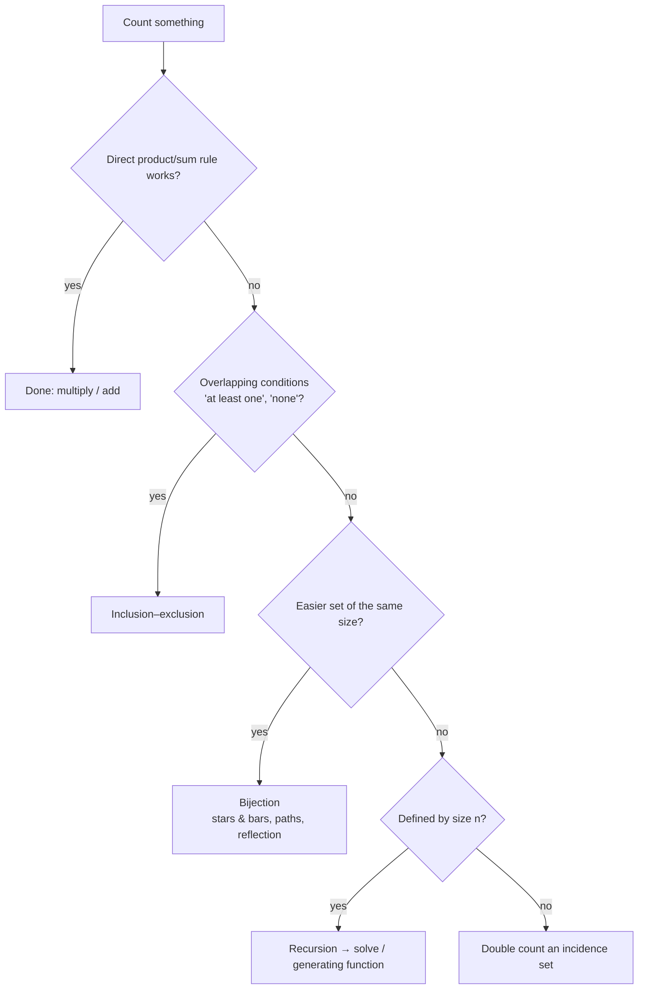

# 04 · Combinatorics
> **Goal:** the hardest and least formulaic IMO area. Build a toolkit, then lots of experience. · **Time:** 5–7 weeks (in rotation)

👉 Tools: **[Lattice paths & Catalan](interactive/lattice-paths.html)** (Pascal counts, the reflection principle), **[Games lab](interactive/games-lab.html)** (Nim, P/N positions, Sprague–Grundy), and the combinatorics set of the **[Which technique? quiz](interactive/technique-quiz.html)**.

## Skip test
- [ ] Count lattice paths from $(0,0)$ to $(m,n)$ and give a bijective proof of $\binom{n}{k}=\binom{n}{n-k}$.
- [ ] Use stars and bars: the number of solutions of $x_1+\dots+x_k=n$ with $x_i\ge0$.
- [ ] Inclusion–exclusion: count derangements $D_n$.
- [ ] Double counting: prove $\sum_v \deg v = 2|E|$, and $\sum_k k\binom nk = n2^{n-1}$.
- [ ] Game theory: find the winning positions in Nim.
- [ ] Prove $R(3,3)=6$.

## Core ideas
- **Counting:** product/sum rule, permutations, $\binom nk$, stars and bars, **inclusion–exclusion**, **bijections** (count something else that is easier).
- **Double counting:** count the same set two ways, e.g. pairs (person, club) by person and by club.
- **Recursion:** set up $a_n$ in terms of smaller cases (tilings, paths). **Catalan numbers** $C_n=\frac1{n+1}\binom{2n}{n}$.
- **Generating functions:** $\sum a_nx^n$ turns counting into algebra.
- **Pigeonhole, extremal, invariants, monovariants, coloring** (from module 01) are *the* combinatorics weapons.
- **Graph theory:** degrees, trees ($|E|=|V|-1$), bipartite ⟺ no odd cycle, Euler circuit ⟺ connected and all degrees even (Euler path: 0 or 2 odd vertices), Hall's marriage theorem, Turán's theorem ($K_{r+1}$-free on $n$ vertices ⇒ at most $(1-\frac1r)\frac{n^2}{2}$ edges; Mantel: triangle-free ⇒ $\le\lfloor n^2/4\rfloor$), Ramsey ($R(3,3)=6$, $R(s,t)\le R(s-1,t)+R(s,t-1)$).
- **Algorithms & processes:** "does the process end?" → find a monovariant (a bounded, strictly changing quantity).
- **Games:** label positions **P** (previous player wins = the player to move loses) or **N** (next player wins) by working backwards: a position is N iff some move leads to a P-position. **Strategy stealing**. Symmetry strategies. **Nim:** P-position ⟺ XOR of pile sizes is 0. **Sprague–Grundy:** every impartial game position has a Grundy value $g=\operatorname{mex}\{g(\text{options})\}$; a sum of games is P ⟺ XOR of values is 0.
- **Combinatorial geometry:** convex hulls, the extremal point, coloring the plane.
- **Probabilistic method:** if a random object has expected bad count < 1, then a good object exists.
- **Constructions:** many problems ask for "the maximum" → you must give a **construction** *and* a **bound**. Two separate proofs.

### How the counting tools connect

## Worked examples

<b>Example 1 (bijection, stars and bars).</b> How many solutions does $x_1+x_2+x_3+x_4=10$ have with $x_i\ge0$? With $x_i\ge1$?

Write 10 stars and 3 bars in a row; each arrangement ↔ one solution (the bars cut the stars into 4 groups). $\binom{13}{3}=286$. For $x_i\ge1$ substitute $y_i=x_i-1\ge0$, $\sum y_i=6$: $\binom{9}{3}=84$.

<b>Example 2 (reflection principle, Catalan).</b> How many lattice paths from $(0,0)$ to $(n,n)$ with unit steps right/up never go above the diagonal $y=x$?

All paths: $\binom{2n}{n}$. A **bad** path touches $y=x+1$. Reflect the part of a bad path *after* its first touch across $y=x+1$: the endpoint $(n,n)$ maps to $(n-1,n+1)$, and this is a bijection between bad paths and **all** paths to $(n-1,n+1)$, of which there are $\binom{2n}{n+1}$. Good paths: $\binom{2n}{n}-\binom{2n}{n+1}=\frac1{n+1}\binom{2n}n=C_n$. See it in the **[lattice-path tool](interactive/lattice-paths.html)**.

<b>Example 3 (double counting).</b> Prove $\sum_{k=0}^n k\binom nk=n2^{n-1}$.

Count pairs (committee, chair) from $n$ people where the chair is in the committee. By committee size $k$: $\sum k\binom nk$. By chair first: $n$ choices, then any subset of the other $n-1$: $n2^{n-1}$.

<b>Example 4 (bound + construction).</b> What is the largest subset of $\{1,\dots,2n\}$ with no element dividing another?

**Bound:** $n+1$ numbers always contain a divisor pair (module 01, P2: group by odd part). So at most $n$. **Construction:** $\{n+1,\dots,2n\}$: any multiple of $k\ge n+1$ other than $k$ is $\ge 2n+2$. **Answer $n$.** Both halves are needed for full marks.

<b>Example 5 (Ramsey, $R(3,3)=6$).</b> Colour the edges of $K_6$ red/blue. Prove there is a monochromatic triangle, and that $K_5$ can avoid one.

Pick a vertex $v$: it has 5 edges, so by pigeonhole $\ge3$ share a colour, say red to $a,b,c$. If any of $ab,bc,ca$ is red, it closes a red triangle with $v$; otherwise $abc$ is a blue triangle. For $K_5$: colour the pentagon edges red and the pentagram (diagonals) blue: both colour classes are 5-cycles, which contain no triangle.

<b>Example 6 (games, P/N positions).</b> From a pile of $n$ stones a move removes 1, 3, or 4 stones; the player who can't move loses. Which $n$ are losing for the player to move?

Work backwards: $0$ is P. $n=1$: move to 0 (P) ⇒ N. $2$: only to 1 (N) ⇒ P. $3,4,5,6$: N (reach 0 or 2). $7$: moves to 6, 4, 3, all N ⇒ P. Pattern: **P ⟺ $n\equiv0,2\pmod7$**. Prove by induction: from $7k$ or $7k+2$ every move lands in a residue in $\{1,3,4,6,5\}$ (all N), and from each N residue there's a move to 0 or 2 mod 7. The **[Games lab](interactive/games-lab.html)** computes such tables for any move set.

## Practice

C1. In how many ways can you seat 5 couples in a row so that no couple sits together?

Inclusion–exclusion over the set $S$ of couples that sit together: $\sum_{k=0}^{5}(-1)^k\binom5k 2^k(10-k)!$ $=3628800-5\cdot2\cdot362880+10\cdot4\cdot40320-10\cdot8\cdot5040+5\cdot16\cdot720-32\cdot120=1263360$.

C2. Prove that in any group of $n\ge2$ people, two have the same number of friends inside the group.

Degrees lie in $\{0,\dots,n-1\}$, but 0 and $n-1$ can't both occur (someone friends with everyone vs. someone with no friends). So at most $n-1$ values for $n$ people: pigeonhole.

C3. A triangle-free graph has $n$ vertices. Prove it has at most $n^2/4$ edges (Mantel).

For an edge $uv$, $N(u)\cap N(v)=\varnothing$ (else a triangle), so $\deg u+\deg v\le n$. Sum over edges: $\sum_{uv\in E}(\deg u+\deg v)=\sum_v\deg(v)^2\le n|E|$. By Cauchy–Schwarz $\sum\deg^2\ge\frac{(2|E|)^2}{n}$. So $\frac{4|E|^2}{n}\le n|E|$, $|E|\le\frac{n^2}4$. Equality: complete bipartite $K_{n/2,n/2}$.

C4. Nim with piles 3, 5, 6. Who wins, and what is the winning first move?

$3\oplus5\oplus6=011\oplus101\oplus110=000$. XOR is 0: **the second player wins**; there is no winning first move. (With piles 3, 5, 7: XOR $=1$; take 1 from the pile of 3, 5 or 7 whose XOR with 1 is smaller, e.g. $3\to2$: $2\oplus5\oplus7=0$.)

C5. Prove that every tournament (each pair plays once, no draws) has a Hamiltonian path: an ordering $v_1,\dots,v_n$ where $v_i$ beat $v_{i+1}$ for all $i$.

Induction on $n$. Take a Hamiltonian path $v_1\to\dots\to v_{n-1}$ of the first $n-1$ players and insert $v_n$: if $v_n\to v_1$ put it first. Otherwise $v_1\to v_n$; if $v_{n-1}\to v_n$ put it last. Otherwise $v_n\to v_{n-1}$, so there is a **first** $i\ge2$ with $v_n\to v_i$; by minimality $v_{i-1}\to v_n$, so insert $v_n$ between $v_{i-1}$ and $v_i$.

## Learn from
- ⭐ **[Problem Solving Methods in Combinatorics, Pablo Soberón](https://link.springer.com/book/10.1007/978-3-0348-0597-1)** 💲: short, by technique, IMO-focused.
- **[Yufei Zhao's combinatorics handouts](https://yufeizhao.com/olympiad/)** (e.g. "Combinatorics: a few techniques", double counting).
- **102 Combinatorial Problems**, Andreescu & Feng 💲 · **Engel** ch. on combinatorics · **[Evan Chen's handouts](https://web.evanchen.cc/handouts.html)**.
- **[AoPS: Intro / Intermediate Counting & Probability](https://artofproblemsolving.com/store)** 💲 for the basics.

## Build
- Solve **C1–C4** from the last 5–8 IMO Shortlists. Combinatorics gets better mostly with *volume*, so aim for 60+ problems.

## Traps
- Overcounting from treating identical objects as distinct (or the reverse).
- For max/min problems: giving only the construction or only the bound.
- Inclusion–exclusion sign or term errors: write the general term $(-1)^k\binom{m}{k}N_k$ before plugging numbers, and sanity-check with a tiny case.
- In games, calling a position "winning" without saying **for whom** (use P/N).

## Done when
- [ ] Every Skip-test item done cleanly  - [ ] 60 combinatorics problems solved, key ideas logged in `progress.md`
