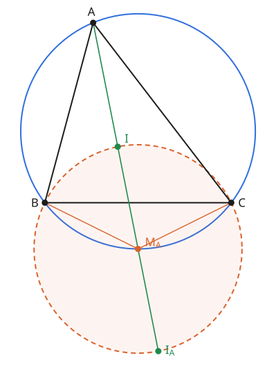

# 05 · Geometry
> **Goal:** from angle chasing to projective tools, plus reliable computational backups. · **Time:** 5–7 weeks (in rotation)

👉 Use the **[Triangle centers explorer](interactive/triangle-centers.html)** and the **[Power of a point & radical axis lab](interactive/power-of-a-point.html)** while studying this module.

## Skip test
- [ ] Prove a convex quadrilateral is cyclic **iff** its opposite angles sum to 180° (both directions).
- [ ] State and use the **power of a point** and the **radical axis** theorem.
- [ ] Prove the orthocenter's reflection over a side lies on the circumcircle.
- [ ] Prove the **incenter–excenter lemma**: $I$, $B$, $C$, $I_A$ all lie on a circle centered at the arc midpoint $M_A$.
- [ ] Prove $O,G,H$ are collinear with $OG:GH=1:2$ (hint: the homothety at $G$ with ratio $-\tfrac12$), and that the nine-point circle has center the midpoint of $OH$ and radius $R/2$.
- [ ] Set up a problem in complex numbers with the unit circle as the circumcircle.

## Core ideas (in learning order)
1. **Angle chasing:** inscribed angle theorem, cyclic quadrilaterals, tangent–chord angle. **Directed angles mod 180°** avoid configuration issues.
2. **Triangle centers & lemmas:** centroid $G$, circumcenter $O$, incenter $I$, orthocenter $H$. Euler line $O,G,H$ with $OG:GH=1:2$. Nine-point circle. Incenter–excenter lemma. Reflections of $H$.
3. **Length tools:** law of sines/cosines, **Ceva** and **Menelaus** (with the trig version), Stewart, Ptolemy.
4. **Circles:** **power of a point**, **radical axis / radical center**, coaxal circles, tangent circles.
5. **Transformations:** homothety (e.g. the incircle–excircle homothety), spiral similarity (Miquel point), reflections, rotations.
6. **Projective (IMO level):** cross-ratio, harmonic bundles, poles/polars, Pascal and Brianchon, Desargues' involution.
7. **Inversion:** turns circles through the center into lines. Great for tangency problems.
8. **Computational "bash" backups:** Cartesian coordinates, **complex numbers** (unit circle), **barycentric coordinates**. Slow but reliable. Learn **one** well as a safety net.

### The incenter–excenter lemma (picture)

*$M_A$ is the midpoint of arc $BC$ not containing $A$. It lies on line $AI$, and $M_AB=M_AC=M_AI=M_AI_A$.* Proof of $M_AB=M_AI$: $\angle M_ABI=\angle M_ABC+\angle CBI=\frac{A}{2}+\frac{B}{2}$ and $\angle BIM_A=\angle IAB+\angle ABI=\frac A2+\frac B2$ (exterior angle of $\triangle ABI$). So $\triangle M_ABI$ is isosceles.

## Worked examples

<b>Example 1 (angle chasing, reflection of H).</b> Prove the reflection of the orthocenter $H$ over $BC$ lies on the circumcircle.

Let $AH$ meet the circumcircle again at $H'$ and $BC$ at $D$ (acute case). $\angle HBC=90^\circ-C$ (in right triangle $BEC$ with $E$ the foot from $B$). $\angle H'BC=\angle H'AC=90^\circ-C$ (same arc $H'C$). So $BD$ bisects $\angle HBH'$ and is perpendicular to $HH'$: triangles $BDH\cong BDH'$, so $DH=DH'$. With **directed angles** the same argument covers obtuse triangles.

<b>Example 2 (power of a point).</b> Two circles meet at $X,Y$. Prove that line $XY$ bisects every common tangent segment.

Let a common tangent touch the circles at $P,Q$, and let $XY$ meet $PQ$ at $M$. $M$ is on the radical axis $XY$, so its powers are equal: $MP^2=MX\cdot MY=MQ^2$. Hence $MP=MQ$.

<b>Example 3 (radical center).</b> Three circles pairwise intersect. Prove the three common chords are concurrent.

Each common chord lies on the radical axis of its pair. Two of them meet at a point with equal power to all three circles, so that point is on the third axis too (centres not collinear ⇒ the axes are not parallel). Try it in the **[lab](interactive/power-of-a-point.html)**.

<b>Example 4 (complex bash).</b> On the unit circle, prove $H=a+b+c$.

Let $h=a+b+c$. Then $h-a=b+c$ and $b-c$. For $AH\perp BC$ we need $\frac{b+c}{b-c}$ purely imaginary. Its conjugate is $\frac{1/b+1/c}{1/b-1/c}=\frac{c+b}{c-b}=-\frac{b+c}{b-c}$ ✓. By symmetry $BH\perp CA$, so $h$ is the orthocenter. Then $G=\frac{a+b+c}3=\frac h3$ shows $O=0,G,H$ collinear with $OG:GH=1:2$.

## Practice

G1. $ABCD$ is cyclic with $AB=AD$. Prove $AC$ bisects $\angle BCD$.

Equal chords $AB=AD$ subtend equal inscribed angles: $\angle ACB=\angle ACD$.

G2. Prove Ptolemy's theorem for a cyclic quadrilateral $ABCD$: $AC\cdot BD=AB\cdot CD+AD\cdot BC$.

Pick $E$ on $AC$ with $\angle ABE=\angle DBC$. Then $\triangle ABE\sim\triangle DBC$ (also $\angle BAE=\angle BDC$, same arc), so $AE=\frac{AB\cdot CD}{BD}$. Also $\triangle CBE\sim\triangle DBA$ ($\angle CBE=\angle DBA$, $\angle BCE=\angle BDA$), so $CE=\frac{BC\cdot AD}{BD}$. Add: $AC=AE+EC$.

G3. Let $\omega$ be the incircle of $ABC$, tangent to $BC$ at $D$. Prove $BD=s-b$ where $s$ is the semiperimeter.

Tangent lengths from a point are equal: call them $x$ from $A$, $y$ from $B$, $z$ from $C$. Then $y+z=a$, $z+x=b$, $x+y=c$, so $y=\frac{a+c-b}2=s-b$.

G4. Point $P$ lies outside circle $\omega$ (centre $O$, radius $r$). A line through $P$ meets $\omega$ at $A,B$; the tangent from $P$ touches at $T$. Prove $PA\cdot PB=PT^2=PO^2-r^2$.

$\triangle PTA\sim\triangle PBT$ (common angle $P$; tangent–chord angle $\angle PTA=\angle PBT$), so $\frac{PT}{PB}=\frac{PA}{PT}$. And $OT\perp PT$ gives $PT^2=PO^2-r^2$ (Pythagoras).

## Learn from
- ⭐ **Euclidean Geometry in Mathematical Olympiads (EGMO), Evan Chen** 💲. *The* olympiad geometry book. Part I (ch. 1–4) is essential, Part II for IMO-level. Some chapters are free on [his website](https://web.evanchen.cc/).
- **[Yufei Zhao: Lemmas in Euclidean geometry, Cyclic quadrilaterals handouts](https://yufeizhao.com/olympiad/)**.
- **Lemmas in Olympiad Geometry**, Andreescu, Korsky & Pohoata 💲 · **Geometry Revisited**, Coxeter & Greitzer 💲 (classic).
- **[GeoGebra](https://www.geogebra.org/geometry)**: draw every problem precisely. It's free.

## Build
- For every geometry problem: (1) draw an accurate figure, (2) **guess** the key concurrency/collinearity from the figure, (3) prove it synthetically, (4) as a backup, prove it with complex/barycentric bash.
- Solve G1–G4 from recent IMO Shortlists.

## Traps
- Proofs that only work for one configuration. Use directed angles.
- Over-relying on bash. It's a time sink on hard problems, so keep it as plan B.
- Trusting a sketchy figure: an inaccurate drawing suggests false concurrences. Use GeoGebra or the repo tools for a precise one.
- Writing "by symmetry" or "clearly" for a configuration fact (which side a point is on). State and justify it, or use directed angles.

## Done when
- [ ] Every Skip-test item done cleanly  - [ ] G1–G4 from 5 recent IMO Shortlists solved, each with one synthetic and one bash proof
