# 06 · Contest Practice & Solution Writing
> **Goal:** turn knowledge into points under exam conditions. · **Time:** ongoing from week 3

👉 Run every mock with the **[Mock exam timer & log](interactive/mock-exam.html)**: 4.5 h countdown with phase reminders, strict 0–7 self-grading, and a log you can export.

## Skip test
You can skip the *advice* here (not the practice!) if all of these are already true:
- [ ] You have sat at least 5 full 4.5-hour mocks under real conditions.
- [ ] Your self-grades match an outside grader within 1 point per problem.
- [ ] You keep a one-line key-idea log for every problem you've studied.
- [ ] You fully solve P1/P4-level problems in most mocks.

## Core ideas
- **Mock exams:** 3 problems, 4.5 h, no notes, real timer. Use past national olympiads → **IMO Shortlist (ISL)** → past IMOs.
- **Grade strictly** on the 0–7 IMO scale. IMO marking schemes give points for specific milestones (a key lemma, a correct bound, a full construction), and little for "ideas" without proof. An almost-complete solution with a real gap is often worth only a few points, so don't give yourself a 6 for "basically done".
- **Time allocation:** first ~30 min reading *all* three problems and trying small cases. Spend most of the time on the problem you're most likely to fully solve. Reserve the last ~30 min to write up what you have.
- **Partial credit:** write down proven lemmas, reductions, and the answer with a construction. Graders reward *substantial progress*, not attempts.
- **Post-mortem every mock:** for each problem, what was the key idea, and what would have led you to it faster? Log it in `progress.md`.
- **Difficulty ladder** (roughly): school/regional → national olympiad → hard national (e.g. USAMO/Balkan/APMO style) → ISL easy (A1/C1/G1/N1) → IMO P1/P4 → ISL medium → IMO P2/P5 → P3/P6.

```mermaid
gantt
  title A 4.5-hour paper (example plan)
  dateFormat HH:mm
  axisFormat %H:%M
  section Explore
  Read all 3, small cases, draw figures :a1, 00:00, 30m
  section Solve
  Main attack on the most promising problem :a2, after a1, 120m
  Second problem (or continue)            :a3, after a2, 60m
  section Write
  Write up every proven piece cleanly     :a4, after a3, 60m
```

## What a full-marks write-up looks like

Sample: prove that $n^5-n$ is divisible by 30 for every integer $n$.

**Solution.** $30=2\cdot3\cdot5$ with pairwise coprime factors, so it suffices to show $2$, $3$ and $5$ each divide $n^5-n$.

*Claim 1: $5\mid n^5-n$.* By Fermat's little theorem, $n^5\equiv n\pmod5$ for every integer $n$ (this form holds even when $5\mid n$).

*Claim 2: $3\mid n^5-n$.* $n^5-n=n(n^4-1)=(n^3-n)(n^2+1)$ and $n^3-n=(n-1)n(n+1)$ is a product of three consecutive integers, so divisible by 3.

*Claim 3: $2\mid n^5-n$.* $n^5$ and $n$ have the same parity.

Combining the claims, $2\cdot3\cdot5=30$ divides $n^5-n$. $\blacksquare$

*Why it scores 7:* the reduction is stated and justified (coprimality), each claim is proven, nothing is "clear".

## Self-grading guide (adapted from typical IMO-style marking)
| Score | What you have |
|---|---|
| 7 | Complete, correct proof. Minor slips that don't affect correctness. |
| 5–6 | Complete approach with a small fixable gap or a missing easy case. |
| 2–4 | Substantial progress: a key lemma proven, or a correct reduction to a much simpler problem, or answer + construction with a partial bound. |
| 1 | A non-trivial useful observation proven (e.g. the right answer **with** a correct construction for a "find all/max" problem). |
| 0 | Only small cases, a conjecture, or an idea without proof. |

## Where to find problems
- ⭐ **[AoPS Contest Collections](https://artofproblemsolving.com/community/c13_contest_collections)**: almost every olympiad ever, with community solutions.
- ⭐ **[IMO official site: problems & results](https://www.imo-official.org/problems.aspx)**. The **IMO Shortlist** for year X is kept confidential until the end of IMO X+1, then published on the same page.
- **[Evan Chen's OTIS Excerpts](https://web.evanchen.cc/textbooks/OTIS-Excerpts.pdf)** (free) and his **[MOHS hardness ratings](https://web.evanchen.cc/upload/MOHS-hardness.pdf)** (to pick problems at the right level).
- Past papers of your **own national olympiad**. Ask the committee or past participants.

## Traps
- Reading solutions too early. Stay stuck 30–60 min first; otherwise you train recognition, not discovery.
- Doing only "favourite" topics in mocks. Use full past papers so the mix is realistic.
- Writing "it is easy to see" for the hardest step. If you skip it, the grader assumes you couldn't do it.

## Done when
- [ ] You consistently fully solve P1/P4-level problems in mocks and have partial progress on P2/P5.
