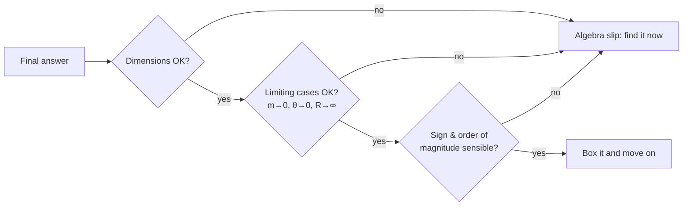

# 01 · Math Methods & Estimation
> **Goal:** the mathematical moves olympiad physics uses constantly. · **Time:** 1–2 weeks (you're strong at math, so this is mostly about the *physics habits*)

👉 Interactive: [Dimensional analysis solver](interactive/dimensional.html) · [Auto-graded quiz](interactive/quiz.html?deck=Methods)

## Skip test
If you can do ALL of these without notes, in about 30 minutes, skip the module.
- [ ] Use dimensional analysis to find the period of a pendulum and the speed of deep-water waves ($v\propto\sqrt{g\lambda}$). Say what dimensional analysis *cannot* tell you.
- [ ] Expand $(1+x)^n$, $\sqrt{1+x}$, $\sin x$, $\cos x$, $\tan x$, $e^x$, $\ln(1+x)$ to second order (third for $\sin$, $\tan$).
- [ ] Solve $\ddot x + 2\gamma\dot x + \omega_0^2 x = 0$ in all three damping regimes, and say which one returns to zero fastest.
- [ ] Solve $\dot v = -kv^2$ for $v(t)$ and $x(t)$.
- [ ] Estimate the number of air molecules in your room, to within a factor of 3.
- [ ] Compute the flux of a uniform field through a hemisphere using a symmetry argument, not an integral.
- [ ] Find the equilibria of $U(x) = -\tfrac12 kx^2 + \tfrac14\lambda x^4$, say which are stable, and give the small-oscillation frequency.

## Core ideas
- **Dimensional analysis:** write $[Q] = M^aL^bT^c\ldots$ and match exponents. With $n$ quantities built from $k$ base dimensions you get $n-k$ independent dimensionless groups (Buckingham π theorem). If there is only one group, the answer is fixed up to a constant. If there are two or more, an unknown *function* remains. It is also the fastest check on every result.
- **Small-quantity expansions:** $(1+x)^n\approx1+nx+\frac{n(n-1)}2x^2$. **Keep the first non-vanishing order.** Most IPhO tasks say "to first order in $\epsilon$". If the first-order terms cancel, you must go to second order *consistently* in every term.
- **Fermi estimation:** break it into factors and get each within ×3. Errors partly cancel, so the product is usually better than you'd fear.
- **ODEs you must solve instantly:**
  - $\dot x = -x/\tau$ → $x = x_0e^{-t/\tau}$. $\ddot x = -\omega^2x$ → $x = A\cos(\omega t+\varphi)$.
  - Damped $\ddot x + 2\gamma\dot x + \omega_0^2x = 0$: try $e^{st}$, so $s = -\gamma\pm\sqrt{\gamma^2-\omega_0^2}$. Under-damped ($\gamma<\omega_0$): $e^{-\gamma t}\cos(\omega_dt+\varphi)$ with $\omega_d=\sqrt{\omega_0^2-\gamma^2}$. Critical ($\gamma=\omega_0$): $(A+Bt)e^{-\gamma t}$, the fastest return without overshoot. Over-damped: sum of two decaying exponentials.
  - Quadratic drag $\dot v = -kv^2$ → $v = \dfrac{v_0}{1+kv_0t}$, $x = \dfrac1k\ln(1+kv_0t)$. Separation of variables does most first-order ODEs.
- **Vector calculus (light):** gradient, divergence, curl as physical ideas. Gauss and Stokes theorems → Gauss's law and Ampère's law.
- **Symmetry first:** before integrating, ask what symmetry makes the integral trivial.
- **Limiting cases:** check every answer at $m\to0$, $\theta\to0$, $R\to\infty$, etc.
- **Stability:** equilibria are where $U'(x_0)=0$. Stable if $U''(x_0)>0$, and then $\omega^2 = U''(x_0)/m$.

## Worked examples

**1. Deep-water waves.** Assume $v$ depends on $g$, $\lambda$ and the density $\rho$. Write $v = g^a\lambda^b\rho^c$. Then $LT^{-1} = (LT^{-2})^aL^b(ML^{-3})^c$. Mass gives $c=0$, time gives $a=\tfrac12$, length gives $a+b=1$, so $b=\tfrac12$. Hence $v = C\sqrt{g\lambda}$. The exact result is $v=\sqrt{g\lambda/2\pi}$, so $C = 1/\sqrt{2\pi}\approx0.40$. Dimensional analysis gives everything except that constant. Density drops out because it is the only quantity containing mass.

**2. First non-vanishing order.** Find $\sqrt{1+x}-\sqrt{1-x}-x$ for small $x$. To first order, $\sqrt{1\pm x}\approx1\pm\frac x2$, so the whole thing is $0$. That isn't wrong, but it isn't the answer either. The $x^2$ terms cancel by symmetry, so go to third order. $\sqrt{1+x} = 1+\frac x2-\frac{x^2}8+\frac{x^3}{16}-\dots$, so the expression is $2\cdot\frac{x^3}{16} = \frac{x^3}{8}$.

**3. Hemisphere flux.** A uniform field $\mathbf E$ points along the axis of a hemisphere of radius $R$. The hemisphere and its flat base form a closed surface with no charge inside, so the net flux is 0. The flux through the hemisphere is therefore the flux through the disk: $\Phi = E\pi R^2$. No integral needed.

## Practice

<b>P1.</b> A small water droplet oscillates under surface tension. Find how its frequency scales with σ, ρ and R.

$[\sigma] = MT^{-2}$, $[\rho]=ML^{-3}$, $[R]=L$. Try $f = \sigma^a\rho^bR^c$. Mass: $a+b=0$. Time: $-2a=-1$, so $a=\tfrac12$ and $b=-\tfrac12$. Length: $-3b+c=0$, so $c=-\tfrac32$. Result: $f\propto\sqrt{\sigma/(\rho R^3)}$. (Rayleigh's exact lowest mode gives $\omega^2 = 8\sigma/(\rho R^3)$.)

<b>P2.</b> Estimate the number of air molecules in a 4 m × 5 m × 3 m room.

$n = p/(k_BT) = 10^5/(1.38\times10^{-23}\times293)\approx2.5\times10^{25}\ \text{m}^{-3}$. With $V = 60\ \text{m}^3$: $N\approx1.5\times10^{27}$. A cruder route: 1 mol occupies about 24 L, so $60\,000/24\approx2500$ mol $\approx1.5\times10^{27}$ molecules.

<b>P3.</b> A puck slides on a surface with drag force −mkv². Starting at v₀, how far has it gone when its speed has halved?

$v = v_0/(1+kv_0t)$ reaches $v_0/2$ at $kv_0t = 1$. Then $x = \frac1k\ln(1+kv_0t) = \frac{\ln2}{k}$. Faster: $v\,dv/dx = -kv^2$ gives $v = v_0e^{-kx}$ directly, so $x = \ln 2/k$, which doesn't depend on $v_0$.

<b>P4.</b> A particle of mass m moves in U(x) = −½kx² + ¼λx⁴ (k, λ > 0). Find the stable equilibria and the small-oscillation frequency.

$U' = -kx+\lambda x^3 = 0$ gives $x=0$ or $x=\pm\sqrt{k/\lambda}$. $U'' = -k+3\lambda x^2$: at $x=0$ it is $-k<0$ (unstable), and at $\pm\sqrt{k/\lambda}$ it is $2k>0$ (stable). So $\omega = \sqrt{2k/m}$, which doesn't depend on $\lambda$.

<b>P5.</b> Expand the period of a pendulum to first order in the amplitude θ₀².

$T \approx 2\pi\sqrt{L/g}\left(1+\frac{\theta_0^2}{16}\right)$. At $\theta_0 = 20^\circ = 0.35$ rad, the correction is 0.76%. That is already bigger than a good timing error, so it matters for the experimental exam.

## Common mistakes
- Expanding to first order when the first-order terms cancel, then reporting "0" (see worked example 2).
- Mixing orders: keeping $x^2$ in one factor but dropping it in another factor of the same product.
- Treating the constant from dimensional analysis as 1. It is often $2\pi$ or $1/2\pi$, which is a factor of 6.
- Forgetting that angles are dimensionless, so $f(\theta)$ can hide anywhere in a dimensional-analysis answer.

## Learn from
- ⭐ **[Kevin Zhou's handouts](https://knzhou.github.io/#handouts)**: **P1** (dimensional analysis, limiting cases, series expansions) and **P2** (estimation, error analysis). Oscillation ODEs are in **M4**. These are the best free olympiad physics materials.
- **[Street-Fighting Mathematics](https://library.oapen.org/handle/20.500.12657/26090), Sanjoy Mahajan**: an open-access book (CC-licensed, free PDF via OAPEN) on estimation and approximation.
- **Mathematical Methods for Physics and Engineering**, Riley, Hobson & Bence 💲: reference only.

## Build
- Redo 10 textbook results using only dimensional analysis + one physical argument, and check them against the exact formula. The [dimensional analysis solver](interactive/dimensional.html) checks your exponents.

## Done when
- [ ] Every Skip-test item takes under 5 minutes.  - [ ] You run the three checks (dimensions, limits, magnitude) on every answer without thinking.
