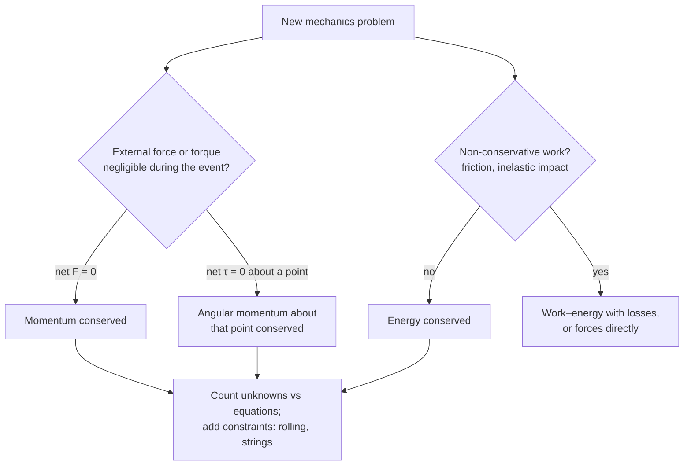

# 02 · Mechanics
> **Goal:** the backbone of every IPhO (often 1–2 of the 3 theory problems). · **Time:** 5–7 weeks

👉 Interactive: [Orbit simulator](interactive/orbits.html) · [Driven damped oscillator](interactive/oscillator.html) · [Coupled oscillators & normal modes](interactive/normal-modes.html) · [Quiz](interactive/quiz.html?deck=Mechanics)

## Skip test
- [ ] A ladder leans on a frictionless wall with floor friction μ. Find the minimum angle before it slips.
- [ ] A cylinder rolls without slipping down an incline. Find its acceleration two ways: forces/torques, and energy.
- [ ] Find the period of small oscillations about a stable equilibrium of $U(x)$ ($\omega^2 = U''(x_0)/m$).
- [ ] Two equal masses are joined by a coupling spring κ, and each is tied to a wall by a spring k. Find both normal-mode frequencies and the beat period.
- [ ] Derive Kepler's third law for circular orbits, and the escape velocity. Use the effective potential to explain why orbits have a closest approach.
- [ ] In a rotating frame, write down the centrifugal and Coriolis forces. Find the shape of the water surface in a spinning bucket.
- [ ] A rocket expels mass at relative speed $u$. Derive $\Delta v = u\ln(m_0/m_f)$.

## Core ideas
- **Kinematics:** projectiles, relative motion, constraints (strings, rods, rolling: $v = \omega R$).
- **Newton's laws:** free-body diagrams. **Choose axes wisely.** Non-inertial frames add $-m\mathbf a_{frame}$, centrifugal $-m\boldsymbol\omega\times(\boldsymbol\omega\times\mathbf r)$ (magnitude $m\omega^2r_\perp$, outward), and Coriolis $-2m\boldsymbol\omega\times\mathbf v$.
- **Conservation laws:** energy (work–energy, potential energy), momentum (collisions, CM frame), angular momentum (central forces, a skater pulling in her arms). **Ask which quantity is conserved before writing equations.**
- **Rigid bodies:** moment of inertia (parallel/perpendicular axis theorems), torque $\boldsymbol\tau = \mathbf r\times\mathbf F$, $\tau = I\alpha$ about the CM or a fixed axis, rolling, the instantaneous axis of rotation, statics (Σ**F** = 0 and Σ**τ** = 0 about *any* point).
- **Oscillations:** SHM, small-oscillation approximations, energy method, coupled oscillators and **normal modes** (find them from symmetry first: in-phase and anti-phase), damped/driven oscillators, resonance, the Q-factor.
- **Gravitation:** Kepler's laws, the effective potential $U_{eff} = -\frac{GMm}{r}+\frac{L^2}{2mr^2}$, orbital energy $E = -\frac{GMm}{2a}$, vis-viva $v^2 = GM\left(\frac2r-\frac1a\right)$, the shell theorem.
- **Variable mass:** rockets, chains, conveyor belts. Write momentum balance for the *whole* system over a time $dt$; $F = m\,dv/dt$ alone is wrong when mass enters or leaves.
- **Fluids:** hydrostatics, Archimedes, Bernoulli (along a streamline, steady, incompressible, inviscid), continuity, surface tension (Laplace pressure $\Delta p = 2\sigma/R$ for a drop, $4\sigma/R$ for a soap bubble with two surfaces), viscosity basics.
- 💡 **Lagrangian mechanics** is optional at IPhO but often a shortcut for complicated constraints. Learn it after the Newtonian toolkit is solid.

## Worked examples

**1. Ladder against a frictionless wall.** Length $L$, mass $m$, angle $\theta$ with the floor. The forces are: weight $mg$ at the middle, floor normal force $N = mg$, floor friction $f$ (pointing toward the wall), wall normal force $N_w = f$. Take torques about the foot, which removes two unknowns: $N_wL\sin\theta = mg\frac L2\cos\theta$. So $f = \frac{mg}{2\tan\theta}\le\mu mg$, which gives $\tan\theta_{min} = \frac1{2\mu}$. With μ = 0.5 that is 45°.

**2. Rolling, two ways.** A body of radius $R$ and $I = \beta mR^2$ rolls down an incline.
- *Forces:* $mg\sin\theta - f = ma$ and $fR = I\alpha = \beta mR^2(a/R)$. Eliminating $f$ gives $a = \dfrac{g\sin\theta}{1+\beta}$.
- *Energy:* $mgh = \tfrac12mv^2(1+\beta)$. Differentiate with respect to time and use $\dot h = v\sin\theta$. The result is the same.

Solid sphere ($\beta = 2/5$): $a = \tfrac57g\sin\theta$. Hoop ($\beta = 1$): $a = \tfrac12g\sin\theta$. The mass and radius don't matter, only the shape.

**3. Normal modes by symmetry.** Two masses $m$ are joined by a coupling spring κ, and each is tied to its wall by a spring $k$. *In-phase* mode ($x_1 = x_2$): the middle spring never stretches, so $\omega_1 = \sqrt{k/m}$. *Anti-phase* mode ($x_1 = -x_2$): the middle spring stretches by $2x$, so each mass feels $-(k+2\kappa)x$ and $\omega_2 = \sqrt{(k+2\kappa)/m}$. Kick one mass and both modes are excited. The energy then sloshes between the masses with beat period $T_{beat} = 2\pi/(\omega_2-\omega_1)$. See it in the [normal-modes tool](interactive/normal-modes.html).

## Practice

<b>P1.</b> A cylinder (I = ½mR²) starts from rest and rolls without slipping down a height h. Its speed at the bottom?

$mgh = \tfrac12mv^2 + \tfrac12\cdot\tfrac12mR^2(v/R)^2 = \tfrac34mv^2$, so $v = \sqrt{4gh/3}$. Rolling friction does no work because the contact point is at rest.

<b>P2.</b> A bucket of water spins at angular speed ω. Find the shape of the surface.

In the rotating frame the effective potential per unit mass is $gz - \tfrac12\omega^2r^2$, and the surface is an equipotential: $z = \dfrac{\omega^2r^2}{2g}$, a paraboloid. (This is also how liquid-mirror telescopes are made.)

<b>P3.</b> A satellite in circular orbit at radius r fires its engine briefly and its speed rises by 10%. Find the new semi-major axis.

Vis-viva: $v^2 = GM(2/r - 1/a)$. Before, $v_0^2 = GM/r$. After, $1.21\,GM/r = GM(2/r-1/a)$, so $1/a = 0.79/r$ and $a = 1.27r$. The burn point becomes the perigee.

<b>P4.</b> Sand falls at a rate λ (kg/s) onto a conveyor belt moving at constant speed v. What force keeps the belt moving, what power does it supply, and where does the power go?

Momentum balance: each second, mass λ goes from 0 to $v$, so $F = \lambda v$. The power is $Fv = \lambda v^2$. The sand's kinetic energy only rises at $\tfrac12\lambda v^2$, so exactly half the power is dissipated by friction while the sand slips up to speed, whatever the friction coefficient.

<b>P5.</b> A tank of water has a small hole a depth h below the surface. The hole is at height H above the floor. How far from the tank does the jet land?

Torricelli (Bernoulli): $v = \sqrt{2gh}$. Fall time $t = \sqrt{2H/g}$. Range $x = vt = 2\sqrt{hH}$. For a fixed total height $h + H$, this is maximum when the hole is halfway up.

<b>P6.</b> Two equal masses m, springs k–κ–k between two walls (as in worked example 3), with k = 1 N/m, κ = 0.05 N/m and m = 1 kg. How long until all the energy has moved from mass 1 (kicked) to mass 2?

$\omega_1 = 1$ and $\omega_2 = \sqrt{1.1} = 1.0488$ rad/s. The energy moves fully across in half a beat: $t = \pi/(\omega_2-\omega_1) \approx 64$ s. Weak coupling means slow transfer.

## Learn from
- ⭐ **[Jaan Kalda: Mechanics study guide](https://www.ioc.ee/~kalda/ipho/)**: a compact list of "ideas" with olympiad problems. Built specifically for IPhO. Also see Kevin Zhou's mechanics handouts **M1–M8** (M2 statics, M4 oscillations, M5 rotation, M6 gravity, M7 fluids).
- ⭐ **Introduction to Classical Mechanics, David Morin** 💲: the best problem-based textbook. Ch. 1–9.
- **200 Puzzling Physics Problems**, Gnädig, Honyek & Riley 💲 · **Problems in General Physics**, Irodov (classic and hard).

## Build
- Solve every Kalda mechanics idea's associated problems. Then do 5 past IPhO mechanics problems under time pressure.

## Traps
- Taking torques about a point that's accelerating. Only the CM or a fixed point is safe for $\tau = I\alpha$.
- Forgetting friction can point either way. Assume a direction and let the sign tell you.
- Assuming static friction equals μN. It is *at most* μN. Find it from the other equations.
- Applying energy conservation across a sudden collision or a rope going taut. Those are inelastic. Use momentum (or angular momentum) across the jerk, and energy only before and after.
- Writing $F = d(mv)/dt$ for variable mass without checking the velocity of the mass that enters or leaves. That form is only right if it arrives at rest.

## Done when
- [ ] Skip test passes.  - [ ] 5 past IPhO mechanics problems scored ≥ 60% with the official marking scheme.
