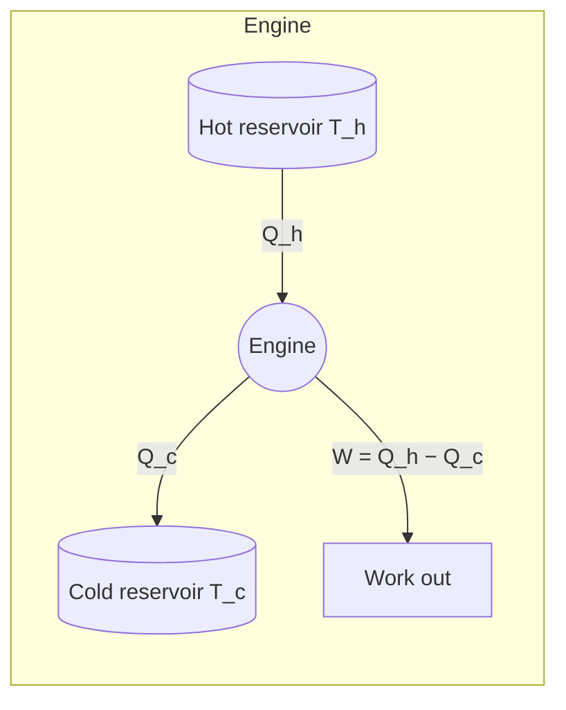

# 03 · Thermodynamics & Statistical Physics
> **Goal:** gases, heat engines, entropy, and the Boltzmann factor. · **Time:** 3–4 weeks

👉 Interactive: [Heat engine cycles on a p–V diagram](interactive/pv-cycles.html) · [Quiz](interactive/quiz.html?deck=Thermo)

## Skip test
- [ ] Derive the work done in isothermal and adiabatic expansions of an ideal gas.
- [ ] Prove the Carnot efficiency $1 - T_c/T_h$ and why no engine between those reservoirs can beat it.
- [ ] Derive the Otto-cycle efficiency $1 - r^{1-\gamma}$.
- [ ] Derive $pV = \frac13 Nm\langle v^2\rangle$ from kinetic theory. State equipartition, and say when it fails (frozen-out degrees of freedom).
- [ ] Use the Boltzmann factor to find the isothermal atmosphere's density profile and its scale height.
- [ ] Find the entropy change when 1 kg of water at 80 °C is mixed with 1 kg at 20 °C.
- [ ] Use Stefan–Boltzmann to estimate Earth's equilibrium temperature.

## Core ideas
- **Ideal gas:** $pV = nRT = Nk_BT$. Internal energy $U = \frac f2 nRT$ ($f$ = degrees of freedom: 3 monatomic, 5 diatomic near room temperature). $C_p - C_V = R$ (per mole), $\gamma = C_p/C_V = 1 + 2/f$.
- **First law:** $dU = \delta Q - p\,dV$ (sign convention: $\delta Q$ into the gas, $p\,dV$ work done *by* the gas). Processes: isobaric, isochoric, isothermal, adiabatic ($pV^\gamma$ = const), polytropic ($pV^n$ = const, molar heat capacity $C = C_V - \frac{R}{n-1}$).
- **Second law & entropy:** $dS = \delta Q_{rev}/T$. The entropy of an isolated system never decreases. $S$ is a state function, so for an irreversible process, compute $\Delta S$ along *any* reversible path between the same end states. For an ideal gas: $\Delta S = nC_V\ln\frac{T_2}{T_1} + nR\ln\frac{V_2}{V_1}$.
- **Engines and fridges:** Carnot efficiency $1 - T_c/T_h$; refrigerator COP $= T_c/(T_h-T_c)$; heat pump COP $= T_h/(T_h-T_c)$.
- **Kinetic theory:** pressure from collisions, Maxwell speed distribution ($v_p = \sqrt{2kT/m} < \bar v = \sqrt{8kT/\pi m} < v_{rms} = \sqrt{3kT/m}$), mean free path $\lambda = \frac{1}{\sqrt2 n\sigma}$, effusion flux $\frac14 n\bar v$.
- **Boltzmann factor:** $P \propto e^{-E/kT}$. Equipartition: $\frac12 kT$ per quadratic degree of freedom (classical limit only).
- **Heat transfer:** conduction (Fourier's law $\dot Q = -kA\,dT/dx$, thermal resistance $L/(kA)$ adds like electrical resistance), convection (qualitative, Newton's law of cooling), **radiation** (Stefan–Boltzmann $P = \varepsilon\sigma A T^4$, Wien's law $\lambda_{max}T = b = 2.90\times10^{-3}$ m·K).
- **Phase transitions:** latent heat, Clausius–Clapeyron $\frac{dp}{dT} = \frac{L}{T\Delta v}$ (with vapour as an ideal gas: $p\propto e^{-L_m/RT}$), vapour pressure and humidity.
- **Surface phenomena and real gases:** van der Waals $\left(p + \frac{an^2}{V^2}\right)(V - nb) = nRT$ (qualitative).

Entropy bookkeeping for one cycle: $\Delta S_{total} = -\frac{Q_h}{T_h} + \frac{Q_c}{T_c} \ge 0$, so $\frac{Q_c}{Q_h}\ge\frac{T_c}{T_h}$ and $\eta = 1 - \frac{Q_c}{Q_h} \le 1 - \frac{T_c}{T_h}$. That is the whole proof of the Carnot limit.

## Worked examples

**1. Adiabatic work.** In an adiabatic process $Q = 0$, so $W_{by} = -\Delta U = nC_V(T_1 - T_2) = \dfrac{p_1V_1 - p_2V_2}{\gamma - 1}$. Example: 1 L of air at 1 bar compressed adiabatically to 0.1 L. $p_2 = 10^{1.4} = 25.1$ bar, and $W_{by} = \frac{100 - 251}{0.4}$ J $= -378$ J. So 378 J of work is done *on* the gas, and its temperature rises from 300 K to 754 K.

**2. Isothermal atmosphere.** Each molecule has energy $mgh$, so $n(h) = n_0e^{-mgh/kT} = n_0e^{-h/H}$ with scale height $H = kT/(mg)$. For air ($m = 29$ u) at 288 K, $H\approx8.4$ km. The pressure halves near 5.8 km. (The real atmosphere isn't isothermal, but this is the standard first model.)

**3. Mixing water.** 1 kg at 353 K and 1 kg at 293 K reach 323 K. Each part's entropy change follows from a reversible heating path: $\Delta S = mc\ln(T_f/T_i)$. The total is $4186\left[\ln\frac{323.15}{353.15} + \ln\frac{323.15}{293.15}\right] = +36$ J/K $> 0$, as the second law demands.

**4. Earth's temperature.** Absorbed power $S(1-A)\pi R^2$ equals emitted power $4\pi R^2\sigma T^4$. With $S = 1361$ W/m² and $A = 0.30$: $T = \left[\frac{S(1-A)}{4\sigma}\right]^{1/4} = 255$ K. The observed mean is about 288 K. The 33 K difference is the greenhouse effect.

## Practice

<b>P1.</b> Find the efficiency of an Otto cycle with compression ratio r = 8 and γ = 1.4. Check it in the p–V tool.

Heat enters at constant volume (2→3) and leaves at constant volume (4→1): $\eta = 1 - \frac{T_4 - T_1}{T_3 - T_2}$. Along the adiabats $T_2 = T_1r^{\gamma-1}$ and $T_3 = T_4r^{\gamma-1}$, so $\eta = 1 - r^{1-\gamma} = 1 - 8^{-0.4} = 56.5\%$. It depends only on $r$.

<b>P2.</b> A gas undergoes the polytropic process pV² = const. Does it absorb or release heat as it expands? (γ = 5/3)

$C = C_V - \frac{R}{n-1} = \frac32R - R = \frac12R > 0$. Expanding along $pV^2$ = const, the temperature falls ($T\propto pV\propto 1/V$). With $C > 0$, $\delta Q = nC\,dT < 0$, so it releases heat. (Compare: for $1<n<\gamma$, $C<0$ and the gas absorbs heat while cooling.)

<b>P3.</b> A house loses heat through a wall: 10 cm brick (k = 0.7 W/m·K) plus 5 cm foam (k = 0.03 W/m·K), area 20 m², ΔT = 20 K. Heat flow?

Resistances in series: $R = \frac{0.10}{0.7\cdot20} + \frac{0.05}{0.03\cdot20} = 0.0071 + 0.0833 = 0.0905$ K/W. $\dot Q = 20/0.0905 = 221$ W. The foam dominates, as the thinnest layer with the lowest k.

<b>P4.</b> A heat pump keeps a house at 20 °C when it is 0 °C outside. At best, how many joules of heat does it deliver per joule of electricity?

$\text{COP}_{max} = \frac{T_h}{T_h - T_c} = \frac{293}{20} = 14.7$. Real heat pumps reach about 3–4.

<b>P5.</b> The Sun's spectrum peaks near 500 nm. Estimate its surface temperature.

$T = b/\lambda_{max} = 2.90\times10^{-3}/5.0\times10^{-7}\approx5800$ K.

## Common mistakes
- Using $dS = \delta Q/T$ along an irreversible path (e.g. free expansion, where $Q = 0$ but $\Delta S = nR\ln(V_2/V_1) > 0$).
- Using °C in $pV = nRT$, Carnot, or Stefan–Boltzmann. Always use kelvin.
- Mixing up the two sign conventions for work. Pick $W_{by}$ or $W_{on}$ and write it at the top of the page.
- Applying equipartition to vibrations at room temperature. They are mostly frozen out, which is why diatomic $f = 5$ and not 7.
- Forgetting the factor 4 (sphere area / disk area) in planet-temperature problems.

## Learn from
- ⭐ **[Kalda: Thermodynamics study guide](https://www.ioc.ee/~kalda/ipho/)** + Kevin Zhou's thermodynamics handouts **T1** (ideal gases, kinetic theory, atmosphere), **T2** (laws of thermodynamics, radiation, conduction), **T3** (surface tension, phase transitions).
- **An Introduction to Thermal Physics, Daniel Schroeder** 💲: excellent and readable (ch. 1–4, 6).
- **Fundamentals of Physics, Halliday/Resnick/Walker** 💲: the basics, if you need them.

## Build
- Draw p–V diagrams for 5 cycles and compute their efficiencies by hand. Check each one with the [p–V tool](interactive/pv-cycles.html). Estimate Earth's temperature with and without albedo.

## Done when
- [ ] Skip test passes.  - [ ] You can do the entropy bookkeeping for any engine, fridge, or mixing problem in under 5 minutes.
