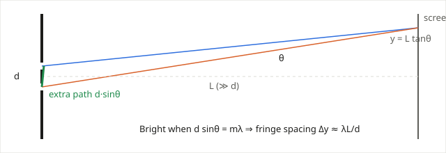

# 05 · Waves & Optics
> **Goal:** interference, diffraction, and geometric optics. These show up in both the theory and the experiment. · **Time:** 2–3 weeks

👉 Interactive: [Wave interference & diffraction](interactive/interference.html) · [Thin lens ray tracer](interactive/lens.html) · [Quiz](interactive/quiz.html?deck=Waves)

## Skip test
- [ ] Derive the double-slit fringe spacing $\Delta y = \lambda L/d$, and say what changes if the whole setup is put under water.
- [ ] Find the condition for thin-film constructive reflection (including the phase flip).
- [ ] Locate the image for a thin lens and a spherical mirror. Trace the rays for a two-lens system.
- [ ] Use the Doppler formula for a moving source and a moving observer (sound).
- [ ] Find the resolving power of a telescope (Rayleigh criterion $1.22\lambda/D$) and of a grating ($\lambda/\Delta\lambda = mN$).
- [ ] Unpolarized light passes three polarizers at 0°, 45°, 90°. What fraction gets through? What if the middle one is removed?

## Core ideas
- **Waves:** $y = A\sin(kx - \omega t)$, $v = \omega/k = f\lambda$. The wave equation $\partial_t^2y = v^2\partial_x^2y$. String speed $v = \sqrt{T/\mu}$, sound speed $\sqrt{\gamma p/\rho}$ in a gas. Standing waves and harmonics (string fixed at both ends: $L = n\lambda/2$; pipe closed at one end: $L = (2n-1)\lambda/4$). Beats at $|f_1 - f_2|$. Intensity $\propto A^2$.
- **Superposition:** phase difference $\Delta\phi = \frac{2\pi}{\lambda}\Delta(\text{optical path})$ + reflection phase. Constructive at $\Delta\phi = 2\pi m$. Optical path = $n\times$ geometric path.
- **Interference:** double slit, thin films (π phase shift on reflection off a higher-n medium), Newton's rings, Michelson interferometer (moving one mirror by $d$ shifts $2d/\lambda$ fringes).
- **Diffraction:** single slit minima at $a\sin\theta = m\lambda$ ($m\ne0$), diffraction grating maxima at $d\sin\theta = m\lambda$. Intensity = (single-slit envelope $\text{sinc}^2$) × (multi-slit interference); a grating order is missing where an envelope zero lands on it. Rayleigh criterion $\theta_{min} = 1.22\lambda/D$ for a circular aperture.
- **Geometric optics:** Fermat's principle, Snell's law, total internal reflection ($\sin\theta_c = n_2/n_1$), the thin lens/mirror equation $\frac1f = \frac1{d_o}+\frac1{d_i}$, magnification $m = -d_i/d_o$, lensmaker's equation $\frac1f = (n-1)\left(\frac1{R_1}-\frac1{R_2}\right)$, mirror $f = R/2$, optical instruments (telescope angular magnification $f_{obj}/f_{eye}$, microscope), prisms and dispersion.
- **Polarization:** Malus's law $I = I_0\cos^2\theta$ (unpolarized light → $I_0/2$ through the first polarizer), Brewster's angle $\tan\theta_B = n_2/n_1$ (reflected light fully s-polarized).
- **Doppler effect:** sound $f' = f\frac{v \pm v_o}{v \mp v_s}$ (upper signs: moving toward each other). Relativistic Doppler in module 06.

## Worked examples

**1. Soap film.** A soap film ($n = 1.33$) in air is lit from the front. Reflection at the front face (air → soap) flips the phase by π; reflection at the back face (soap → air) does not. So the condition for *constructive* reflection is $2nt = (m+\tfrac12)\lambda$. The thinnest film that reflects 550 nm strongly has $t = \lambda/(4n) = 103$ nm. As the film thins toward $t\to0$, the reflection becomes destructive for every λ. That's why the top of a draining film turns black.

**2. Two lenses.** Lens 1 ($f_1 = 15$ cm) has an object at 30 cm, so $d_{i1} = 30$ cm (real, $m_1 = -1$). Lens 2 ($f_2 = 10$ cm) is 50 cm from lens 1, so its object is at $d_{o2} = 20$ cm, giving $d_{i2} = 20$ cm and $m_2 = -1$. The final image is 70 cm from lens 1, upright, and the same size. Try it in the [ray tracer](interactive/lens.html).

**3. DVD as a grating.** A DVD's track pitch is 0.74 µm. A red 650 nm laser gives a first order at $\sin\theta = 650/740 = 0.88$, so $\theta = 61°$, and there is no second order. A CD (1.6 µm) gives a first order at 24° and a second order at 54°: two orders on each side. This is the home experiment in the Build below.

## Practice

<b>P1.</b> Light of 600 nm hits a slit 0.10 mm wide. The screen is 1.0 m away. How wide is the central maximum?

The first minima are at $\sin\theta = \lambda/a$, so the full width is $2L\lambda/a = 2(1.0)(6\times10^{-7})/(10^{-4}) = 12$ mm. A narrower slit gives a *wider* pattern.

<b>P2.</b> Unpolarized light passes polarizers at 0°, 45° and 90°. What fraction gets through? And without the middle one?

$\frac12\cdot\cos^245°\cdot\cos^245° = \frac12\cdot\frac12\cdot\frac12 = \frac18$. Without the middle polarizer: $\frac12\cos^290° = 0$. Adding a filter lets *more* light through.

<b>P3.</b> Newton's rings: a lens with R = 1.0 m rests on flat glass, lit with 589 nm light from above. Find the radius of the 5th dark ring (in reflection).

The air gap at radius $r$ is $t\approx r^2/(2R)$. With the π flip at the bottom surface, dark rings are at $2t = m\lambda$, so $r_m = \sqrt{m\lambda R}$. $r_5 = \sqrt{5\cdot589\times10^{-9}\cdot1.0} = 1.72$ mm. The centre is dark.

<b>P4.</b> How many lines must a grating have to resolve the sodium doublet (589.0 and 589.6 nm) in first order?

$\lambda/\Delta\lambda = mN$, so $N = 589.0/0.6\approx 982$ illuminated lines. Any decent grating does this, if the beam covers about 1000 lines.

<b>P5.</b> In a Michelson interferometer with a 632.8 nm laser, one mirror moves by 0.100 mm. How many fringes pass the centre?

The path changes by $2d$, so $N = 2d/\lambda = 2\times10^{-4}/6.328\times10^{-7} = 316$ fringes. Counting fringes measures lengths to a fraction of a wavelength.

<b>P6.</b> You run at 20 m/s toward a stationary 500 Hz source (v = 343 m/s). What do you hear? Compare with the source running at you at 20 m/s.

Moving observer: $f' = 500\cdot\frac{343+20}{343} = 529$ Hz. Moving source: $f' = 500\cdot\frac{343}{343-20} = 531$ Hz. They differ, because for sound the medium picks out a frame. For light they don't (module 06).

## Common mistakes
- Forgetting the π phase flip (or adding it at the wrong surface) in thin films. Count the flips: each reflection off a higher-n medium gives one.
- Using geometric path instead of optical path ($n\times$ length) inside a medium.
- Mixing up single-slit *minima* ($a\sin\theta = m\lambda$) with grating *maxima* ($d\sin\theta = m\lambda$). Same formula, opposite meaning.
- Sign errors in the lens equation. Pick one convention (the [ray tracer](interactive/lens.html) uses the real-is-positive one) and stick to it.
- Applying the small-angle formula $\Delta y = \lambda L/d$ at large angles.

## Learn from
- ⭐ **[Kalda: Wave optics study guide](https://www.ioc.ee/~kalda/ipho/)** + Kevin Zhou's waves handouts **W1** (wave equation, standing waves, interferometry), **W2** (interference and diffraction), **W3** (sound, polarization, geometrical optics).
- **Optics, Eugene Hecht** 💲 for reference · **[Falstad ripple tank](https://www.falstad.com/ripple/)** to play with waves.

## Build
- Measure the track spacing of a CD/DVD with a laser pointer (diffraction grating). A classic home experiment for module 07, too.

## Done when
- [ ] Skip test passes.  - [ ] You can sketch the intensity pattern of an N-slit grating with finite slit width without the simulator.
