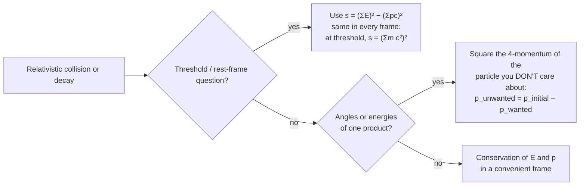

# 06 · Modern Physics
> **Goal:** special relativity, quantum basics, and atomic/nuclear physics at IPhO level. · **Time:** 3–4 weeks

👉 Interactive: [Minkowski diagram](interactive/minkowski.html) · [Quiz](interactive/quiz.html?deck=Modern)

## Skip test
- [ ] Derive time dilation and length contraction from the Lorentz transformation.
- [ ] Two events are 3 light-seconds apart and 1 s apart in S. Find the frame speed in which they are simultaneous, and explain why no frame reverses a cause and its effect.
- [ ] Use 4-momentum invariance to find the threshold energy of a particle-creation reaction.
- [ ] Compute the photoelectric stopping potential, and derive the Compton shift.
- [ ] Use the Bohr model to derive the hydrogen energy levels $E_n = -13.6\,\text{eV}/n^2$.
- [ ] Use Heisenberg to estimate the ground-state energy of a particle in a box.
- [ ] Compute the activity after $t$ given the half-life. Compute a nuclear reaction's Q-value.

## Core ideas
- **Special relativity:** postulates; Lorentz transformation $t' = \gamma(t - vx/c^2)$, $x' = \gamma(x - vt)$, $\gamma = 1/\sqrt{1-v^2/c^2}$; time dilation, length contraction, relativity of simultaneity; velocity addition $u' = \frac{u-v}{1-uv/c^2}$; $E = \gamma mc^2$, $\mathbf p = \gamma m\mathbf v$; **invariants** $(c\Delta t)^2 - \Delta x^2$ and $E^2 - (pc)^2 = (mc^2)^2$. Use invariants for collisions and decays. Relativistic Doppler.
- **Quantum basics:** photon $E = hf$, $p = h/\lambda$; photoelectric effect $eV_s = hf - \phi$; Compton $\Delta\lambda = \frac{h}{m_ec}(1-\cos\theta)$; de Broglie $\lambda = h/p$; uncertainty $\Delta x\Delta p \ge \hbar/2$ (use $\Delta x\Delta p\sim\hbar$ for estimates); particle in a box $E_n = \frac{n^2h^2}{8mL^2}$; tunneling (qualitative, $T\sim e^{-2\kappa a}$).
- **Atoms:** Bohr model ($L = n\hbar$, $r_n = n^2a_0$, $a_0 = 0.0529$ nm), spectral lines (Rydberg $\frac1\lambda = R_H\left(\frac1{n_1^2}-\frac1{n_2^2}\right)$), the energy-level diagram, X-rays (Moseley).
- **Nuclear:** binding energy and mass defect (1 u = 931.5 MeV/c²), $\alpha/\beta/\gamma$ decay, half-life $N = N_02^{-t/T_{1/2}}$, activity $A = \lambda N$ with $\lambda = \ln2/T_{1/2}$, fission/fusion Q-values.
- **Optional (IPhO-adjacent):** blackbody (Planck), lasers, semiconductors basics, cosmology/astrophysics estimates.

## Worked examples

**1. Muons reach the ground.** Muons made 15 km up move at $0.995c$ ($\gamma = 10.0$). Their mean lifetime at rest is 2.20 µs. Without relativity they would travel on average $c\tau\approx660$ m, and the fraction surviving 15 km would be $e^{-15000/656}\approx10^{-10}$. With time dilation the mean range is $\gamma v\tau\approx6.6$ km, so about $e^{-2.3}\approx10\%$ survive. That matches observation. In the muon's frame the same result comes from the atmosphere being length-contracted to 1.5 km.

**2. Pion production threshold.** For $p + p_{\text{rest}}\to p + p + \pi^0$, the invariant $s = (E_{tot})^2 - (p_{tot}c)^2$ is the same in the lab and the CM frame. At threshold all products are at rest in the CM, so $s = (2m_p + m_\pi)^2c^4$. In the lab, $s = 2m_p^2c^4 + 2m_pc^2E$. Solving gives $K = E - m_pc^2 = \frac{m_\pi(4m_p + m_\pi)}{2m_p}c^2\approx280$ MeV, more than twice $m_\pi c^2 = 135$ MeV, because momentum must be conserved too.

**3. Compton in three lines.** Photon $p_\gamma$ hits an electron at rest; the photon leaves as $p_\gamma'$. Isolate the electron: $p_e' = p_\gamma + p_e - p_\gamma'$, and square both sides (4-vectors, $c = 1$): $m^2 = 0 + m^2 + 0 + 2(p_\gamma\cdot p_e) - 2(p_\gamma\cdot p_\gamma') - 2(p_e\cdot p_\gamma')$. This gives $mE - EE'(1-\cos\theta) - mE' = 0$, which is $\frac1{E'} - \frac1E = \frac{1-\cos\theta}{m}$, i.e. $\Delta\lambda = \frac h{mc}(1-\cos\theta)$.

## Practice

<b>P1.</b> A spaceship moving at 0.6c fires a probe forward at 0.6c relative to the ship. Probe speed in the ground frame?

$u = \frac{0.6+0.6}{1+0.36}c = 0.882c$. Never more than $c$.

<b>P2.</b> Electrons are accelerated from rest through 100 V. Find their de Broglie wavelength.

$p = \sqrt{2meV}$, so $\lambda = h/\sqrt{2meV} = 0.123$ nm (handy: $\lambda\approx1.226/\sqrt{V}$ nm). That's comparable to atomic spacings, which is why electron diffraction off crystals works (Davisson–Germer used 54 V).

<b>P3.</b> Light of 400 nm hits sodium (work function 2.28 eV). Stopping potential?

$E = 1240/400 = 3.10$ eV, so $eV_s = 3.10 - 2.28 = 0.82$ eV and $V_s = 0.82$ V. Brighter light means more electrons, but the same $V_s$.

<b>P4.</b> Estimate the ground-state energy of an electron confined to 0.1 nm.

Box formula: $E_1 = \frac{h^2}{8mL^2} = 37.6$ eV. Heisenberg estimate: $p\sim\hbar/L$, $E\sim\frac{\hbar^2}{2mL^2}\approx3.8$ eV. The estimate is $\pi^2$ smaller than the box answer. Both give the right *scale* (eV for atoms), which is what an estimate is for.

<b>P5.</b> Find the Q-value of D + T → ⁴He + n. (Masses: D 2.014102 u, T 3.016049 u, ⁴He 4.002603 u, n 1.008665 u.)

$\Delta m = 2.014102 + 3.016049 - 4.002603 - 1.008665 = 0.018883$ u, so $Q = 0.018883\times931.5 = 17.6$ MeV. Momentum conservation gives the light neutron about 4/5 of it (14.1 MeV).

<b>P6.</b> A sample has 25% of its original ¹⁴C (half-life 5730 y). Age?

$0.25 = 2^{-2}$, so 2 half-lives: 11 460 years.

## Common mistakes
- Using $\gamma m v^2/2$ or $mc^2 + \frac12mv^2$ for relativistic kinetic energy. It is $(\gamma-1)mc^2$.
- Adding masses: the mass of a system is not the sum of the masses. Use $M^2c^4 = E_{tot}^2 - p_{tot}^2c^2$.
- Applying time dilation to the wrong clock. The *proper* time is measured by a clock present at both events.
- Forgetting the 2 in the threshold formula's derivation, or setting the products at rest in the *lab* instead of the CM.
- Using atomic masses vs nuclear masses inconsistently in β-decay Q-values (electron masses).

## Learn from
- ⭐ **[Kevin Zhou's handouts](https://knzhou.github.io/#handouts)**: relativity **R1** (kinematics), **R2** (dynamics), **R3** (fields), and modern physics **X1** (semiclassical QM), **X2** (nuclear, particle, atomic). Also [Kalda](https://www.ioc.ee/~kalda/ipho/).
- **Spacetime Physics, Taylor & Wheeler** 💲 (relativity done beautifully) · Morin's *Classical Mechanics* ch. 11–14 (relativity).
- **[Feynman Lectures, Vol. III](https://www.feynmanlectures.caltech.edu/)** for quantum intuition (free online).

## Build
- 10 relativity problems solved with **invariants only** (no frame juggling). Compare them against the brute-force method. Draw each one on the [Minkowski diagram](interactive/minkowski.html).

## Done when
- [ ] Skip test passes.  - [ ] You reach for $s = E^2 - p^2c^2$ automatically in every collision problem.
